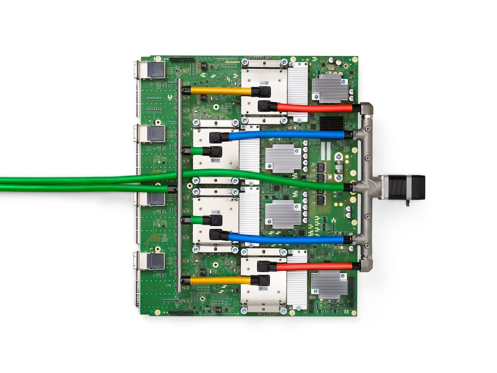
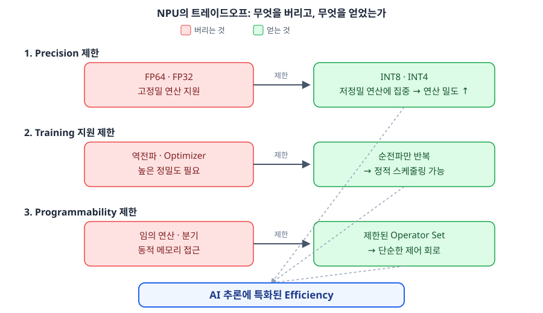
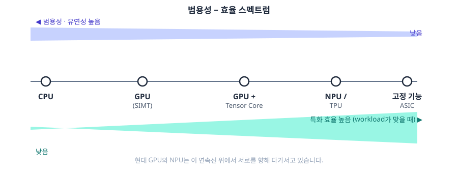
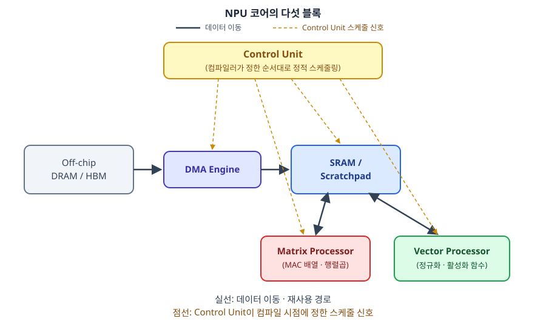

# 01. NPU란 무엇인가 / GPU vs NPU

## 개요

**NPU(Neural Processing Unit)**는 AI 연산, 특히 추론(inference)에 특화된 프로세서입니다. 이 장은 NPU를 "AI용 빠른 칩"이 아니라 특정 워크로드에 맞춰 범용성을 의도적으로 줄인 설계로 이해하는 것을 목표로 합니다.

| 절 | 다루는 질문 |
|---|---|
| 1. 왜 지금 NPU인가 | 추론 워크로드는 어떤 물리적 한계에 부딪히는가 |
| 2. GPU의 딜레마 | GPU의 범용성은 추론에서 어떤 비용이 되는가 |
| 3. NPU의 설계 철학 | NPU는 무엇을 버리고 무엇을 얻었는가 |
| 4. 범용성-효율 스펙트럼 | GPU와 NPU는 어떤 관계에 있는가 |
| 5. GPU vs NPU 비교 | 두 프로세서는 항목별로 어떻게 다른가 |
| 6. 다음 장 미리보기 | 트레이드오프는 어떤 회로 블록으로 구현되는가 |
| 7. 리벨리온 NPU의 위치 | 이 책에서 다루는 NPU는 어떻게 사용하는가 |

## 1. 왜 지금 NPU인가

### 1.1 학습에서 추론으로

AI 산업의 무게중심은 학습(training)에서 추론과 서비스로 옮겨가고 있습니다. 두 단계는 실행 방식이 다르고, 그에 따라 경쟁력의 기준도 달라집니다.

| 구분 | 학습 단계 | 서비스(추론) 단계 |
|---|---|---|
| 실행 빈도 | 비용은 크지만 몇 차례로 끝남 | 사용자 요청마다 계속 반복 |
| 경쟁력 기준 | 얼마나 큰 모델을 학습할 수 있는가 | 같은 모델을 얼마나 빠르고 적은 전력으로 안정적으로 반복 실행할 수 있는가 |
| 누적되는 비용 | 학습 1회의 비용 | 지연 시간(latency)·전력·발열·운영비 |

### 1.2 반복 추론의 두 가지 물리적 한계

반복되는 추론은 다음 두 가지 물리적 한계에 부딪힙니다.

| 한계 | 원인 | 결과 |
|---|---|---|
| **메모리 월(Memory Wall)** | 연산 장치와 메모리가 분리된 폰 노이만 구조에서는 연산할 때마다 데이터를 읽고 다시 저장해야 합니다 [1]. 연산 성능은 빠르게 증가했지만 메모리 대역폭의 증가 속도는 상대적으로 더딥니다. | 연산기가 데이터 도착을 기다리는 시간이 점점 길어집니다 [2]. |
| **전력 장벽** | 데이터센터와 온디바이스 모두에서 반복 추론의 비용이 누적됩니다. | 배터리와 폼팩터가 제한된 환경(스마트폰, 로봇, 차량, 엣지 서버)에서는 최고 연산 성능보다 전력당 처리량(throughput)이 더 중요해집니다. |

따라서 NPU의 핵심은 계산량을 늘리는 데 있지 않습니다. NPU는 데이터를 연산기 가까이 두고 재사용해 이동 자체를 줄이는 데 초점을 맞춘 가속기입니다 [3].

*그림 1-1. 전용 AI 가속기의 실물 예시인 Google TPU v4 패키지(가운데 ASIC과 HBM 4스택, 액체 냉각). 4절에서 다루는 2017년 TPU v1과는 다른 세대입니다. 출처: [4], [5] (CC BY 4.0)*

## 2. GPU의 딜레마

### 2.1 그래픽에서 AI로 넘어온 이유

GPU는 본래 3차원 그래픽을 실시간으로 화면에 투영하기 위한 칩입니다. 그래픽 파이프라인은 좌표 변환, 클리핑, 삼각형 설정, 래스터화, 셰이딩 단계로 이루어집니다. 이 단계들은 모두 "3차원 좌표를 색이 채워진 화면 픽셀로 바꾸는" 하나의 흐름에 속합니다.

신경망의 핵심 연산인 행렬곱은 **MAC(Multiply-Accumulate)**, 즉 곱한 값을 기존 값에 누적해 더하는 연산의 대량 반복입니다. 두 작업은 다음과 같이 같은 성격을 가집니다.

| 구분 | 그래픽 파이프라인 | 신경망 행렬곱 |
|---|---|---|
| 반복 단위 | 수많은 꼭짓점과 픽셀 | 수많은 MAC 연산 |
| 연산 성격 | 같은 단계를 모든 데이터에 반복 적용 | 같은 곱셈·누산을 모든 원소에 반복 적용 |
| 하드웨어 요구 | 단순한 연산 유닛을 아주 많이 배치 | 단순한 연산 유닛을 아주 많이 배치 |

이 공통점 덕분에 GPU는 AI 워크로드에도 잘 들어맞았습니다. 이후 CUDA가 등장하면서 GPU는 스레드·블록·커널로 직접 프로그래밍하는 범용 병렬 컴퓨터가 되었습니다.

### 2.2 범용성의 비용

GPU는 그래픽, 과학 계산, AI 학습, AI 추론을 모두 다루는 범용 병렬 프로세서로 발전했습니다. 이를 위해 다양한 연산·정밀도·프로그래밍 기능을 계속 지원해야 합니다. GPU가 갖춘 기능을 AI 추론 관점에서 나누면 다음과 같습니다.

| 구분 | GPU 기능 | 하는 일 |
|---|---|---|
| 추론에 쓰임 | INT8·FP16 행렬곱(MAC) | 신경망 행렬곱을 대규모로 반복·병렬 실행합니다. |
| 추론에 쓰임 | Tensor Core | 행렬 곱셈·누산을 전용 실행 장치에서 처리합니다. |
| 추론에 쓰이지 않음 | FP64·FP32 고정밀 연산 | 과학 계산처럼 높은 정밀도가 필요한 연산을 처리합니다. |
| 추론에 쓰이지 않음 | 그래픽 파이프라인·텍스처 유닛 | 3차원 그래픽을 렌더링합니다. |
| 추론에 쓰이지 않음 | 복잡한 명령 해석 | 다양한 명령어를 해독해 실행합니다. |
| 추론에 쓰이지 않음 | 워프 스케줄러 | 다음에 실행할 스레드 그룹을 고릅니다. |
| 추론에 쓰이지 않음 | 복잡한 분기·조건문 제어 | 스레드마다 다른 제어 흐름을 처리합니다. |
| 추론에 쓰이지 않음 | 큰 레지스터 파일·L1/L2 캐시 | 많은 스레드의 상태와 불규칙한 데이터 접근을 지원합니다. |
| 추론에 쓰이지 않음 | 동적 인덱스 메모리 접근 | 이전 계산 결과에 따라 달라지는 주소를 읽습니다. |

이 구분은 실측이 아니라 논지를 보여주기 위한 개념적 분류입니다. 추론에 쓰이지 않는 기능도 범용성을 유지하려면 트랜지스터·전력·면적을 계속 차지합니다. 그래서 추론 효율 관점에서는 낭비가 될 수 있습니다.

> GPU가 "느려서" 문제인 것이 아닙니다. AI 추론에 필요하지 않은 유연성까지 계속 지원해야 하는 구조적 비용이 문제입니다. NPU는 "추론에 쓰이지 않는 유연성을 덜어내면 무엇을 얻을 수 있는가?"라는 질문에서 출발합니다.

## 3. NPU의 설계 철학: 무엇을 버리고, 무엇을 얻었는가

NPU의 설계 원칙은 범용성을 줄이는 대신 반복되는 AI 추론 연산의 효율을 최대화하는 것입니다. 이 트레이드오프는 세 가지 축으로 나타납니다.

| 축 | 버리는 것 | 얻는 것 | 대가 |
|---|---|---|---|
| Precision | FP64·FP32 등 고정밀 연산 지원 | 같은 면적에 더 많은 연산 유닛, 적은 메모리 이동량 | 모델별 정확도 검증 필요 |
| Training | 역전파·옵티마이저 등 학습 전용 경로 | 컴파일 시점 정적 스케줄링, 단순한 제어 회로 | 학습은 다른 장치에서 수행 |
| Programmability | 임의 연산과 복잡한 제어 흐름 | 제어 자원을 MAC과 SRAM으로 전환 | 미지원 연산의 CPU fallback 비용 |

### 3.1 Precision 제한

NPU는 FP64, FP32 같은 고정밀 부동소수점 연산 지원을 줄입니다. 대신 INT8·INT4처럼 AI 추론에 적합한 저정밀 연산에 연산 자원을 집중합니다.

| 관점 | 내용 |
|---|---|
| 회로 | 값 하나의 비트 수가 줄면 곱셈기·덧셈기의 비트 폭도 줄어듭니다. 같은 실리콘 면적에 더 많은 연산 유닛을 배치할 수 있습니다. |
| 메모리 | 값 하나의 크기가 작아져 메모리 이동량과 저장 공간이 함께 줄어듭니다. |
| 주의할 점 | 낮은 정밀도가 항상 공짜는 아닙니다. 모델에 따라 정확도·누산 범위·안정성을 함께 검증해야 합니다. |

### 3.2 Training 지원 제한

학습에는 순전파뿐 아니라 역전파와 옵티마이저 연산이 필요합니다. NPU는 이런 학습 전용 경로를 적극적으로 지원하지 않고, 추론에 필요한 연산과 데이터 흐름에 집중합니다. 두 단계의 실행 특성은 다음과 같이 다릅니다.

| 실행 특성 | 학습 | 추론 |
|---|---|---|
| 가중치 | 매 단계 갱신 | 고정 |
| 연산 경로 | 순전파 + 역전파 + 옵티마이저 | 순전파만 |
| 정밀도·메모리 | 높은 정밀도와 중간 활성값 보존 필요 | 저정밀 연산 가능 |
| 실행 그래프 | 단계마다 다른 연산이 섞임 | 같은 순전파 그래프가 반복 |
| 스케줄링 | 실행 중 판단이 필요 | 컴파일 시점에 정적으로 결정 가능 |

추론에서는 연산 순서와 메모리 접근 패턴을 미리 예측할 수 있습니다. 그래서 "어떤 데이터를 언제 SRAM으로 옮기고 어떤 순서로 계산할지"를 실행 전에 컴파일러가 모두 정할 수 있습니다. 실행 중에는 미리 짜인 순서대로만 움직이면 되므로, 다음 동작을 판단하는 제어 회로가 필요 없습니다. 이 예측 가능성이 더 단순하고 전력 효율적인 하드웨어로 이어집니다.

### 3.3 General-Purpose Programmability 제한

NPU는 임의의 연산이나 복잡한 제어 흐름에 대한 지원을 제한합니다. 지원하는 연산자(Operator)·데이터 타입·실행 패턴은 AI 워크로드 중심으로 좁힙니다. 실제로 NPU 벤더는 지원 연산자 목록을 별도로 공개합니다 [6].

| 구분 | 내용 |
|---|---|
| 다루기 어려운 경우 | 다음에 읽을 메모리 주소가 이전 계산 결과에 따라 달라지는 동적 인덱스 접근 |
| 다루기 어려운 경우 | GPU라면 조건 분기로 쉽게 처리할 복잡한 제어 흐름 |
| 얻는 것 | 명령 해석·스케줄링·분기 처리에 쓰이던 자원을 연산 유닛과 로컬 메모리로 돌릴 수 있습니다. |
| 대가 | 지원되지 않는 연산은 CPU가 대신 처리합니다(fallback) [7]. |

fallback이 일어나면 NPU와 CPU 사이에 다음 과정이 추가됩니다.

1. NPU 연산이 끝나기를 기다립니다.
2. 결과를 CPU가 이해할 수 있는 형태로 바꿔 전달합니다.
3. CPU가 미지원 연산을 처리합니다.
4. 결과를 다시 NPU로 돌려받습니다.

이 동기화와 형식 변환 비용 때문에, 작은 미지원 연산 하나가 전체 지연 시간에 큰 영향을 줄 수 있습니다.

### 3.4 세 축의 수렴

세 가지 제한은 서로 독립적이지 않습니다. 정밀도를 낮추고, 학습 경로를 걷어내고, 지원 연산을 좁히는 선택은 하나의 설계 방향으로 수렴합니다. 그 방향은 "복잡한 제어와 범용 기능을 줄인 면적에 MAC과 SRAM을 더 채운다"는 것이며, 결과는 AI 추론에 특화된 효율입니다.

*그림 1-2. NPU의 세 가지 트레이드오프. 각 축의 "버리는 것"과 "얻는 것"이 짝을 이루고, 세 선택이 AI 추론 특화 효율로 수렴합니다. 출처: 직접 제작*

## 4. 범용성과 효율은 하나의 스펙트럼이다

### 4.1 스펙트럼 위의 프로세서

GPU와 NPU는 완전히 분리된 두 종류의 기계가 아닙니다. 둘은 범용 제어에서 도메인 특화로 이어지는 하나의 스펙트럼 위에 있습니다.

*그림 1-3. 범용성-효율 스펙트럼. 왼쪽일수록 범용성·유연성이 높고, 오른쪽일수록 워크로드가 맞을 때의 특화 효율이 높습니다. 출처: 직접 제작*

| 위치 | 특징 |
|---|---|
| CPU | 범용 제어 중심 |
| GPU (SIMT) | 범용 병렬 연산 |
| GPU + Tensor Core | 범용 병렬 연산에 행렬 곱셈·누산 전용 실행 장치(Tensor Core)를 내장 |
| NPU / TPU | AI 추론 특화, 어느 정도 프로그램 가능한 벡터 유닛과 컴파일러를 갖춤 |
| 고정 기능 ASIC | 정해진 기능만 수행 |

현대 GPU는 Tensor Core를 내장하고, 현대 NPU는 프로그램 가능한 벡터 유닛과 컴파일러를 갖추고 있습니다. 그래서 둘의 경계는 점점 흐려지고 있습니다.

오른쪽으로 갈수록 워크로드가 맞아떨어졌을 때의 잠재 효율은 높아지지만, 지원하는 작업의 범위는 좁아집니다. 특화한다고 자동으로 빨라지지는 않습니다. 모델의 연산 형태, 지원 범위, 컴파일러의 실제 배치 결과가 맞아떨어져야 그 이득이 실현됩니다.

### 4.2 사례: TPU v1

이 스펙트럼 관점을 보여주는 대표 사례가 초기 TPU입니다.

| 항목 | 내용 |
|---|---|
| 발표 | Google, 2017년 [8] |
| 비교 대상 | 같은 시기의 K80 GPU, Haswell CPU |
| 보고 결과 | 성능은 수십 배, 성능당 전력 효율은 그보다 더 큰 폭으로 앞섬 [8] |
| 해석 시 주의 | Tensor Core가 없던 2015년 하드웨어 기준이므로, 지금의 GPU와 비교한 절대 격차로 받아들이면 안 됩니다. |
| 시사점 | 명령·제어 오버헤드를 줄이고 데이터를 가까이서 재사용하도록 특화한 구조가 실제로 큰 효율 차이를 만들 수 있습니다. |

## 5. GPU vs NPU 비교

| 항목 | GPU | NPU |
|---|---|---|
| 출발 문제 | 실시간 그래픽 렌더링 | AI 추론 연산을 낮은 전력으로 처리 |
| 설계 목적 | 범용 병렬 연산(그래픽·HPC·AI 학습/추론) | AI 추론 특화 |
| 정밀도 | FP64~INT8까지 폭넓게 지원 | INT8·INT4 등 저정밀 중심 |
| 학습 지원 | 순전파·역전파·옵티마이저 모두 지원 | 대개 추론 경로만 지원 |
| 제어 흐름 | 분기·동적 인덱스 등 유연하게 처리 | 지원 연산·형태가 제한적, 미지원 시 CPU fallback |
| 강점 | 새 연산을 코드로 표현하는 유연성, 넓은 생태계 | 반복 추론의 높은 연산 밀도와 전력 효율 |
| 약점 | 추론만 보면 전력·면적 비효율 발생 가능 | 범용성·생태계가 상대적으로 좁음 |
| 사용 방식 | CUDA 등 범용 프로그래밍 | 전용 SDK로 모델을 컴파일해 실행 |
| 칩 내부 구조 | SM(Streaming Multiprocessor) + 워프 스케줄러 + 큰 레지스터 파일/캐시 중심 | MAC 배열 + SRAM(Scratchpad) + 정적 스케줄러 중심 |

> NPU가 GPU보다 무조건 낫다는 뜻이 아닙니다. NPU는 "반복되는 추론을 효율적으로 돌리는 것"이라는 목적에 맞을 때 유리합니다. 어떤 모델·연산이 NPU에 잘 맞는지는 정밀도·배치 크기·지원 연산 같은 조건에 따라 달라집니다.

마지막 행의 "칩 내부 구조"는 3절의 세 가지 제한이 실제로 어떤 회로 블록으로 구현되는지를 보여줍니다. 이 블록들을 하나씩 뜯어보는 것이 다음 장의 주제입니다.

> **참고**: SM은 GPU 안에서 연산을 실제로 수행하는 코어 묶음입니다. 워프 스케줄러는 SM 안에서 스레드 32개를 한 묶음으로 보고, 다음에 어떤 묶음을 실행할지 고르는 장치입니다. 지금은 "GPU에는 이런 범용 스케줄링 장치가 많고 NPU에는 적다" 정도만 기억하면 됩니다.

## 6. 트레이드오프가 새겨진 회로: 다음 장 미리보기

3절의 세 가지 제한은 추상적인 원칙에 그치지 않습니다. 이 제한은 NPU 코어를 구성하는 물리적인 블록으로 그대로 나타납니다.

| 블록 | 역할 | 관련 설계 선택 |
|---|---|---|
| Matrix Processor | `torch.matmul`, `nn.Linear`, `nn.Conv2d` 같은 행렬곱 연산을 저정밀 MAC 배열로 처리 | 3.1 Precision 제한 |
| Vector Processor | RMSNorm·LayerNorm 같은 정규화와 ReLU·Softmax·GELU 같은 Activation 연산 담당 | 3.3 AI 워크로드 중심 연산자 |
| DMA Engine | Off-chip 메모리(DRAM/HBM)와 내부 SRAM 사이의 데이터 이동, 제한된 대역폭에서도 연산기에 데이터 공급 | 1.2 메모리 월 대응 |
| Control Unit | 컴파일러가 미리 정한 순서대로 연산기에 명령을 스케줄링 | 3.2 정적으로 예측 가능한 실행 순서 |
| SRAM/Scratchpad | Off-chip 접근을 최소화하도록 데이터를 온칩에 두고 재사용 | 1.2 데이터 재사용, 3.4 MAC과 SRAM 확충 |

*그림 1-4. NPU 코어의 다섯 블록과 데이터 흐름. Control Unit이 컴파일 시점에 정한 순서대로 명령을 내리고, 데이터는 Off-chip 메모리에서 SRAM을 거쳐 연산 유닛으로 이동합니다. 출처: 직접 제작*

[다음 장](02-npu-hw-architecture-basic.md)에서는 이 다섯 블록을 하나씩 살펴봅니다. 이어서 이 코어 여러 개가 NoC(Network-on-Chip)로 연결된 멀티 코어 SoC(System-on-Chip)로 어떻게 확장되는지를 리벨리온 ATOM SoC 구조를 중심으로 다룹니다. NoC는 칩 안에서 코어 간 데이터를 주고받는 통신망이고, SoC는 여러 기능 블록을 하나의 칩에 통합한 구조입니다. 같은 문제를 AWS Inferentia, Google TPU, NVIDIA GPU, FuriosaAI NPU가 각자 어떻게 풀었는지도 함께 비교합니다.

## 7. 리벨리온 NPU의 위치

| 항목 | 내용 |
|---|---|
| 회사 | 리벨리온(Rebellions), NPU를 만드는 회사 |
| 제품군 | 서버용 추론 NPU 제품군(ATOM 등) [9] |
| 실행 흐름 | PyTorch/HuggingFace 모델을 전용 SDK(RBLN SDK)로 컴파일한 뒤 NPU에서 구동 |
| 지원 연산 | 개발자 문서의 지원 연산자 목록에서 확인 [6] |

자세한 환경 구성은 [02. 리벨리온 NPU & RBLN SDK 시작하기](02-rbln-sdk.md)에서 다룹니다.

## 정리

- AI 산업의 무게중심이 추론·서비스로 이동하면서, 반복 추론의 지연 시간·전력·비용을 줄이는 것이 새로운 경쟁 조건이 되었습니다.
- GPU의 범용성은 추론 효율만 놓고 보면 전력·면적 낭비로 이어질 수 있습니다.
- NPU는 정밀도·학습 지원·프로그램 가능성의 세 축에서 범용성을 의도적으로 제한하고, 그 대가로 반복 추론에 특화된 효율을 얻습니다.
- 이 제한은 Matrix Processor·Vector Processor·DMA Engine·Control Unit·SRAM이라는 다섯 블록으로 구현되며, 다음 장에서 자세히 다룹니다.

## 참고

1. Sze, Chen, Yang, Emer, [Efficient Processing of Deep Neural Networks: A Tutorial and Survey](https://arxiv.org/abs/1703.09039), Proceedings of the IEEE, 2017.
2. Pope et al., [Efficiently Scaling Transformer Inference](https://arxiv.org/abs/2211.05102), MLSys, 2023.
3. Chen et al., [Eyeriss: A Spatial Architecture for Energy-Efficient Dataflow for Convolutional Neural Networks](https://ieeexplore.ieee.org/document/7551407), ISCA, 2016.
4. Jouppi et al., [TPU v4: An Optically Reconfigurable Supercomputer for Machine Learning with Hardware Support for Embeddings](https://arxiv.org/abs/2304.01433), arXiv:2304.01433, 2023.
5. Wikimedia Commons, [File:TPU v4.png](https://commons.wikimedia.org/wiki/File:TPU_v4.png), CC BY 4.0, (확인일 확인 필요).
6. Rebellions, [지원 연산자(Operator) 목록 — PyTorch](https://docs.rbln.ai/latest/ko/misc/supported_ops_pytorch.html), RBLN SDK 개발자 문서, (확인일 확인 필요).
7. Arm, [Vela Compiler: Deploy your NN model on the Arm Ethos-U microNPU](https://developer.arm.com/community/arm-community-blogs/b/ai-blog/posts/vela-compiler-deploy-your-nn-model-on-the-arm-ethos-u-micronpu), Arm Community AI Blog, (확인일 확인 필요).
8. Jouppi et al., [In-Datacenter Performance Analysis of a Tensor Processing Unit](https://arxiv.org/abs/1704.04760), ISCA, 2017.
9. Rebellions, [ATOM Generative AI White Paper](https://rebellions.ai/wp-content/uploads/2024/07/ATOMgenAI_white-paper.pdf), 백서, (연도 확인 필요).
