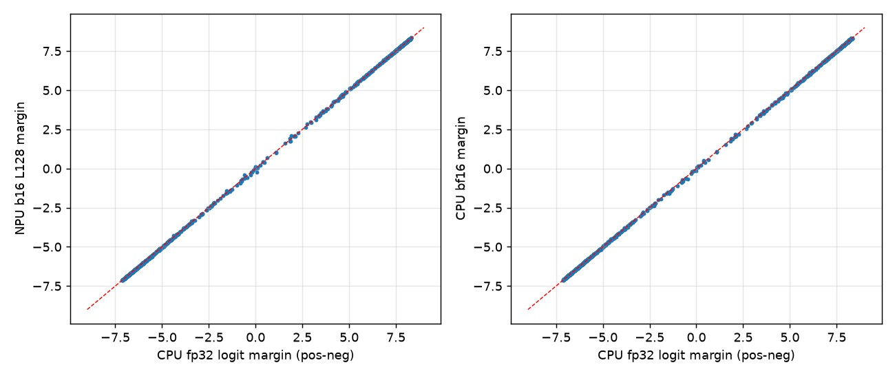
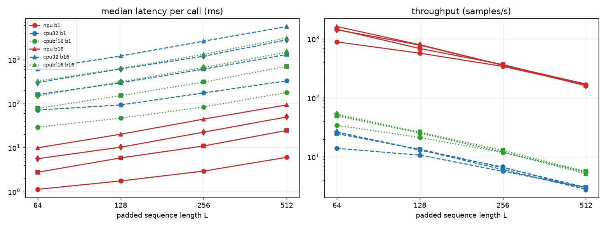
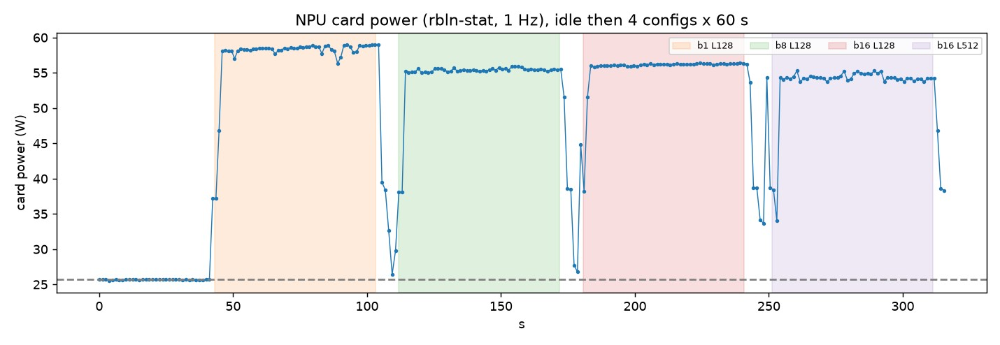
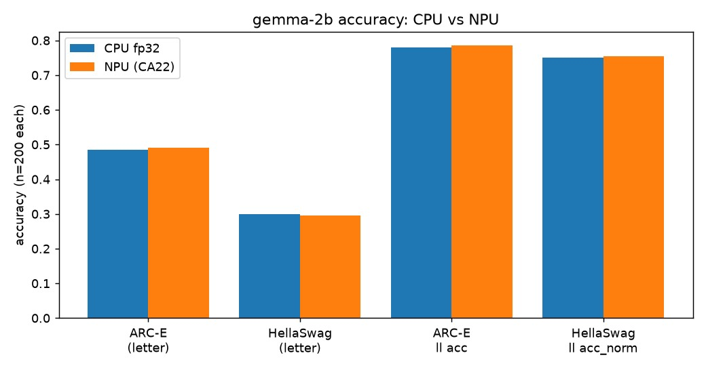
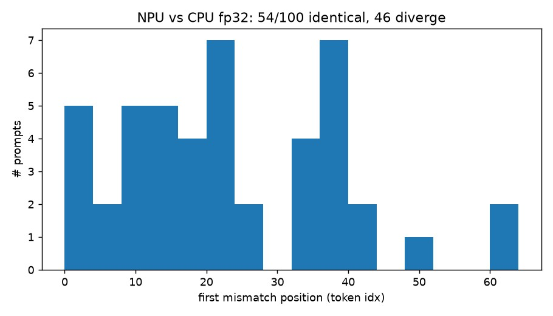
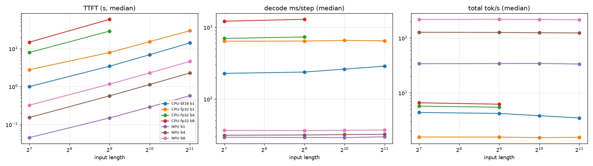
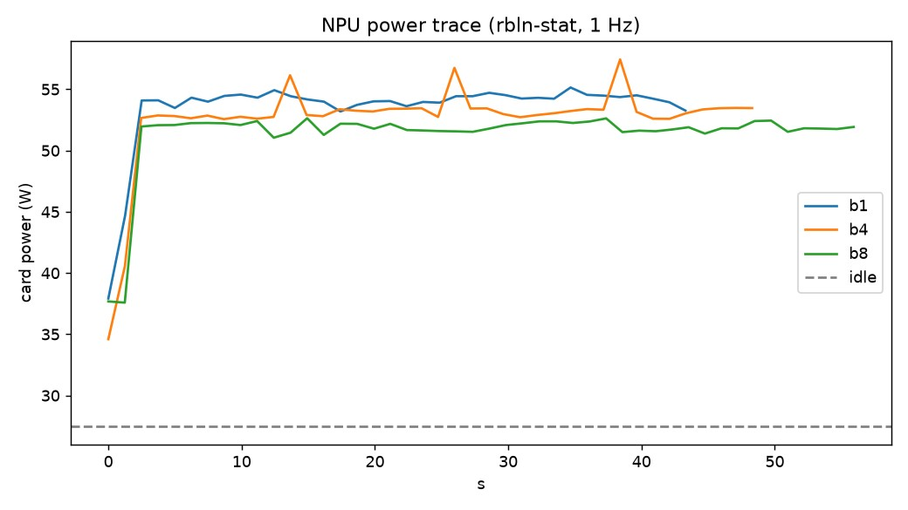

# 05. 비전·NLP 모델 구동기

## 개요

대표적인 비전 모델과 NLP 모델을 리벨리온 NPU에 올려 구동하고 성능을 측정한 기록입니다. NLP 부분은 BERT 계열(RoBERTa 분류, MiniLM 임베딩)과 디코더 LLM인 gemma-2b를 다룹니다. 읽고 나면 HuggingFace 모델을 컴파일해 NPU에서 추론하고, 정확도·속도·전력을 같은 방식으로 재 볼 수 있습니다.

## 1. 비전 모델

### 1.1 구동

> 📝 실습 채움: 모델 선택, 컴파일·추론 코드.

### 1.2 결과

> 📝 실습 채움: 정확도, latency/throughput.

## 2. NLP 모델

### 2.1 실험 환경

| 항목 | 내용 |
|---|---|
| 장치 | Rebellions RBLN-CA22 1장(16GB), 여러 사람이 공유 |
| 드라이버·펌웨어 | KMD 3.0.0, 펌웨어 3.0.0 |
| SDK | rebel-compiler 0.10.1, optimum-rbln 0.10.1 |
| 파이썬 패키지 | torch 2.9.0+cpu, transformers 4.57.6 (업그레이드하지 않음) |
| 호스트 | AMD EPYC 9254, 6 vCPU, RAM 70GB, Ubuntu 24.04 (가상 환경) |
| 측정일 | gemma-2b 2026-11-01, BERT 계열 2026-11-02 |

비교 대상 CPU는 같은 호스트의 PyTorch(fp32, bf16)입니다. CPU는 6 vCPU의 공유 가상 서버이므로 더 큰 CPU나 GPU와의 비교로 일반화할 수 없습니다.

### 2.2 BERT 계열 구동

#### 시작 전 확인

공유 장치이므로 실행 전에 NPU가 비어 있는지 확인합니다.

```bash
source ~/rbln-env/bin/activate
rbln-stat            # NPU 메모리 0.0B, 프로세스 N/A이어야 합니다. 점유 중이면 끝날 때까지 기다립니다.
pip list | grep -E "^(rebel|optimum|torch|transformers) "   # 버전만 확인하고 업그레이드하지 않습니다.
```

#### 모델 선택

NPU에서 돌릴 수 있는 HuggingFace 클래스는 optimum-rbln이 래퍼를 제공하는 것뿐입니다. 설치된 래퍼를 먼저 확인합니다.

```bash
ls ~/rbln-env/lib/python3.12/site-packages/optimum/rbln/transformers/models/
python -c "import optimum.rbln as o; print([n for n in dir(o) if 'Bert' in n or 'Roberta' in n])"
```

0.10.1에서 BERT 계열은 `RBLNBertModel`, `RBLNBertForMaskedLM`, `RBLNBertForQuestionAnswering`, `RBLNDistilBertForQuestionAnswering`, `RBLNRobertaForSequenceClassification`, `RBLNRobertaForMaskedLM`과 XLM-RoBERTa 계열이 있었습니다. BERT와 DistilBERT에는 시퀀스 분류 클래스가 없어서, 분류에는 RoBERTa를 골랐습니다.

- 분류(주력): `textattack/roberta-base-SST-2`. RoBERTa-base(125M 파라미터)를 SST-2 감성분류로 파인튜닝한 모델입니다.
- 임베딩(보조): `sentence-transformers/all-MiniLM-L6-v2`. 6층 BERT 구조이고 임베딩은 384차원입니다.

#### 모델·데이터 다운로드

```bash
export MODELS=~/models      # 모델 저장 위치. 컴파일본도 같은 곳에 둡니다.
hf download textattack/roberta-base-SST-2 --local-dir $MODELS/textattack/roberta-base-SST-2
hf download sentence-transformers/all-MiniLM-L6-v2 --local-dir $MODELS/sentence-transformers/all-MiniLM-L6-v2
python - <<'PY'
from datasets import load_dataset
d = load_dataset("nyu-mll/glue", "sst2", split="validation")   # 872문장
d.to_json("sst2_validation.jsonl")
PY
```

#### 컴파일

NPU 모델은 입력 shape(batch, 시퀀스 길이)가 컴파일 때 고정됩니다. 그래서 batch와 최대 길이 L 조합마다 따로 컴파일했습니다. 컴파일은 CPU에서 일어나므로 NPU를 점유하지 않습니다.

`compile_cls.py`

```python
# 사용: python compile_cls.py <batch> <max_seq_len>
import os
from optimum.rbln import RBLNRobertaForSequenceClassification

src = os.path.expanduser("~/models/textattack/roberta-base-SST-2")
m = RBLNRobertaForSequenceClassification.from_pretrained(
    src, export=True,
    rbln_max_seq_len=128, rbln_batch_size=16)
m.save_pretrained(f"{src}-b16-l128-rbln")
```

사용한 옵션은 `rbln_max_seq_len`과 `rbln_batch_size` 두 개뿐이고 나머지는 기본값입니다. 텐서 병렬은 쓰지 않았고 장치는 1장입니다. 임베딩 모델은 `RBLNBertModel`로 같은 방식으로 컴파일했습니다.

분류 모델은 L 64/128/256/512와 batch 1/4/8/16의 16개 조합, MiniLM은 4개 조합으로 모두 20개를 컴파일했고 실패는 없었습니다. 분류 모델은 대부분 10.3~12.7초가 걸렸고 가장 긴 것은 batch 16, L512의 19.3초였습니다. MiniLM은 6초 안팎이었습니다. 산출물 크기는 분류 327~368MB, MiniLM 74MB입니다.

#### 추론

컴파일본을 읽을 때는 `export=False`로 합니다.

```python
import os
from transformers import AutoTokenizer
from optimum.rbln import RBLNRobertaForSequenceClassification

src = os.path.expanduser("~/models/textattack/roberta-base-SST-2")
tok = AutoTokenizer.from_pretrained(src)
m = RBLNRobertaForSequenceClassification.from_pretrained(f"{src}-b1-l64-rbln", export=False)

e = tok(["a charming and often affecting journey ."],
        padding="max_length", truncation=True, max_length=64, return_tensors="pt")  # 고정 길이로 패딩
out = m(input_ids=e["input_ids"], attention_mask=e["attention_mask"])
print(out.logits.argmax(-1))     # 0=부정, 1=긍정
```

입력 batch 크기는 컴파일한 값과 정확히 같아야 합니다. 마지막 묶음이 모자라면 아무 문장으로 채운 뒤 결과를 버립니다.

임베딩(MiniLM)은 트랜스포머 본체만 NPU에서 돌리고, 평균 풀링과 L2 정규화는 호스트에서 합니다.

```python
from optimum.rbln import RBLNBertModel

minilm = os.path.expanduser("~/models/sentence-transformers/all-MiniLM-L6-v2")
m = RBLNBertModel.from_pretrained(f"{minilm}-b16-l128-rbln", export=False)
o = m(input_ids=e["input_ids"], attention_mask=e["attention_mask"],
      token_type_ids=e["token_type_ids"])
h = o.last_hidden_state          # 이후 평균 풀링과 L2 정규화는 직접 구현
```

#### 측정 순서

정확도, 속도, 전력을 이 순서로 측정했습니다. 매 실행 전에 `rbln-stat`로 NPU가 비어 있는지 확인했습니다.

```bash
python acc_cls.py cpu32  8 128 logits_cpu_fp32     # 정확도 기준(CPU fp32)
python acc_cls.py npu   16 128 logits_npu_b16_l128 # NPU 정확도
python acc_emb.py                                  # 임베딩 정확도
python bench_speed.py npu speed_npu.json 100 10    # 속도. CPU는 cpu32/cpubf16, 반복 20회, 워밍업 3회
python bench_eff.py eff_npu.json 60                # 전력(rbln-stat 1 Hz)
```

### 2.3 BERT 계열 결과

#### 정확도

SST-2 validation 872문장 전체로 쟀습니다. 기준은 CPU PyTorch fp32 로짓입니다. 문장의 토큰 길이는 평균 26, 최대 63이라 L이 64 이상이면 잘림이 없습니다.

| 구성 | 정확도 | 맞은 수 | CPU fp32와 예측 일치 | 불일치 문장 수 | 로짓 평균 절대오차 | 로짓 최대 절대오차 |
|---|---|---|---|---|---|---|
| CPU fp32 (기준) | 94.04% | 820 | 100% | 0 | 0 | 0 |
| CPU bf16 | 94.04% | 820 | 100% | 0 | 0.0087 | 0.110 |
| NPU batch 16, L128 | 93.92% | 819 | 99.89% | 1 | 0.0129 | 0.150 |
| NPU batch 1, L64 | 93.92% | 819 | 99.66% | 3 | 0.0132 | 0.122 |
| NPU batch 8, L256 | 93.81% | 818 | 99.77% | 2 | 0.0126 | 0.086 |
| NPU batch 4, L512 | 93.92% | 819 | 99.89% | 1 | 0.0134 | 0.150 |

- NPU 정확도는 CPU fp32와 0.1~0.2%p 차이였습니다. 872문항의 표준오차가 약 0.8%p이므로 이 차이는 통계적으로 의미가 없습니다.
- 예측이 갈린 문장은 설정에 따라 1~3개였습니다. batch 16, L128의 1개(검증셋 749번)는 CPU 로짓 마진(긍정−부정)이 +0.076으로 거의 동점이었고 NPU에서 −0.216이 되었습니다. 나머지 설정의 불일치 문장은 개별로 확인하지 않았습니다.
- 평균 오차 0.013은 로짓 절대값 평균(3.11)의 약 0.4%입니다. CPU bf16(0.0087)과 같은 자릿수의 편차입니다.
- NPU 내부 연산 정밀도는 확인하지 못했습니다. 컴파일 설정 파일의 dtype은 float32였지만 실제 내부 정밀도와 같은지는 확인하지 않았습니다.



*그림 5-1. CPU fp32 대비 로짓 마진(긍정−부정) 산점도. 왼쪽은 NPU(batch 16, L128), 오른쪽은 CPU bf16. 출처: 직접 제작*

임베딩(MiniLM)은 SST-2 validation 872문장의 평균 풀링 임베딩을 CPU fp32 결과와 비교했습니다.

| NPU 설정 | 코사인 평균 | 코사인 최소 | 원소 평균 절대오차 |
|---|---|---|---|
| batch 16, L128 | 0.999978 | 0.999917 | 0.00026 |
| batch 1, L128 | 0.999980 | 0.999931 | 0.00026 |
| batch 16, L256 | 0.999978 | 0.999917 | 0.00026 |

CPU와 코사인 0.99992 이상이었습니다. 다운스트림 검색 정확도는 측정하지 않았습니다.

#### 속도

측정 구간은 `model(input_ids, attention_mask)` 호출 한 번입니다. 호스트에서 NPU로의 입력 전달, NPU 실행, 로짓 회수를 포함하고 토큰화는 제외합니다. NPU는 워밍업 10회 뒤 100회, CPU는 워밍업 3회 뒤 20회 측정했고 표는 중앙값입니다. throughput은 batch를 중앙값 latency로 나눈 값입니다. 16개 조건 중 일부를 싣습니다.

| L | batch | NPU latency (ms) | NPU samples/s | CPU fp32 latency (ms) | CPU fp32 samples/s | CPU bf16 latency (ms) | CPU bf16 samples/s |
|---|---|---|---|---|---|---|---|
| 64 | 1 | 1.13 | 886 | 71.6 | 14.0 | 29.2 | 34.3 |
| 128 | 1 | 1.75 | 571 | 93.4 | 10.7 | 46.9 | 21.3 |
| 128 | 16 | 20.18 | 793 | 1206.9 | 13.3 | 629.9 | 25.4 |
| 256 | 16 | 44.58 | 359 | 2627.7 | 6.1 | 1322.2 | 12.1 |
| 512 | 1 | 6.02 | 166 | 329.8 | 3.0 | 179.2 | 5.6 |
| 512 | 16 | 93.35 | 171 | 5666.6 | 2.8 | 3106.9 | 5.1 |

- 16개 조건(L 64~512, batch 1~16) 전체에서 NPU는 CPU fp32의 50~63배, bf16의 26~33배 처리량이었습니다.
- NPU throughput은 L128에서 batch 8(781 samples/s)과 batch 16(793)이 거의 같습니다. batch를 키워도 얻는 것이 적고 지연만 늘어납니다.
- 같은 batch에서 L이 2배가 되면 latency는 대체로 길이에 비례해 늘었습니다.
- NPU의 반복 간 편차는 작았습니다. p5~p95가 중앙값의 ±10% 이내인 조건이 대부분이었습니다.
- MiniLM 임베딩은 batch 16, L128에서 NPU 3505 samples/s, CPU fp32 87.3 samples/s였습니다.



*그림 5-2. RoBERTa-base SST-2의 L별 latency와 throughput. 출처: 직접 제작*

고정 길이 컴파일의 비용도 있습니다. SST-2 문장은 평균 26토큰인데 가장 짧은 L64로 패딩해도 평균 2.5배를 연산합니다. 이를 보려고 CPU에서 872문장을 패딩 없이 batch 1로 처리했더니 fp32 중앙값은 38.2ms, bf16은 19.9ms였습니다. 이 기준으로 비교해도 NPU batch 1, L64(1.13ms)는 CPU fp32의 약 34배, bf16의 약 18배 빨랐습니다. 길이가 다양한 서비스에서는 여러 L로 컴파일해 두고 문장 길이에 맞춰 고르는 방식이 필요합니다. 이 장에서는 그런 서빙을 만들거나 측정하지 않았습니다.

CPU 측정은 단일 실행이라 불확실성이 있습니다. batch 1, L64를 다시 쟀더니 fp32 중앙값이 59.3ms로, 표의 71.6ms와 약 20% 달랐습니다. 원인은 확인하지 못했습니다. CPU 대비 배율에는 ±20% 정도의 불확실성이 있다고 봐 주세요.

#### 효율

1초마다 `rbln-stat -j`의 `card_power`(카드 전체 전력)를 읽었습니다. 먼저 아무것도 돌리지 않고 유휴 전력을 쟀고 평균은 25.69W였습니다. 이어서 각 구성을 60초 연속 추론한 구간의 전력 샘플 평균을 평균 전력으로 썼습니다.

| 구성 | 평균 전력 (W) | samples/s | samples/s per W | J/샘플 (mJ) |
|---|---|---|---|---|
| batch 1, L128 | 57.73 | 629.8 | 10.91 | 91.7 |
| batch 8, L128 | 55.06 | 787.5 | 14.30 | 69.9 |
| batch 16, L128 | 55.71 | 791.9 | 14.22 | 70.3 |
| batch 16, L512 | 53.62 | 164.5 | 3.07 | 326.1 |

- 추론 중 카드 전력은 구성과 무관하게 약 54~58W여서 샘플당 에너지는 처리량에 반비례했습니다.
- 같은 batch 16에서 L을 128에서 512로 늘리면 샘플당 에너지가 약 4.6배(70→326mJ)가 되었습니다. 패딩 길이를 크게 잡는 만큼 에너지가 낭비됩니다.
- CPU 전력은 측정하지 못했습니다. 가상 환경이라 RAPL/hwmon 센서가 없습니다. 따라서 CPU와의 에너지 효율 비교는 하지 않았습니다.



*그림 5-3. RoBERTa-base 추론 중 NPU 카드 전력 시계열. 출처: 직접 제작*

### 2.4 gemma-2b 구동

디코더 LLM인 `google/gemma-2b`(베이스 모델)를 `RBLNGemmaForCausalLM`으로 올렸습니다. 모델 다운로드와 `rbln-stat` 확인은 앞 절과 같습니다.

#### 컴파일

`compile_b.py`

```python
# 사용: python compile_b.py <batch>
import sys, time, os
from optimum.rbln import RBLNGemmaForCausalLM

b = int(sys.argv[1])
src = os.path.expanduser("~/models/google/gemma-2b")
t = time.time()
m = RBLNGemmaForCausalLM.from_pretrained(
    src, export=True,
    rbln_batch_size=b, rbln_max_seq_len=4096, rbln_tensor_parallel_size=1)
m.save_pretrained(f"{src}-b{b}-rbln")
print(f"compile+save b={b} {time.time()-t:.1f}s")
```

batch 1, 4, 8을 컴파일했고 모두 성공했습니다. 소요 시간은 batch 1 약 179초, batch 4 223초, batch 8 260초였습니다. 나머지 옵션은 기본값이며 prefill은 128토큰 청크, KV 캐시는 정적입니다.

#### 추론

```python
import os, torch
from transformers import AutoTokenizer
from optimum.rbln import RBLNGemmaForCausalLM

src = os.path.expanduser("~/models/google/gemma-2b")
tok = AutoTokenizer.from_pretrained(src)
m = RBLNGemmaForCausalLM.from_pretrained(f"{src}-b1-rbln", export=False)

e = tok("The capital of France is", return_tensors="pt")
with torch.no_grad():
    out = m.generate(input_ids=e["input_ids"], attention_mask=e["attention_mask"],
                     max_new_tokens=32, do_sample=False, pad_token_id=0)
print(tok.decode(out[0], skip_special_tokens=True))
```

이 코드는 측정 스크립트의 `generate()` 호출을 줄인 것입니다. batch 크기는 컴파일한 값과 같아야 하고, 입력 길이와 생성 길이의 합이 `rbln_max_seq_len`(4096)을 넘으면 안 됩니다.

#### 속도 측정 방법

입력은 길이 L(128, 512, 1024, 2048)의 고정 시드 랜덤 토큰이고, batch가 b이면 같은 시퀀스를 b개 복사했습니다. `generate()`에 `StoppingCriteria`를 넣어 토큰이 나올 때마다 시각을 기록했습니다. TTFT(첫 토큰까지의 시간)는 호출 시작부터 첫 토큰까지이고 토큰화는 제외합니다. 디코드 시간은 첫 토큰부터 마지막 토큰까지를 (토큰 수 − 1)로 나눈 값입니다. 조건마다 워밍업 1회 뒤 5회 반복(CPU batch 4, 8은 3회)하고 중앙값을 썼습니다. 새 토큰 수는 NPU 64개, CPU 16개입니다.

### 2.5 gemma-2b 결과

#### 정확도

기준은 CPU PyTorch fp32입니다. NPU의 장치 메모리 사용량은 4.8GiB였습니다. 이는 가중치가 16비트로 저장된다는 추정과 맞지만, 내부 연산 정밀도는 확인하지 못했습니다.

| 정확도 (각 n=200) | CPU fp32 | NPU | 예측 일치 |
|---|---|---|---|
| wikitext-2 perplexity (65,408 토큰) | 10.427 | 10.432 | |
| ARC-Easy 로그우도 acc | 78.0% | 78.5% | 99.5% |
| HellaSwag 로그우도 acc_norm | 75.0% | 75.5% | 99.5% |
| ARC-Easy 글자 선택 | 48.5% | 49.0% | 96.5% |
| HellaSwag 글자 선택 | 30.0% | 29.5% | 93.5% |

- perplexity 차이는 +0.04%였습니다. wikitext-2 test의 앞부분 1023토큰 비중첩 창 64개이며 전체 test 세트가 아닙니다.
- 문항 200개의 표준오차는 약 3%p이므로 0.5%p 차이는 문항 1개 차이이고 의미가 없습니다. 이 점수는 공개 리더보드 수치와 직접 비교하지 않습니다. 공개 GPU 수치와의 비교는 [10. 벤치마크 모음](10-benchmarks.md)의 gemma-2b 절에서 다룹니다.
- 글자 선택은 보기를 A~D로 나열하고 다음 토큰의 로짓을 비교하는 방식입니다. gemma-2b 베이스가 이 형식에 약해 HellaSwag는 우연 수준(25%)에 가깝습니다. 이 방식은 점수 자체보다 CPU와 같은 답을 내는지 보는 용도로만 썼습니다.



*그림 5-4. gemma-2b의 CPU fp32 대비 NPU 정확도. 출처: 직접 제작*

고정 프롬프트 100개로 64토큰을 greedy 생성한 결과는 다음과 같습니다.

| 비교 | 64토큰 완전 일치 | 첫 불일치 전까지의 토큰 비율 | 첫 불일치 위치 중앙값 |
|---|---|---|---|
| NPU vs CPU fp32 | 54 / 100 | 70.7% | 22.5 |
| CPU bf16 vs CPU fp32 (비교 기준선) | 38 / 100 | 59.1% | 19.0 |

NPU가 비트 단위로 같은 결과를 내는 것은 아닙니다. 다만 CPU에서 bf16으로 돌렸을 때보다 fp32와 덜 어긋났으므로 일반적인 저정밀 추론 수준의 편차로 판단합니다. 첫 불일치 위치는 2~62에 분포했고 앞쪽(2~4)에서 갈라진 시퀀스도 있었습니다. 프롬프트 100개, 단일 실행이어서 이 순위의 통계적 유의성은 검정하지 않았습니다.



*그림 5-5. greedy 생성에서 CPU fp32와 처음 갈라진 토큰 위치. 출처: 직접 제작*

#### 속도

NPU 결과(중앙값)입니다. 이 장의 비교 기준(CPU)은 6 vCPU 가상 머신이며, NPU와 GPU의 비교는 [10. 벤치마크 모음](10-benchmarks.md)에서 다룹니다. 여기서 CPU는 참고용 기준선입니다.

| batch | 입력 길이 | TTFT (s) | 디코드 (ms/step) | tok/s (시퀀스당) | tok/s (전체) |
|---|---|---|---|---|---|
| 1 | 128 | 0.045 | 29.4 | 34.05 | 34.05 |
| 1 | 2048 | 0.578 | 29.8 | 33.57 | 33.57 |
| 4 | 128 | 0.154 | 31.4 | 31.89 | 127.6 |
| 4 | 2048 | 2.285 | 32.3 | 30.96 | 123.9 |
| 8 | 128 | 0.325 | 36.6 | 27.29 | 218.4 |
| 8 | 2048 | 4.619 | 37.1 | 26.96 | 215.6 |

CPU 결과(batch 1, 중앙값)입니다.

| 설정 | 입력 길이 | TTFT (s) | 디코드 (ms/step) | tok/s |
|---|---|---|---|---|
| fp32 | 128 | 2.79 | 638.9 | 1.57 |
| fp32 | 2048 | 29.61 | 647.1 | 1.55 |
| bf16 | 128 | 1.00 | 227.8 | 4.39 |
| bf16 | 2048 | 14.17 | 286.9 | 3.49 |

- batch 1 디코드는 NPU가 CPU fp32의 약 21.7배, bf16의 약 7.8배입니다. 정밀도가 같지 않은 비교(NPU는 16비트 추정, CPU fp32)이므로 bf16 쪽이 더 공정한 비교입니다.
- TTFT는 입력 길이에 거의 선형이었습니다. 입력 128토큰에서 NPU 0.045초, CPU fp32 2.79초(약 62배)였습니다.
- batch 8에서는 NPU 218.4 tok/s, CPU fp32 6.59 tok/s로 약 33배였습니다.
- batch를 키우면 step 시간이 29.4→31.4→36.6ms로 조금만 늘어 총 처리량은 batch 1의 3.7배(batch 4), 6.4배(batch 8)가 됩니다. 대신 시퀀스당 속도는 34.1에서 27.3 tok/s로 떨어집니다.
- batch가 커지면 prefill이 시퀀스별로 순차 실행되어 TTFT가 대략 batch배로 늘었습니다.
- 디코드 시간은 입력 길이에 거의 무관했습니다. 정적 KV 캐시 4096 전체를 매 스텝 처리하기 때문으로 추정하지만 내부 구현은 확인하지 못했습니다.

디코드 속도의 이론 상한은 가중치 읽기만 센 낙관적인 값입니다. 가중치는 5.012GB(HF 체크포인트의 `total_size`), 카드 메모리 대역폭은 256GB/s입니다[1]. 상한은 256 ÷ 5.012 = 51.1 tok/s이고, batch 1의 실측 34.05 tok/s는 상한의 66.7%입니다. batch 4는 62.4%, batch 8은 53.4%로 batch가 커질수록 비율이 떨어졌습니다. 원인(KV 캐시 접근, 연산, 호스트 오버헤드 중 무엇인지)은 분리해 측정하지 않았습니다.



*그림 5-6. gemma-2b의 NPU와 CPU 속도(TTFT, 디코드 tok/s). 출처: 직접 제작*

#### 효율

입력 128토큰에서 384토큰을 생성하며 3회 반복했습니다. 디코드 구간의 전력 샘플(조건당 24~33개)을 평균했습니다. 유휴 전력은 모델 없이 30초 잰 평균이 측정 전 25.3W, 측정 후 26.1W입니다.

처음 측정(2026-11-01)에서는 유휴 전력을 27.5W로 적었으나, 다시 재 보니 튀는 값 하나(42W)가 평균을 올린 것이었습니다. 또 `card_power`가 실제 부하보다 약 2초 늦게 반응하는 것을 확인해, 이 표는 센서 시각을 보정해 다시 계산한 값(2026-11-04)입니다. 보정 방법과 입력 길이별 결과는 [10. 벤치마크 모음](10-benchmarks.md)의 5.2에 있습니다.

| batch | 평균 전력 (W) | tok/s (전체) | tokens/s per W | J/토큰 |
|---|---|---|---|---|
| 1 | 52.8 | 34.7 | 0.656 | 1.52 |
| 4 | 52.2 | 125.7 | 2.407 | 0.416 |
| 8 | 51.1 | 218.2 | 4.267 | 0.234 |

- 디코드 중 카드 전력은 batch와 무관하게 약 51~53W였으므로, 처리량이 커진 만큼 토큰당 에너지가 줄었습니다. batch 8은 batch 1의 약 1/6.5입니다.
- 이전 측정과 비교하면 J/토큰은 사실상 같고(batch 1은 1.54에서 1.52), 평균 전력은 1~1.5W 낮고 tok/s는 약 1~2.4% 낮습니다. 공유 장치라 같은 조건이어도 날마다 조금 달라질 수 있습니다.
- 이 표의 tok/s는 384토큰 생성의 중앙값이라 속도 표(64토큰 생성)와 약간 다릅니다. 예를 들어 batch 1은 34.7과 34.05입니다.
- 카드 전력만이며 호스트 CPU 전력은 빠져 있습니다. 샘플은 1Hz여서 정밀한 값은 아닙니다.
- CPU 전력은 측정하지 못했으므로 CPU와의 에너지 효율 비교는 하지 않았습니다.



*그림 5-7. gemma-2b 디코드 중 NPU 카드 전력 시계열(2026-11-01 측정, 센서 시각 보정 전). 출처: 직접 제작*

## 정리

- BERT 계열은 optimum-rbln 래퍼로 컴파일해 NPU에서 돌렸고, SST-2 872문장 정확도는 CPU fp32와 0.1~0.2%p 차이였습니다.
- RoBERTa 분류 처리량은 CPU(6 vCPU) 대비 fp32 50~63배, bf16 26~33배였습니다. batch를 8 이상으로 키워도 처리량은 거의 늘지 않았습니다.
- gemma-2b는 batch 1에서 34.05 tok/s이고 CPU fp32의 약 21.7배, bf16의 약 7.8배입니다. batch 8은 218.4 tok/s입니다.
- 카드 전력은 구성과 무관하게 약 51~58W여서 에너지 효율은 처리량이 좌우했습니다. CPU 전력은 측정하지 못해 CPU와의 에너지 비교는 없습니다.
- 정확도 차이는 모두 표본 크기상 의미가 없는 수준이었지만, greedy 생성은 비트 단위로 같지 않았습니다.

## 막힌 점 / 해결

### 비전 모델

> 📝 실습 채움: 모델 구조상 NPU에서 막힌 연산, 우회 방법.

### NLP 모델

1. **분류 클래스 없음**: optimum-rbln 0.10.1에 BERT와 DistilBERT의 시퀀스 분류 클래스가 없었습니다. RoBERTa 분류(지원)를 주력으로 하고, BERT 구조는 `RBLNBertModel`로 MiniLM 임베딩만 보조로 돌렸습니다. SDK를 올리지는 않았습니다.
2. **`ValueError: The input(token_type_ids) is not specified.`**: `RBLNBertModel`을 `input_ids`와 `attention_mask`만으로 호출하면 발생했습니다. 토크나이저가 만든 `token_type_ids`를 함께 넘겨 해결했습니다. RoBERTa 분류는 두 입력만으로 문제가 없었고 이유는 조사하지 않았습니다.
3. **고정 shape**: 길이나 batch가 바뀌면 재컴파일이 필요합니다. BERT 계열은 컴파일이 10~20초여서 조합마다 컴파일본을 만들었습니다. gemma-2b는 batch 1이 약 3분이어서 필요한 batch만 컴파일했습니다.
4. **마지막 위치 로짓만 반환**: 기본 컴파일은 `logits_to_keep=1`이라 마지막 위치 로짓만 돌려줍니다. perplexity와 로그우도 평가에는 전체 위치 로짓이 필요합니다. 설정값으로 0을 주면 구현의 `logits_to_keep or default` 때문에 다시 1이 되어, 컴파일 전에 클래스 기본값을 바꾸고 별도 모델(batch 1, `rbln_max_seq_len=2048`)을 컴파일했습니다. 공식 지원 경로가 아니며 이 모델은 속도 측정에는 쓰지 않았습니다.

   `compile_fulllogits.py`

   ```python
   from optimum.rbln import RBLNGemmaForCausalLM, RBLNGemmaForCausalLMConfig as G

   G._default_logits_to_keep = 0      # 전체 위치 로짓을 반환하도록 기본값 변경
   m = RBLNGemmaForCausalLM.from_pretrained(
       "gemma-2b", export=True,
       rbln_batch_size=1, rbln_max_seq_len=2048, rbln_tensor_parallel_size=1)
   print(m.rbln_config.logits_to_keep)
   m.save_pretrained("gemma-2b-fulllogits-rbln")
   ```

   실제 컴파일은 `RBLNDecoderOnlyModelForCausalLMConfig`의 같은 속성도 함께 바꿨습니다.
5. **입력 길이가 128의 배수일 때 빈 로짓**: 전체 로짓 모드에서 입력 길이가 prefill 청크(128)의 정확한 배수이면 로짓이 빈 텐서로 나왔습니다. 코드의 `[:, :-0]` 슬라이싱 때문으로 보입니다. 입력 뒤에 더미 토큰 1개를 붙이고 결과에서 잘라 우회했습니다. causal 모델이라 앞 위치 로짓에는 영향이 없습니다.
6. **공유 장치**: 여러 사람이 NPU 1장을 함께 씁니다. 매 실행 전에 `rbln-stat`로 메모리 사용이 0임을 확인했고 대기는 없었습니다. 실행 도중 다른 사용자가 쓰지 않았다고 보장할 수는 없으며, NPU 반복 간 편차가 작았다는 것이 간접 근거입니다.
7. **bash 대기 함정**: 백그라운드 작업을 `while pgrep -f <이름>`으로 기다리면 그 명령줄 자체가 매칭되어 끝나지 않습니다. 프로세스 종료는 `wait`나 결과 파일 생성으로 확인합니다.

## 참고

1. Rebellions, [ATOM Product Brief v3.1](https://rebellions.ai/wp-content/uploads/2023/09/Rebellions_ATOMProduct_Brief_v.3.1.pdf), v3.1, 2026-11-01 확인.
