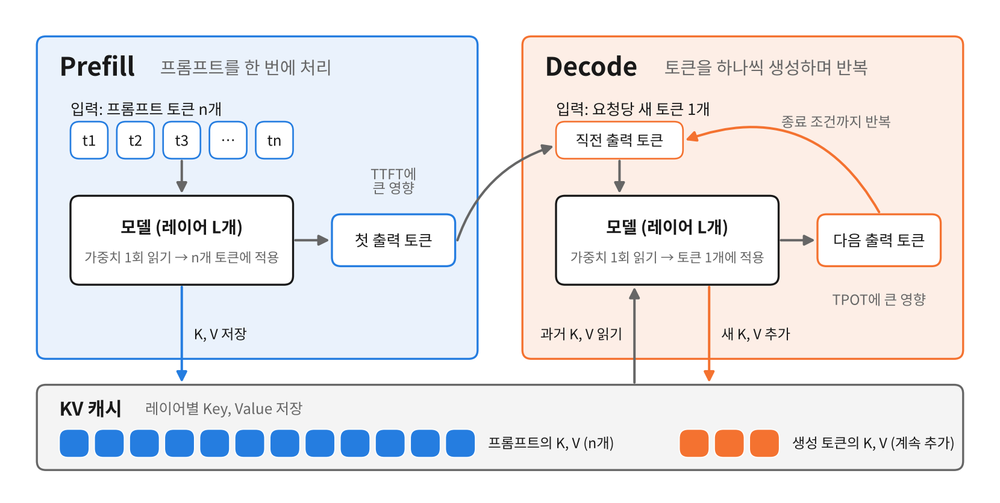
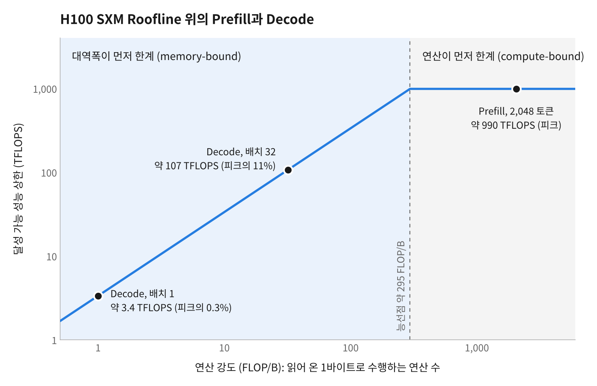
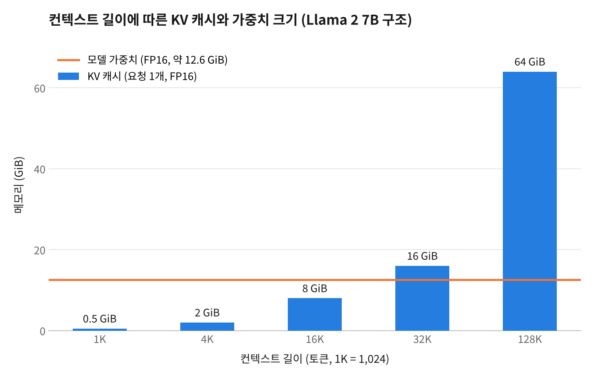

## 개요

1부에서는 NPU의 하드웨어 구조와 그 하드웨어를 잘 쓰는 소프트웨어 기법을 살펴봤습니다. 이 장에서는 그 위에서 실행되는 워크로드, 그중에서도 LLM 추론(inference)이 어떤 단계로 이루어지고 단계마다 무엇이 병목이 되는지를 다룹니다. 핵심은 Prefill, Decode, KV 캐시(KV cache) 세 가지입니다.

읽고 나면 TTFT와 TPOT 같은 서비스 지표를 연산 성능과 메모리 대역폭에 연결해 설명할 수 있습니다. 또한 양자화(quantization), 배칭, KV 캐시 최적화가 각각 어떤 비용을 줄이는지 구분할 수 있고, LLM 추론용 NPU를 평가할 때 확인할 질문을 세울 수 있습니다.

이 장의 수치는 대부분 공개 사양과 모델 구조에서 계산한 설명용 값이며 실측 벤치마크가 아닙니다. 계산에 쓴 가정은 해당 절에 함께 적었습니다.

## 1. 추론을 평가하는 기준

### 1.1 학습과 추론의 목표

학습과 추론은 같은 모델을 다루지만 목표가 다릅니다. 학습은 가중치를 찾고 갱신하는 과정이고, 추론은 학습한 가중치로 실제 요청의 출력을 계산하는 과정입니다.

| 구분 | 학습 | 추론 |
|---|---|---|
| 목적 | 가중치를 찾고 갱신 | 학습한 가중치로 출력 계산 |
| 연산 | 순전파, 역전파, 가중치 갱신 | 주로 순전파 |
| 반복 단위 | 학습 스텝과 데이터 배치 | 서비스 요청과 출력 토큰 |
| 주요 평가 | 학습 시간과 품질 | 지연 시간(latency), 처리량(throughput), 에너지 |
| 최적화 여지 | 학습 안정성과 병렬화 | 양자화, 연산 융합, 캐시, 배칭 |

학습도 미세조정이나 재학습으로 여러 차례 수행할 수 있습니다. 다만 추론 비용은 서비스가 운영되는 동안 요청마다 계속 발생합니다. 추론에서는 가중치가 고정되어 있고 같은 실행 흐름이 반복되므로, 미리 양자화하거나 연산 순서를 최적화할 수 있습니다. 추론 전용 설계가 이 특성을 어떻게 활용하는지는 [01. NPU Intro: 무엇을 버리고, 무엇을 얻었는가?](https://wikidocs.net/487808)에서 다뤘습니다.

### 1.2 사용자가 체감하는 속도: TTFT, TPOT, 처리량

챗봇을 쓰는 사용자는 두 가지 기다림을 경험합니다. 하나는 질문을 보낸 뒤 답이 시작되기까지의 시간이고, 다른 하나는 답이 이어지는 속도입니다. 이 둘은 원인이 다르므로 나누어 측정합니다.

| 지표 | 의미 | 평가 질문 |
|---|---|---|
| TTFT(Time To First Token) | 첫 토큰이 나올 때까지의 시간 | 답변이 시작되기까지 얼마나 기다리는가 |
| TPOT(Time Per Output Token) | 첫 토큰 이후 토큰 사이의 평균 시간 | 답변이 얼마나 빠르게 이어지는가 |
| 처리량 | 초당 처리하는 요청 수 또는 토큰 수 | 동시에 얼마나 많은 일을 처리하는가 |
| 메모리, 에너지 | 메모리 사용량, 토큰당 에너지(J/token) | 몇 개의 요청을 수용하고 전력을 얼마나 쓰는가 |

지표를 읽을 때 주의할 점은 다음과 같습니다.

- **TTFT의 구성**: 프롬프트 처리 시간뿐 아니라 대기열, 전처리, 스케줄링 시간이 포함될 수 있습니다. TTFT가 길다고 곧바로 연산기의 문제라고 결론 내릴 수 없습니다.
- **처리량과 지연 시간**: 여러 요청을 묶으면 처리량은 좋아지지만 개별 요청의 지연 시간은 늘어날 수 있습니다. 두 지표를 함께 봅니다.
- **비교 조건**: 모델, 정밀도, 입력 길이와 출력 길이, 동시 요청 수, 서비스 지연 목표를 맞춘 뒤에 비교합니다.

## 2. LLM 추론의 세 요소: Prefill, Decode, KV 캐시

LLM 추론은 통역사의 일에 비유할 수 있습니다. 통역사는 긴 연설을 듣고, 내용을 이해한 뒤, 한마디씩 옮겨 말합니다. 앞에서 분석한 내용은 다시 분석하지 않도록 메모장에 적어 둡니다.

| 요소 | 통역사 비유 | 하는 일 |
|---|---|---|
| Prefill | 연설을 듣는 시간 | 프롬프트의 토큰을 함께 처리합니다 |
| Decode | 말을 이어가는 시간 | 토큰을 하나씩 순서대로 생성합니다 |
| KV 캐시 | 메모장 | 이전 토큰의 Key와 Value를 저장해 다음 단계에서 재사용합니다 |

### 2.1 자기회귀 생성

LLM은 다음 토큰 하나를 선택하고, 그 결과를 입력에 더해 다시 다음 토큰을 선택합니다. 이 방식을 자기회귀(autoregressive) 생성이라고 합니다. 토큰은 모델이 다루는 텍스트 단위이며, 토크나이저와 언어에 따라 단어 전체일 수도 있고 단어 조각일 수도 있습니다.

다음 토큰은 앞에서 생성한 토큰에 의존하므로, 답변이 길어질수록 모델의 레이어 전체를 통과하는 실행이 그만큼 반복됩니다. 토큰 하나를 만들 때마다 가중치를 다시 사용한다는 점이 3절에서 다룰 병목의 출발점입니다.

### 2.2 Attention과 Causal mask

Attention은 현재 토큰의 표현을 만들 때 이전 토큰의 정보를 참조하는 방법입니다 [1].

```text
Attention(q, K, V) = softmax(q Kᵀ / √d) V
```

| 요소 | 역할 | 통역사 비유 |
|---|---|---|
| Query | 현재 위치가 찾는 정보의 기준 | 지금 해석하려는 말 |
| Key | 관련도를 비교할 기준 | 이전에 들은 말의 꼬리표 |
| Value | 관련도에 따라 섞을 정보 | 이전에 분석한 내용 |

Query와 각 Key의 관련도를 계산하고, 그 관련도를 가중치로 삼아 Value를 섞습니다. 비교하는 기준(Key)과 실제로 가져오는 내용(Value)이 나뉘어 있다는 점만 기억하면 됩니다.

생성 모델에는 미래 토큰을 보지 못하게 하는 Causal mask가 있습니다. 이 규칙에서 두 가지 성질이 나옵니다.

- **과거 표현의 불변성**: 과거 위치의 표현은 나중에 토큰이 추가되어도 바뀌지 않습니다. 그래서 과거 위치에서 계산한 Key와 Value를 저장해 두고 재사용할 수 있습니다. 이것이 KV 캐시의 근거입니다.
- **프롬프트의 병렬 처리**: 프롬프트의 토큰은 이미 모두 주어져 있으므로, 같은 레이어 안에서 여러 위치를 한꺼번에 계산할 수 있습니다. 레이어 자체는 여전히 순서대로 통과합니다.

### 2.3 Prefill과 Decode의 역할

사용자가 질문을 보내고 답을 받는 과정에 위 구조를 놓으면 두 단계로 나뉩니다.

- **Prefill**: 프롬프트의 토큰을 함께 처리합니다. 각 레이어에서 만든 Key와 Value를 KV 캐시에 저장하고, 마지막 위치의 출력으로 첫 출력 토큰을 선택합니다.
- **Decode**: 직전에 선택한 토큰을 입력으로 넣고 KV 캐시를 참조합니다. 새 토큰의 Key와 Value를 캐시에 추가하고 다음 토큰을 선택합니다. 종료 토큰이 나오거나 출력 길이 한도에 닿을 때까지 반복합니다.



*그림 6-1. Prefill과 Decode의 역할. Prefill은 프롬프트의 K, V를 KV 캐시에 저장하고 첫 토큰을 선택합니다. Decode는 과거 K, V를 읽고 새 K, V를 추가하면서 종료 조건까지 반복합니다. 출처: 직접 제작*

Decode는 매번 질문을 처음부터 다시 처리하지 않습니다. Prefill이 저장해 둔 상태를 이어받아 답변을 확장합니다. 첫 토큰 이전의 입력 처리와 이후의 순차 생성을 구분하면, 1.2절의 TTFT는 주로 Prefill에, TPOT는 주로 Decode에 연결됩니다.

## 3. Prefill과 Decode의 병목이 다른 이유

### 3.1 Roofline으로 보는 연산 강도

[03. Model Optimization: NPU 100% 활용하기](https://wikidocs.net/487810)에서 본 Roofline Model은 연산 성능과 메모리 대역폭 중 먼저 닿는 한계가 성능을 결정한다는 모델입니다 [2]. 03장의 Arithmetic Intensity를 이 장에서는 연산 강도라고 부릅니다. 메모리에서 가져온 1바이트로 몇 번의 연산을 수행하는지를 뜻합니다.

```text
달성 가능 성능 ≤ min( 피크 연산 성능, 연산 강도 × 메모리 대역폭 )
능선점(Ridge Point) = 피크 연산 성능 ÷ 메모리 대역폭
```

03장은 가상의 하드웨어로 계산했습니다. 이 장에서는 공개 사양이 있는 NVIDIA H100 SXM을 기준으로 삼습니다. H100 SXM의 FP16 Tensor Core 성능은 희소성(sparsity) 적용 기준 1,979 TFLOPS이고, 메모리 대역폭은 3.35 TB/s입니다 [3]. 희소성을 쓰지 않는 밀집 연산의 성능을 그 절반인 약 990 TFLOPS로 가정하면 능선점은 다음과 같습니다.

```text
능선점 ≈ 989.5 TFLOPS ÷ 3.35 TB/s ≈ 295 FLOP/B
```

가져온 1바이트로 약 295번 이상 연산해야 이 단순 모델에서 연산기의 피크 성능에 도달할 여지가 생깁니다. 연산 강도가 이보다 낮으면 대역폭이 먼저 한계가 되고, 높으면 연산 성능이 먼저 한계가 됩니다.

### 3.2 가중치 재사용이 연산 강도를 바꾼다

이 장의 예시 모델은 Llama 2 7B입니다. 레이어 32개, 은닉 차원 4,096, FFN 차원 11,008인 구조에서 파라미터 수는 약 6.74B이고, FP16 가중치 크기는 약 13.5 GB입니다 [4]. 밀집 모델의 토큰당 행렬 연산량은 파라미터 수의 약 2배로 근사할 수 있으므로 약 13.5 GFLOP입니다 [5]. 03장의 2.3절은 같은 계산을 7B, 14 GB로 반올림해 썼습니다.

> 📝 확인 필요: Llama 2 7B와 70B의 Hugging Face 저장소는 접근 승인이 필요해 `config.json`의 값을 원문에서 직접 확인하지 못했습니다. 승인된 계정으로 레이어 수, 헤드 수, 은닉 차원, FFN 차원을 확인해 주세요.

같은 가중치를 쓰더라도 Prefill과 Decode는 한 번 읽은 가중치를 적용하는 토큰 수가 다릅니다.

- **Decode, 배치 1**: 가중치 13.5 GB를 읽어 새 토큰 하나에 13.5 GFLOP을 수행합니다. 연산 강도는 약 1 FLOP/B입니다.
- **Decode, 배치 B**: 요청 B개의 새 토큰이 한 번 읽은 가중치를 함께 쓰므로 연산 강도는 약 B FLOP/B입니다.
- **Prefill, 입력 n 토큰**: 프롬프트의 토큰 n개가 가중치를 함께 쓰므로 연산 강도는 약 n FLOP/B입니다.



*그림 6-2. H100 SXM의 Roofline 위에 놓은 Prefill과 Decode. 가중치 읽기만 센 근사에서 Decode 배치 1은 약 1 FLOP/B, 배치 32는 약 32 FLOP/B, 2,048 토큰 Prefill은 약 2,048 FLOP/B입니다. 능선점 약 295 FLOP/B를 넘는 것은 Prefill뿐입니다. 출처: 직접 제작, 사양은 [3]*

이 근사는 활성값과 KV 캐시의 이동량을 세지 않았습니다. 실제 연산 강도는 연산자마다 다르고 이보다 낮습니다. 그래도 한 번 읽은 데이터를 더 많은 토큰에 쓰는 쪽이 유리하다는 방향은 분명합니다. 두 단계의 차이를 정리하면 다음과 같습니다.

| 구분 | Prefill | Decode |
|---|---|---|
| 처리 대상 | 프롬프트의 여러 토큰 | 요청당 새 토큰 1개 |
| 주요 연산 형태 | 큰 행렬 곱(GEMM) | 소배치에서는 행렬과 벡터의 곱(GEMV)에 가까움 |
| 가중치 재사용 | 프롬프트 토큰 사이에서 재사용 | 동시 요청 사이에서 재사용 |
| 전형적 병목 | 긴 입력에서 연산 성능 | 소배치에서 메모리 대역폭 |
| 결과 | 프롬프트의 KV 캐시와 첫 토큰 | 새 KV 추가와 다음 토큰 |
| 체감 지표 | TTFT에 큰 영향 | TPOT에 큰 영향 |

이 표는 전형적인 경향입니다. Decode도 여러 요청을 묶으면 행렬 곱 형태가 되고, Prefill도 입력이 짧으면 연산 외의 비용이 중요해집니다. 배치 32의 Decode는 요청 32개를 함께 처리한다는 뜻이며, 사용자 한 명의 답변이 32배 빨라진다는 뜻은 아닙니다.

### 3.3 Decode 속도의 이론 상한

배치 1에서 매 스텝 가중치 전체를 메모리에서 읽는다고 단순화하면, 초당 토큰 수의 상한은 대역폭을 가중치 크기로 나눈 값입니다.

```text
tokens/s ≲ 메모리 대역폭 ÷ 토큰당 읽을 바이트

FP16 (13.5 GB): 3.35 TB/s ÷ 13.5 GB ≈ 250 tokens/s
INT4 ( 3.4 GB): 3.35 TB/s ÷  3.4 GB ≈ 1,000 tokens/s
```

바뀐 것은 대역폭이 아니라 읽어야 하는 양입니다. 메모리 읽기가 병목인 작업에서 가중치 압축이 도움이 되는 이유를 보여 줍니다.

이 값은 피크 대역폭을 온전히 쓰고 가중치 외의 비용을 생략한 이상적인 상한입니다. 실제로는 KV 캐시 읽기, 양자화 복원, 다른 연산, 런타임 비용이 더해집니다. INT4로 바꾸면 항상 4배 빨라진다는 뜻이 아닙니다.

### 3.4 레이어 하나에서 읽는 가중치

Transformer라고 하면 Attention을 먼저 떠올리지만, 가중치의 큰 부분은 FFN에 있습니다. Llama 2 7B의 레이어 하나를 펼치면 다음과 같습니다 [4].

| 연산 | 레이어당 가중치 수 | Decode에서 읽는 대상 |
|---|---:|---|
| Q, K, V 프로젝션 | 약 50M (3 × 4,096²) | 모델 가중치 |
| Attention 핵심 연산 | 학습 가중치 없음 | 과거 토큰의 K와 V |
| 출력 프로젝션 | 약 17M (4,096²) | 모델 가중치 |
| FFN (SwiGLU) | 약 135M (3 × 4,096 × 11,008) | 모델 가중치 |

레이어 하나의 가중치 약 202M 중 FFN이 약 67%를 차지합니다. 짧은 컨텍스트의 소배치 Decode에서는 FFN을 포함한 가중치 읽기가 큰 부담입니다. 컨텍스트가 길어지면 Attention에서 읽는 KV도 커집니다. 가중치와 KV는 서로 다른 경로로 대역폭을 사용하므로 따로 계산해야 합니다.

## 4. KV 캐시의 비용

### 4.1 줄이는 것과 남는 것

KV 캐시는 재계산을 줄여 주지만 읽는 비용까지 없애지는 않습니다.

| 구분 | 내용 |
|---|---|
| 저장하는 것 | 각 레이어, 각 KV 헤드의 과거 토큰 Key와 Value |
| 줄이는 것 | 과거 토큰의 표현과 K, V를 다시 계산하는 비용 |
| 남는 것 | 새 Query가 과거 K, V를 읽고 Attention을 계산하는 비용 |

표준 Attention에서 새 토큰 하나의 Attention 비용은 현재 컨텍스트 길이에 비례합니다. KV 캐시가 Attention 전체의 비용을 길이에 무관하게 만들어 주는 것은 아닙니다. 대화가 길어질수록 메모장은 두꺼워지고, 매 스텝 읽을 양도 함께 늘어납니다.

### 4.2 KV 캐시의 크기

KV 캐시의 크기는 다음 곱으로 계산합니다.

```text
KV 캐시 (Byte) = 2 × L × H_kv × d_head × n × B × s
```

| 기호 | 의미 |
|---|---|
| 2 | Key와 Value 두 종류 |
| L | 레이어 수 |
| H_kv | KV 헤드 수 |
| d_head | 헤드 하나의 차원 |
| n | 저장하는 토큰 수 |
| B | 동시에 처리하는 요청 수 |
| s | 값 하나를 저장하는 바이트 수 |

모든 요청의 길이가 같다고 가정한 식입니다. 길이가 다르면 `n × B` 대신 각 요청의 길이를 합해 계산합니다. Llama 2 7B의 FP16 예시는 다음과 같습니다 [4].

```text
토큰당 KV = 2 × 32 × 32 × 128 × 2 Byte = 524,288 Byte = 512 KiB
4,096 토큰, 요청 1개 = 512 KiB × 4,096 = 2 GiB
```

같은 길이의 요청이 2개면 4 GiB, 10개면 20 GiB입니다. 길이와 동시 요청 수가 모두 메모리를 직접 늘립니다. 이 장에서 GiB는 2³⁰ Byte, KiB는 2¹⁰ Byte이고, 제품 사양의 GB는 10⁹ Byte입니다. 가중치 13.5 GB는 약 12.6 GiB입니다.



*그림 6-3. 컨텍스트 길이에 따른 KV 캐시와 가중치 크기. Llama 2 7B 구조, FP16, 요청 1개 기준입니다. 4K를 넘는 값은 같은 구조를 길이에 대해 외삽한 용량 계산입니다. 출처: 직접 제작*

가중치 크기는 길이와 무관하지만 KV 캐시는 1,024 토큰마다 0.5 GiB씩 늘어납니다. 약 2만 5천 토큰 부근에서 KV 캐시가 가중치와 같아지고, 32K에서는 요청 하나의 KV 캐시가 가중치보다 큽니다. Llama 2의 컨텍스트 길이는 4K이므로 [6], 그보다 긴 구간은 모델이 그 길이를 지원한다는 뜻이 아니라 메모리 비용이 늘어나는 방향을 보기 위한 계산입니다.

긴 컨텍스트의 성능을 이야기할 때는 가중치 크기만으로 부족합니다. 캐시를 저장할 용량과 매 스텝 읽을 대역폭을 함께 봐야 하고, 동시 요청 수만큼 이 비용이 다시 곱해집니다.

### 4.3 GQA: KV 헤드를 공유하는 구조

모델이 커지면 KV 캐시도 커질 것 같지만, Attention 구조에 따라 그렇지 않을 수 있습니다. GQA(Grouped-Query Attention)는 여러 Query 헤드가 같은 K와 V를 공유하는 구조입니다 [7]. Llama 2는 큰 모델에 GQA를 적용했고 [6], 70B는 Query 헤드 64개가 KV 헤드 8개를 공유합니다 [8].

| 구조 | 레이어 수 | KV 헤드 수 | 토큰당 KV | 4K 컨텍스트의 KV |
|---|---:|---:|---:|---:|
| 7B, MHA | 32 | 32 | 512 KiB | 2 GiB |
| 70B, GQA | 80 | 8 | 320 KiB | 1.25 GiB |
| 70B, 가상 MHA | 80 | 64 | 2.5 MiB | 10 GiB |

마지막 행은 70B에서 KV 헤드를 Query 헤드와 같은 64개로 두었다고 가정한 계산입니다. GQA를 쓴 70B의 KV 캐시는 이 가정보다 8배 작고, 7B보다도 작습니다. 파라미터 수와 KV 캐시 크기는 서로 다른 구조 변수로 결정됩니다. 캐시 비용을 예상할 때는 레이어 수, KV 헤드 수, 헤드 차원, 정밀도를 함께 확인해야 합니다.

### 4.4 KV 비용을 줄이는 기법

KV 캐시를 줄인다는 기법들은 줄이는 대상이 서로 다릅니다.

| 기법 | 주로 줄이는 비용 | 적용할 때 확인할 점 |
|---|---|---|
| GQA, MQA(Multi-Query Attention) [7] [9] | KV 헤드 수 | 모델 구조와 품질 |
| MLA(Multi-head Latent Attention) [10] | 저장할 잠재 표현의 크기 | 압축 구조와 전용 커널 |
| KV 양자화 | 값 하나의 저장 바이트 | 정확도와 복원 비용 |
| PagedAttention [11] | 예약만 하고 쓰지 않는 공간 | 블록 테이블을 따라 읽는 간접 접근 |
| Prefix caching | 공통 prefix의 중복 계산과 저장 | 캐시 적중률과 재사용 조건 |
| Sliding window [12] | 참조하는 컨텍스트 범위 | 먼 과거 정보의 손실과 모델 설계 |

기법마다 유의할 점은 다음과 같습니다.

- **GQA, MQA, MLA, Sliding window**: 모델 구조와 결합된 방법입니다. 실행할 때 헤드 수나 참조 범위만 임의로 줄이는 최적화가 아닙니다.
- **PagedAttention**: 토큰 하나의 KV 크기를 줄이지 않습니다. KV를 고정 크기 블록으로 나누어 필요할 때 할당하므로, 최대 길이만큼 미리 예약하던 공간의 낭비가 줄어듭니다. 같은 메모리에 더 많은 요청을 넣을 여지가 생깁니다.
- **Prefix caching**: 공통 prefix의 Prefill과 저장을 공유합니다. 새 토큰이 그 prefix를 Attention에서 참조하는 비용은 남습니다.

PagedAttention의 블록 관리와 Prefix caching의 동작은 [08. LLM과 vLLM 이해하기](https://wikidocs.net/487814)에서 자세히 다룹니다.

### 4.5 이미지와 영상 입력

이미지와 영상도 LLM에 연결되면 같은 비용이 나타납니다. 비전 인코더가 이미지를 처리하고 그 결과가 LLM의 입력 위치를 차지하기 때문입니다. LLaVA-1.5는 이미지 한 장을 시각 토큰 576개로 표현합니다 [13].

| 입력 예시 | 시각 토큰 수 | KV 캐시 (7B MHA, FP16 가정) |
|---|---:|---:|
| 이미지 1장, LLaVA-1.5 | 576 | 0.28 GiB |
| 1분 영상, 초당 1프레임 | 12,000 | 5.86 GiB |
| 10분 영상, 초당 1프레임 | 120,000 | 58.59 GiB |

영상 두 행은 프레임당 200 토큰을 가정한 계산 예시이며, 특정 모델의 사양이 아닙니다. 텍스트 토큰과 비전 인코더 자체의 비용은 포함하지 않았습니다. 시각 토큰이 늘면 Prefill에 필요한 연산과 KV 캐시 용량이 함께 커집니다. 프레임 샘플링과 토큰 압축은 이 입력량을 관리하는 방법입니다.

## 5. 최적화 기법이 바꾸는 것

### 5.1 양자화는 줄이는 대상에 따라 효과가 다르다

양자화는 값을 더 적은 비트로 표현하는 방법입니다. 무엇을 줄였는지에 따라 효과가 나타나는 단계가 다릅니다.

| 방식 | 줄이는 대상 | 주요 효과 | 요구 사항 |
|---|---|---|---|
| W4A16, W8A16 | 가중치의 저장 바이트 | 소배치 Decode의 읽기 감소 | 빠른 복원 경로 |
| W8A8, FP8 | 가중치와 활성값 | 메모리 이동과 연산 비용 감소 | 저정밀 연산기와 커널 |
| KV 양자화 | 캐시에 저장하는 K와 V | 긴 컨텍스트의 용량과 읽기 감소 | Attention 품질과 복원 비용 확인 |

W4A16은 가중치를 4비트로 저장하고 활성값은 16비트로 다룬다는 표기입니다. 저장 형식이 작아진다고 연산이 자동으로 빨라지지는 않습니다. 읽은 가중치를 연산에 맞는 형태로 복원하는 경로도 빨라야 합니다. 메모리가 4분의 1로 줄어도 서비스 속도가 4배가 되는 것은 아니므로, 정밀도를 낮출 때는 모델 품질과 실제 지연 시간을 함께 측정합니다. 양자화의 원리와 병목별 이득은 [04. Low Precision & Quantization: 성능과 효율 사이](https://wikidocs.net/488051)에서 다뤘습니다.

### 5.2 소프트웨어는 재사용과 실행 효율을 높인다

| 기법 | 개선하는 대상 | 조건 |
|---|---|---|
| Continuous batching [14] | 스케줄링. 토큰 단계마다 끝난 요청을 빼고 새 요청을 넣어 가중치 재사용 기회를 유지합니다 | 요청 도착 분포와 스케줄링에 따라 배치가 채워지는 정도가 달라집니다 |
| Speculative decoding [15] | 순차 실행. 초안 토큰 여러 개를 큰 모델이 함께 검증해 순차 실행 횟수를 줄입니다 | 초안의 수락률이 낮으면 이득이 줄고, 초안을 만드는 비용이 듭니다 |
| FlashAttention [16] | 메모리 이동. 타일링과 융합으로 Attention 중간 행렬의 메모리 왕복을 줄입니다 | Attention의 연산량 자체를 줄이는 방법은 아닙니다 |

세 기법은 각각 스케줄링, 순차 실행, 메모리 이동이라는 서로 다른 대상을 개선합니다. FlashAttention의 타일링은 03장에서 본 Data Reuse와 같은 발상입니다.

### 5.3 Prefill과 Decode를 분리하는 서빙

Prefill과 Decode가 다른 자원을 필요로 한다면 단계별로 자원을 따로 배정할 수 있습니다 [17]. Prefill 그룹은 TTFT 목표에 맞추고, Decode 그룹은 TPOT와 동시 처리량에 맞춥니다. 서로 다른 종류의 칩이 반드시 필요한 것은 아니며, 같은 가속기를 두 그룹으로 나누어 다른 배치 정책을 적용할 수도 있습니다.

분리에는 비용이 따릅니다. Prefill이 만든 KV 캐시를 Decode 그룹으로 옮겨야 하기 때문입니다. 캐시가 크거나 네트워크가 충분하지 않으면 이 전송이 부담이 됩니다. 분리의 효과는 네트워크, 요청 길이의 분포, 동시성, 스케줄링에 따라 달라지므로, 서비스 목표에서 얻는 이득과 전송 비용을 함께 비교해야 합니다. vLLM에서의 구성은 08장에서 다룹니다.

## 6. NPU 관점의 평가

### 6.1 NPU에 필요한 연산, 메모리, 실행 지원

| 설계 항목 | LLM에서의 역할 | 평가할 조건 |
|---|---|---|
| 연산기와 저정밀 경로 | Prefill 처리와 양자화 모델 실행 | 큰 행렬 곱, 소배치 연산, 복원(dequant) 성능 |
| 메모리 대역폭 | Decode의 가중치와 KV 공급 | 실효 대역폭과 접근 패턴 |
| 온칩 SRAM | 타일과 활성값의 재사용 | 유효 용량과 데이터 이동량 |
| 컴파일러와 런타임 | 동적 요청과 캐시 관리 | 가변 길이, 배칭, 연산자 지원 |

항목별로 확인할 점은 다음과 같습니다.

- **연산기**: 같은 TOPS라도 실제로 쓰는 정밀도와 연산 형태에 따라 결과가 다릅니다.
- **메모리 대역폭**: 사양표의 피크 대역폭과 실제 커널이 쓸 수 있는 대역폭을 구분합니다. 연속 접근인지 블록에 흩어진 접근인지도 영향을 줍니다.
- **온칩 SRAM**: 용량이 제한되므로 모델 전체가 들어간다고 가정하지 않습니다. 어떤 타일과 활성값을 얼마나 재사용할 수 있는지를 봅니다.
- **컴파일러와 런타임**: 지원하지 않는 연산이 다른 장치로 넘어가면 데이터 이동과 실행 비용이 커집니다.

공칭 TOPS만 보지 않고 실제 모델의 TTFT, TPOT, 처리량, 에너지를 함께 측정해야 합니다.

### 6.2 메모리 전략의 세 가지 사례

다음 표는 제품의 성능 순위가 아니라 같은 비용을 서로 다른 메모리 전략으로 다루는 설계 방향의 비교입니다.

| 사례 | 메모리 전략 | 주요 제약 |
|---|---|---|
| H100 SXM | 80 GB HBM, 3.35 TB/s [3]. 배칭으로 가중치를 재사용합니다 | 소배치의 낮은 연산 강도, 전력과 메모리 용량 |
| Groq 계열 설계 | 칩당 230 MB의 온칩 SRAM을 중심으로 쓰고 [18], 모델을 여러 칩에 나눕니다 | 칩당 SRAM 용량, 칩 간 통신과 시스템 규모 |
| 모바일 NPU | CPU, GPU와 공유하는 LPDDR을 씁니다. 작은 모델과 INT4를 활용합니다 | 공유 대역폭, 발열과 전력, 메모리 한계 |

세 사례의 방식은 다르지만, 데이터가 어디에 있고 얼마나 빨리 이동하는가라는 같은 질문을 풀고 있습니다. 세대와 시스템 구성에 따라 결과는 달라집니다.

### 6.3 데이터센터와 엣지

| 조건 | 데이터센터 | 엣지, 모바일 |
|---|---|---|
| 주요 목표 | 서비스 지연 목표 안에서의 총 처리량 | 개별 사용자의 지연 시간과 전력 |
| 동시 요청 | 여러 요청을 배칭할 기회가 많음 | 대체로 소배치 |
| 메모리 | HBM 또는 서버 메모리 | 공유 LPDDR 중심 |
| 효과적인 전략 | 배칭, 스케줄링, 분리 서빙 | 양자화, 작은 모델, 온칩 재사용 |
| 함께 측정할 값 | TTFT와 TPOT의 분포, 처리량 | 지속 성능, 에너지, 발열 |

전형적인 조건을 비교한 표이며 모든 제품에 해당하는 고정 사양은 아닙니다. 엣지의 대화형 생성은 다른 사용자의 요청을 모아 배치를 키울 기회가 적습니다. 그래서 3.2절의 소배치 Decode 조건이 그대로 적용되고, 가중치 양자화와 온칩 재사용이 특히 중요해집니다.

### 6.4 LLM 추론용 NPU를 평가하는 네 가지 질문

1. **어떤 요청을 처리하는가**: 모델 크기, 입력 길이와 출력 길이, 동시성, 목표 정확도를 정합니다. 긴 문서를 요약하는 서비스와 짧은 대화를 이어가는 서비스는 같은 칩에서도 병목이 다릅니다.
2. **어느 단계가 사용자를 기다리게 하는가**: TTFT와 TPOT를 나누어 측정하고 대기열의 영향을 확인합니다.
3. **메모리를 얼마나 읽고 저장하는가**: 가중치뿐 아니라 KV 캐시와 활성값, 동시 요청까지 포함합니다. 실제 접근 패턴에서의 대역폭을 확인합니다.
4. **필요한 실행 경로를 지원하는가**: 저정밀 커널과 복원, Attention, 가변 길이, 캐시 관리, 배칭이 실제 소프트웨어 스택에서 동작하는지 확인합니다.

## 정리

- Prefill은 이미 주어진 여러 토큰에 연산을 모읍니다. 한 번 읽은 가중치를 여러 토큰이 재사용하므로 긴 입력에서는 연산 성능이 병목이 되고, TTFT에 큰 영향을 줍니다.
- Decode는 토큰마다 가중치와 과거 KV를 읽습니다. 소배치에서는 연산 강도가 낮아 메모리 대역폭이 병목이 되고, TPOT에 큰 영향을 줍니다.
- KV 캐시는 재계산을 줄이는 대신 길이와 동시 요청 수에 비례하는 용량을 차지하며, 매 스텝 읽는 비용이 남습니다.
- 양자화, 배칭, KV 최적화는 줄이는 대상이 서로 다릅니다. 어느 비용이 병목인지 먼저 판단해야 기대 이득을 바르게 잡을 수 있습니다.
- NPU의 LLM 성능은 연산기, 메모리 시스템, 소프트웨어가 실제 요청을 함께 처리한 결과입니다. 같은 조건에서 TTFT, TPOT, 처리량, 에너지로 확인합니다.

## 참고

1. Vaswani et al., [Attention Is All You Need](https://arxiv.org/abs/1706.03762), NeurIPS, 2017.
2. Williams, Waterman, Patterson, [Roofline: An Insightful Visual Performance Model for Multicore Architectures](https://escholarship.org/uc/item/78h8v7mr), Communications of the ACM, 2009.
3. NVIDIA, [NVIDIA H100 GPU 제품 사양](https://www.nvidia.com/en-us/data-center/h100/), 제품 페이지, 2026-11-25 확인.
4. Meta, [Llama-2-7b-hf config.json](https://huggingface.co/meta-llama/Llama-2-7b-hf/blob/main/config.json), Hugging Face, 확인 필요.
5. Pope et al., [Efficiently Scaling Transformer Inference](https://arxiv.org/abs/2211.05102), MLSys, 2023.
6. Touvron et al., [Llama 2: Open Foundation and Fine-Tuned Chat Models](https://arxiv.org/abs/2307.09288), arXiv:2307.09288, 2023.
7. Ainslie et al., [GQA: Training Generalized Multi-Query Transformer Models from Multi-Head Checkpoints](https://arxiv.org/abs/2305.13245), EMNLP, 2023.
8. Meta, [Llama-2-70b-hf config.json](https://huggingface.co/meta-llama/Llama-2-70b-hf/blob/main/config.json), Hugging Face, 확인 필요.
9. Shazeer, [Fast Transformer Decoding: One Write-Head is All You Need](https://arxiv.org/abs/1911.02150), arXiv:1911.02150, 2019.
10. DeepSeek-AI, [DeepSeek-V2: A Strong, Economical, and Efficient Mixture-of-Experts Language Model](https://arxiv.org/abs/2405.04434), arXiv:2405.04434, 2024.
11. Kwon et al., [Efficient Memory Management for Large Language Model Serving with PagedAttention](https://arxiv.org/abs/2309.06180), SOSP, 2023.
12. Jiang et al., [Mistral 7B](https://arxiv.org/abs/2310.06825), arXiv:2310.06825, 2023.
13. Liu et al., [Improved Baselines with Visual Instruction Tuning](https://arxiv.org/abs/2310.03744), CVPR, 2024.
14. Yu et al., [Orca: A Distributed Serving System for Transformer-Based Generative Models](https://www.usenix.org/conference/osdi22/presentation/yu), OSDI, 2022.
15. Leviathan, Kalman, Matias, [Fast Inference from Transformers via Speculative Decoding](https://arxiv.org/abs/2211.17192), ICML, 2023.
16. Dao et al., [FlashAttention: Fast and Memory-Efficient Exact Attention with IO-Awareness](https://arxiv.org/abs/2205.14135), NeurIPS, 2022.
17. Zhong et al., [DistServe: Disaggregating Prefill and Decoding for Goodput-optimized Large Language Model Serving](https://arxiv.org/abs/2401.09670), OSDI, 2024.
18. Groq, [GroqChip Processor Product Brief](https://groq.com/wp-content/uploads/2024/08/GroqChip%E2%84%A2-Processor-Product-Brief-v1.7.pdf), v1.7, 2024.
