# 07. LLM과 vLLM 이해하기

## 개요

vLLM은 대규모 언어 모델(LLM) 추론과 서빙의 핵심 병목인 KV 캐시(KV cache) 메모리 관리와 배치 스케줄링을 혁신한 오픈소스 서빙 엔진입니다. 이 장에서는 LLM 추론의 구조적 병목 원인과 PagedAttention, 연속 배칭(Continuous Batching), vLLM V1 아키텍처, 그리고 분산 추론·양자화·Prefill/Decode 분리 기법을 하드웨어 동작 원리 수준에서 살펴봅니다. 이를 통해 향후 NPU 환경에서 LLM을 서빙([8장](08-llm-serving.md))하고 병목을 진단·개선([9장](09-serving-improve.md))하기 위한 기반 지식을 습득할 수 있습니다.

## 1. vLLM 개요 및 탄생 배경

### 1.1 vLLM이란 무엇인가

vLLM은 대규모 언어 모델(LLM)을 높은 처리량(throughput)과 낮은 지연 시간(latency)으로 서빙하기 위해 개발된 오픈소스 추론(inference) 엔진입니다 [1]. 단순히 모델의 Forward 계산만 수행하는 라이브러리가 아니라, 수많은 사용자의 비동기 요청을 묶는 스케줄링, 동적으로 팽창하고 수축하는 KV 캐시 가상 메모리 관리, 그리고 OpenAI 호환 스트리밍 API 서빙에 이르는 전 과정을 총괄합니다 [2].

서버에 도착하는 요청들은 입력 프롬프트 길이와 최종 생성 토큰 수가 모두 다릅니다. vLLM을 정확히 이해하려면 다음 세 가지 핵심 관점을 유기적으로 연결해야 합니다.

| 관점 | 직면한 과제 | vLLM이 제시한 해결책 |
|---|---|---|
| **메모리 관리** | 가변 길이 요청들의 KV 캐시를 어떻게 낭비 없이 저장할 것인가? | **PagedAttention**: 운영체제(OS) 가상 메모리 페이징을 도입하여 비연속 고정 크기(16토큰) 블록으로 매핑합니다. |
| **스케줄링** | 길이가 제각각인 요청들을 어떻게 유휴 코어 없이 처리할 것인가? | **Continuous Batching**: 매 Iteration(토큰 생성 스텝)마다 완료된 요청을 즉시 내보내고 신규 요청을 투입합니다. |
| **GPU 실행** | 흩어진 물리 메모리 블록을 읽으면서 어떻게 최고 속도로 Attention을 계산할 것인가? | **Super-Sequence 평탄화 & 전용 커널**: 패딩 낭비를 0%로 줄이고 워프(Warp) 병합 메모리 접근을 최적화합니다. |

### 1.2 LLM 추론의 근본적 병목과 탄생 배경

전통적인 딥러닝 서빙 시스템(FasterTransformer, 초기 Orca 등)은 정적 배칭(Static Batching)과 연속 메모리 할당 방식을 사용했습니다. 그러나 LLM이 한 번에 토큰을 1개씩 이어 쓰며 생성하는 자기회귀적(Autoregressive) 특성은 기존 방식에서 심각한 비효율을 초래했습니다 [1].

1. **메모리 대역폭 병목 (Memory-Bandwidth Bound)**:
   - 입력 프롬프트를 한꺼번에 처리하는 **프리필(Prefill) 단계**는 행렬과 행렬의 곱셈(GEMM, General Matrix-Matrix Multiplication)이므로 연산 코어(FLOPs)가 병목이 됩니다.
   - 반면 토큰을 1개씩 생성하는 **디코드(Decode) 단계**는 거대한 가중치 행렬에 토큰 1개짜리 벡터를 곱하는 행렬-벡터 곱셈(GEMV, General Matrix-Vector Multiplication)입니다. 이 단계에서는 연산 코어가 부족한 것이 아니라, 수십 GB에 달하는 모델 가중치와 과거 KV 캐시를 외부 메모리(VRAM / HBM)에서 연산 칩 내부(SRAM / Register)로 읽어 오는 **메모리 대역폭**이 결정적인 병목이 됩니다.
2. **KV 캐시 저장 용량 폭발**:
   - 문맥 길이(Context Length)와 동시 접속 요청 수가 늘어날수록 모델 가중치보다 KV 캐시가 차지하는 메모리 용량이 훨씬 커집니다.
3. **연속 메모리 할당으로 인한 60~80% 메모리 손실**:
   - 각 요청이 최종적으로 몇 개의 토큰을 생성하고 멈출지(`EOS`) 사전에 알 수 없으므로, 기존 시스템은 최악의 경우(`max_model_len`, 예: 2,048 토큰)를 가정한 거대한 연속 메모리 공간을 처음부터 통째로 예약해야 했습니다 [1].

그 결과 실제 토큰 데이터를 담는 유효 메모리는 전체 할당량의 20~40%에 그쳤고, 물리적인 여유 메모리가 남아 있어도 단편화 때문에 새로운 요청을 배정하지 못해 동시 처리량이 크게 제한되었습니다 [1].

### 1.3 핵심 특징 한눈에 보기

| 핵심 기능 | 세부 기술 | 기대 효과 |
|---|---|---|
| **PagedAttention** | 비연속 16토큰 물리 블록 매핑 및 참조 카운트(`ref_count`) 기반 Copy-on-Write | 메모리 낭비율을 60~80%에서 **4% 미만**으로 절감하여 동시 배치 수용량을 극대화합니다 [1]. |
| **Continuous Batching** | Iteration-Level 스케줄링 (토큰 스텝 단위 마이크로 배칭) | 정적 배칭 대비 처리량(TPS)을 **약 19배** 향상합니다 (41 TPS $\to$ 793 TPS) [2]. |
| **Prefix Caching** | 16토큰 블록 해시 체인 기반의 공통 시스템 프롬프트 및 문서 재사용 | RAG와 멀티턴 대화에서 중복 Prefill 연산을 제거하고 첫 토큰 응답 시간(TTFT)을 단축합니다. |
| **Chunked Prefill** | 긴 프롬프트를 일정 크기로 분할하여 Decode 요청과 단일 토큰 예산 안에서 혼합 실행 | 대용량 프롬프트가 들어올 때 기존 디코딩 요청이 멈추는 현상(Head-of-Line Blocking)을 방지합니다. |
| **단일·분산 서빙** | OpenAI 호환 API, SPMD 텐서 병렬화, Disaggregated P/D 아키텍처 | 단일 서버부터 대규모 멀티 노드 클러스터까지 표준 규격의 프로덕션 서빙을 지원합니다. |

### 1.4 vLLM 발전사 및 로드맵

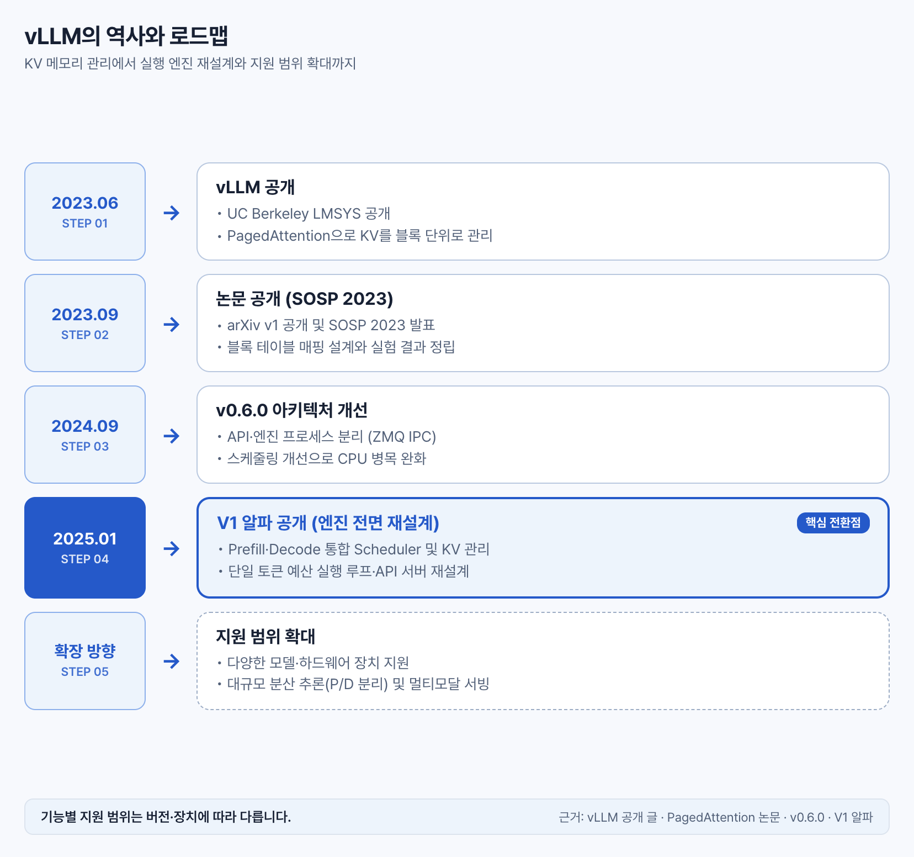

*그림 7-1. vLLM 발전 타임라인. 출처: 직접 제작*

- **2023.06**: UC Berkeley Sky Computing Lab에서 vLLM 프로젝트와 PagedAttention을 공개했습니다.
- **2023.09**: SOSP 2023 학회에서 원 논문(*Efficient Memory Management for Large Language Model Serving with PagedAttention*)을 발표했습니다 [1].
- **2024.09**: v0.6.0 릴리스를 통해 멀티스텝 스케줄링, 비동기 출력 처리, 프로세스 분리(ZMQ IPC)를 도입하여 CPU 오버헤드를 60% 이상 절감했습니다 [2].
- **2025.01~**: V1 엔진 아키텍처를 공개하여 Prefill/Decode 통합 토큰 예산 스케줄러, `Recompute` 단일 선점 정책, XGrammar FSM 비트마스크, Piecewise CUDA Graph, Disaggregated P/D를 본격적으로 지원하고 있습니다 [3] [4].

### 1.5 성능 임팩트: 숫자로 보는 vLLM

#### 기존 방식이 60~80%의 KV 캐시 메모리를 잃어버리는 이유

기존 연속 메모리 할당 기반의 서빙 시스템이 겪었던 60~80% 메모리 손실은 다음 세 가지 원인에서 비롯됩니다 [1] [5].

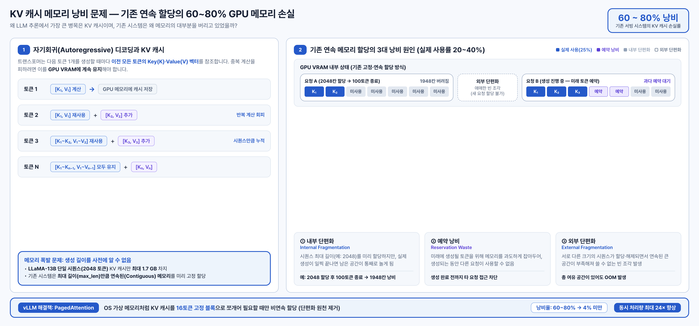

*그림 7-2. 기존 연속 메모리 할당의 KV 캐시 메모리 낭비 원인. 출처: 직접 제작*

1. **내부 단편화 (Internal Fragmentation)**: 최대 길이(예: 2,048 토큰)를 미리 예약했으나 요청이 조기에 종료(예: 100 토큰 생성 후 `EOS`)되면, 할당된 영역 안의 나머지 1,948칸이 사용되지 못한 채 버려집니다.
2. **예약 낭비 (Reservation Waste)**: 언젠가 쓰일 수는 있지만 아직 생성되지 않은 미래 토큰 자리를 미리 점유하고 있어서, 토큰이 생성되는 동안 다른 요청이 해당 VRAM 공간을 전혀 사용할 수 없습니다.
3. **외부 단편화 (External Fragmentation)**: 길이가 서로 다른 요청들의 할당과 해제가 반복되면서 메모리 풀 곳곳에 불규칙한 자투리 빈 공간이 생깁니다. 전체 빈 공간을 합치면 충분하더라도 연속된 큰 공간이 없으면 새 요청을 받지 못하고 메모리 부족(OOM) 오류가 발생합니다.

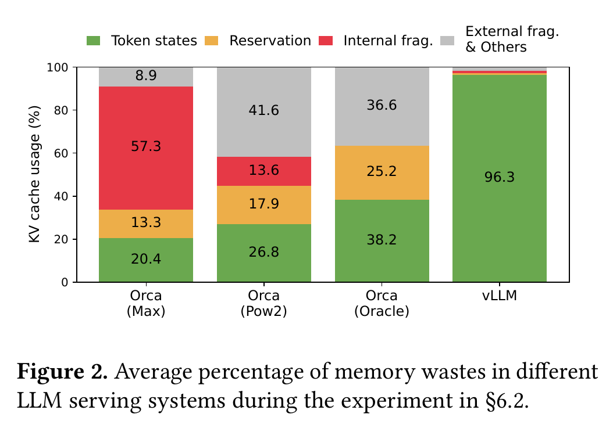

*그림 7-3. 시스템별 평균 KV 캐시 메모리 사용 비율 비교(초록색 영역이 실제 토큰이 저장된 유효 사용률). 출처: [1] Figure 2*

기존 연속 메모리 할당 기반 서빙 엔진(Orca)은 메모리를 사전에 예약하는 전략에 따라 세 가지 베이스라인을 시도했으나, 유효 메모리 사용률이 20.4~38.2%에 머물렀습니다 [1].

| 비교 시스템 | 메모리 사전 예약 전략 | 유효 저장률 | 한계 및 낭비 원인 |
|---|---|:---:|---|
| **Orca (Max)** | 처음부터 무조건 최대 길이(`max_model_len`, 예: 2,048)만큼 연속 메모리를 통째로 예약합니다. | **20.4%** | 요청이 일찍 끝나면 남은 슬롯이 모두 버려져 내부 단편화와 예약 낭비가 극대화됩니다. |
| **Orca (Pow2)** | $2^n$ 거듭제곱(128 $\to$ 256 $\to$ 512...) 단위로 메모리를 점진적으로 재할당하며 확장합니다. | **26.8%** | 다음 단계까지의 예약 낭비가 여전하고, 재할당 시 텐서 복사 비용과 외부 단편화가 발생합니다. |
| **Orca (Oracle)** | 요청이 최종적으로 몇 토큰을 생성할지 사전에 정확히 알고 있다고 가정한 이론상 한계치입니다. | **38.2%** | 최종 길이를 미리 알아도 토큰이 생성되기 전까지의 예약 낭비와 가변 크기 연속 할당에 따른 외부 단편화는 연속 메모리 구조상 해결할 수 없습니다. |
| **vLLM (PagedAttention)** | 사전 예약 없이 16토큰 고정 블록 단위로 필요할 때마다 비연속 물리 메모리를 할당합니다. | **96.3%** | 외부 단편화와 예약 낭비를 0%로 제거하고, 마지막 블록의 내부 단편화만 남겨 낭비율을 4% 미만으로 줄였습니다. |

## 2. 핵심 기술: PagedAttention과 메모리 관리

### 2.1 KV 캐시의 이해와 메모리 폭발

#### KV 캐시의 필요성과 컨텍스트 길이에 따른 메모리 증가

Self-Attention의 기본 계산식은 다음과 같습니다.

$$\text{Attention}(Q, K, V) = \text{softmax}\left(\frac{Q K^T}{\sqrt{d_k}}\right) V$$

자기회귀 디코딩(Autoregressive Decoding)에서 $t$번째 토큰을 생성하려면, 새 토큰의 Query($Q_t$)와 이전 $1 \dots t$번째 모든 토큰의 Key($K_{1\dots t}$) 및 Value($V_{1\dots t}$) 벡터를 내적해야 합니다.

```text
# [KV 캐시가 없을 때] 매 스텝마다 과거 토큰 전체를 다시 계산합니다 (연산량 O(N^2) 폭증)
Step 1: 토큰 1 입력 -> Q1, K1, V1 계산 -> 토큰 2 출력
Step 2: 토큰 1,2 입력 -> Q2, [K1, K2], [V1, V2] 재계산 -> 토큰 3 출력  (K1, V1 중복 계산)
Step 3: 토큰 1,2,3 입력 -> Q3, [K1, K2, K3], [V1, V2, V3] 재계산        (K1~K2 중복 계산)

# [KV 캐시를 사용할 때] 과거 K, V는 VRAM에 저장해 두고 새 토큰 1개만 계산합니다
Step 1: 토큰 1 계산 -> [K1], [V1] 캐시 저장 -> 토큰 2 출력
Step 2: 토큰 2 계산 -> [K2], [V2] 캐시 추가 -> K1, V1은 VRAM에서 로드 -> 토큰 3 출력
Step 3: 토큰 3 계산 -> [K3], [V3] 캐시 추가 -> K1~2, V1~2는 VRAM에서 로드
```

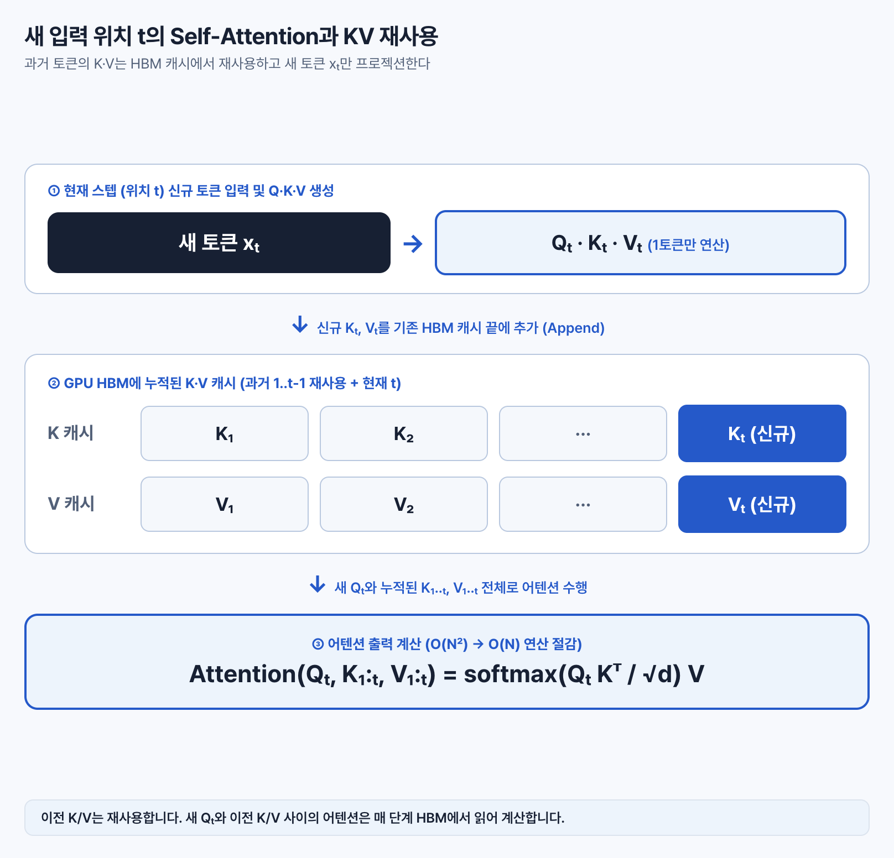

*그림 7-4. 새로 입력된 토큰 위치에 대해서만 Q, K, V를 계산하고 과거 토큰들의 K와 V는 KV 캐시에서 읽어 오는 과정. 출처: 직접 제작*

하나의 시퀀스가 차지하는 유효 KV 캐시 크기는 다음 공식으로 계산됩니다 [2].

$$\text{KV Cache Size (Bytes)} = 2 \times \text{num\_layers} \times \text{num\_kv\_heads} \times \text{head\_dim} \times \text{seq\_len} \times \text{dtype\_bytes}$$

여기서 $2$는 Key와 Value 두 텐서를 의미하며, $\text{dtype\_bytes}$는 FP16/BF16 기준 2바이트입니다.

| 모델 | 파라미터 | 레이어 및 헤드 구성 | 컨텍스트 2,048 | 컨텍스트 8,192 (FP16) |
|---|---|---|---:|---:|
| **LLaMA-7B** | 7B (MHA) | $L=32, H_{kv}=32, d=128$ | 약 1.0 GB | 약 4.0 GB |
| **LLaMA-13B** | 13B (MHA) | $L=40, H_{kv}=40, d=128$ | 약 1.6 GB | 약 6.4 GB |
| **LLaMA-3-70B** | 70B (GQA, 8 KV heads) | $L=80, H_{kv}=8, d=128$ | 약 0.64 GB | 약 2.5 GB |

80GB A100 GPU에서 LLaMA-13B(가중치 약 26GB)를 서빙할 때 남는 가용 VRAM은 약 54GB입니다. 과거 방식처럼 요청당 2,048 토큰 기준 약 1.6GB를 연속 공간으로 고정 예약하면 동시에 처리할 수 있는 요청은 약 30개에 불과합니다 [1] [2].

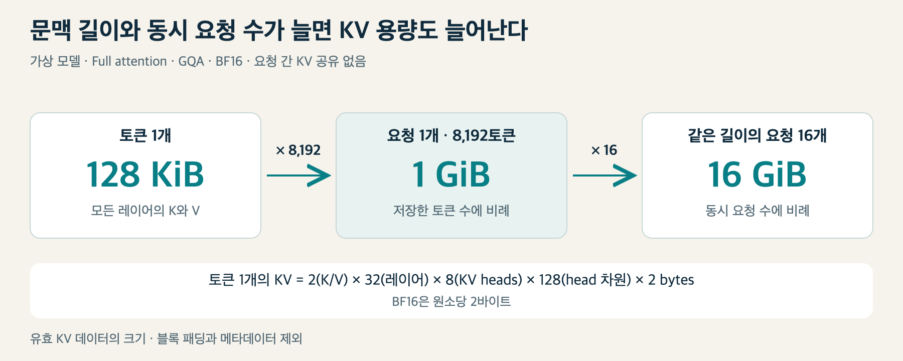

*그림 7-5. Attention 구조(MHA, GQA, MQA)별 유효 KV 용량 스케일링. 출처: 직접 제작*

Attention 구조에 따라 요청당 KV 캐시 크기는 크게 달라집니다 ($L=32, d=128, \text{seq\_len}=8192$, BF16 기준) [2].

| Attention 구조 | KV Head 수 ($H_{kv}$) | 요청당 유효 KV 용량 | 구조적 특징 |
|---|---:|---:|---|
| **MHA (Multi-Head)** | 32 ($H_{q}=32$) | **4.0 GiB** | 모든 Query 헤드가 각자 독립된 K, V 헤드를 보유합니다. |
| **GQA (Grouped-Query)** | 8 ($H_{q}=32$) | **1.0 GiB** | 여러 Query 헤드(예: 4개)가 1개의 K, V 헤드를 공유합니다 (최신 모델 표준). |
| **MQA (Multi-Query)** | 1 ($H_{q}=32$) | **0.125 GiB (128 MiB)** | 모든 Query 헤드가 단 1개의 K, V 헤드를 공유합니다. |

### 2.2 PagedAttention 알고리즘과 참조 카운트

#### 운영체제(OS) 가상 메모리 페이징과의 1:1 대응

vLLM은 운영체제의 가상 메모리 페이징 기법을 KV 캐시 관리에 도입하여 요청의 논리적 토큰 순서와 물리적 GPU 메모리 저장 위치를 완전히 분리했습니다 [1].

| OS 가상 메모리 개념 | vLLM PagedAttention 구현 |
|---|---|
| **가상 페이지 (Virtual Page)** | **논리 블록 (Logical KV Block)**: 요청의 토큰 시퀀스를 16개 단위로 묶은 논리적 번호표입니다. |
| **물리 프레임 (Page Frame)** | **물리 블록 (Physical KV Block)**: GPU VRAM 풀에 사전 할당된 고정 크기(16토큰) 슬롯 버퍼입니다. |
| **페이지 테이블 (Page Table)** | **블록 테이블 (Block Table)**: 논리 블록 번호를 실제 물리 블록 ID로 연결하는 매핑 장부입니다. |
| **요구 페이징 (Demand Paging)** | **동적 블록 할당**: 토큰이 실제로 생성되어 이전 블록이 꽉 찰 때마다 새 물리 블록을 1개씩 배정합니다. |

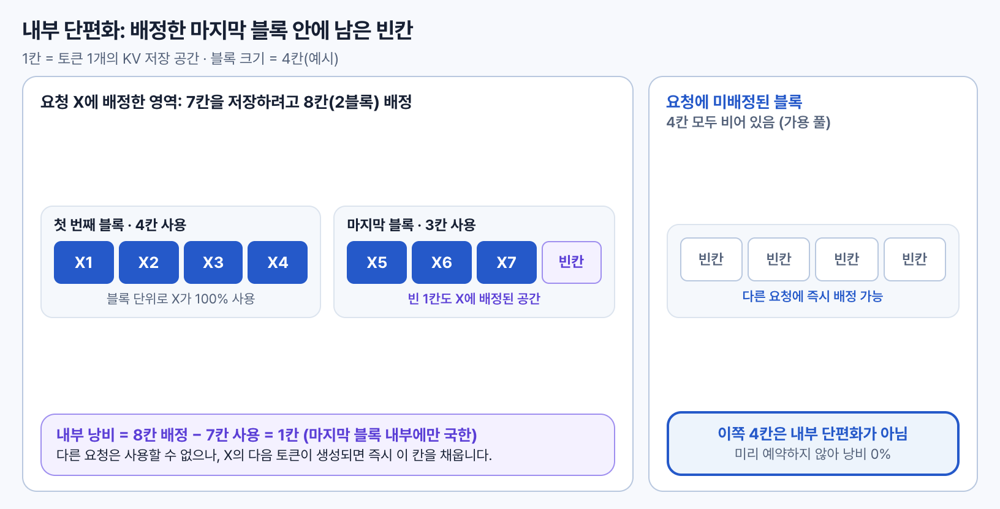

*그림 7-6. 내부 단편화 개념도. PagedAttention에서도 각 시퀀스의 마지막 블록에 한해 미사용 슬롯(최대 15토큰, 전체 메모리의 4% 미만)이 남을 수 있습니다. 출처: 직접 제작*

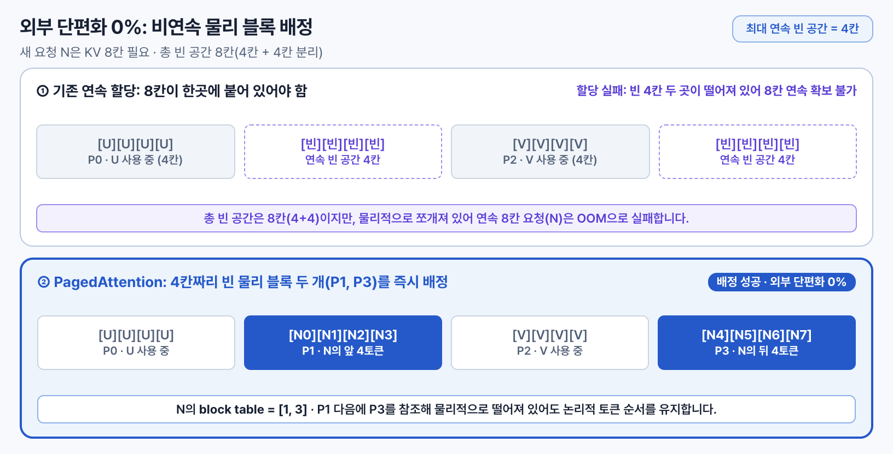

*그림 7-7. 외부 단편화와 페이징 해결 개념도. 물리 메모리에 빈 조각이 흩어져 있어도 모든 블록 크기가 16토큰으로 동일하므로 물리 블록 7, 1, 3을 비연속적으로 매핑하여 외부 단편화를 0%로 제거합니다. 출처: 직접 제작*

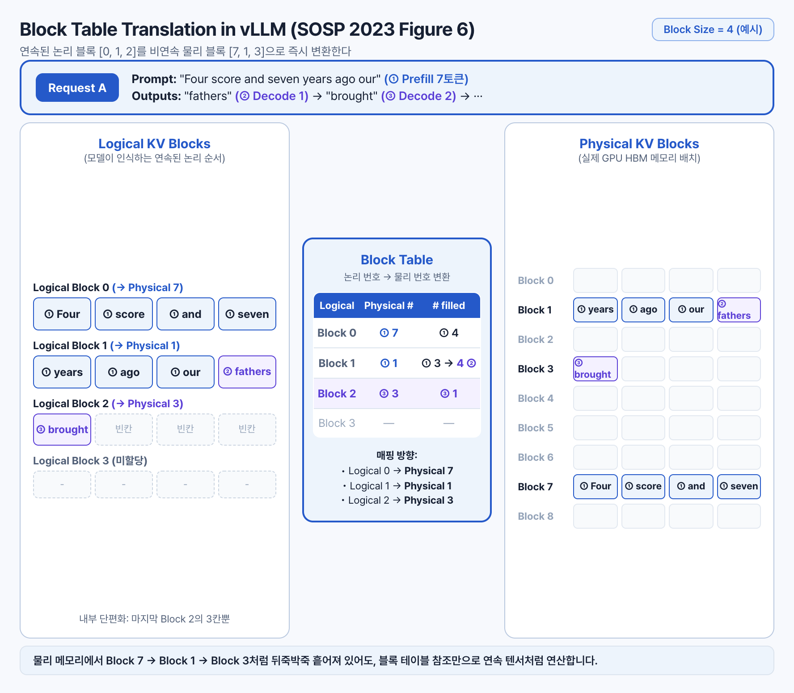

*그림 7-8. 논리 블록 0, 1, 2가 블록 테이블을 통해 비연속적인 물리 블록 7, 1, 3으로 매핑되는 과정. 출처: [1] Figure 6*

#### 물리 블록에 참조 카운트(ref_count)를 유지하는 이유

PagedAttention에서는 동일한 프롬프트를 가진 여러 시퀀스나 요청이 하나의 물리 블록을 동시에 공유할 수 있습니다. 이때 각 물리 블록을 현재 몇 개의 시퀀스가 바라보고 있는지 기록하는 `ref_count`(참조 카운트)는 다음 세 가지 핵심 기능을 수행합니다 [1] [4].

1. **Copy-on-Write (CoW) 발동 시점 판단 (데이터 덮어쓰기 오염 방지)**:
   - 병렬 샘플링이나 빔 서치(`n > 1`)에서 시퀀스 A와 시퀀스 B가 공통 프롬프트가 담긴 물리 블록을 공유하면 해당 블록의 `ref_count`는 `2`가 됩니다.
   - 이후 시퀀스 A와 B가 서로 다른 응답 토큰을 마지막 블록의 빈 슬롯에 기록하려 할 때, 엔진은 `ref_count > 1`임을 감지하고 즉시 새 물리 블록을 할당받아 기존 내용을 복사(Copy-on-Write)한 뒤 기록합니다. 덕분에 시퀀스 B가 참조하는 원본 KV 캐시가 훼손되지 않으며, 빔 서치의 KV 메모리 사용량을 최대 55% 절감합니다 [1].
2. **안전한 메모리 해제 시점 판단 (Use-After-Free 방지)**:
   - 블록을 공유하던 시퀀스 A와 B 중 시퀀스 A가 먼저 생성을 마쳐도(`EOS`), 시퀀스 B가 아직 살아 있으므로 공유 블록 `#0`을 지우지 않고 `ref_count`만 `2 -> 1`로 감소시킵니다. 만약 이때 블록을 회수해 버리면 아직 실행 중인 시퀀스 B가 어텐션을 계산할 때 메모리가 파괴되는 문제(Use-After-Free)가 발생합니다.
   - 이후 시퀀스 B까지 생성을 마쳐 `ref_count == 0`이 되는 순간에만 해당 물리 블록을 가용 풀(`free_block_queue`)로 안전하게 반환합니다.
3. **Prefix Caching의 지연 무효화 (Lazy Eviction) 구현**:
   - 모든 요청이 종료되어 `ref_count`가 `0`이 된 블록이라도 데이터와 해시값을 즉시 삭제하지 않고 가용 풀에 그대로 유지합니다. 다른 요청이 새 블록을 할당받아 덮어쓰기 전에 동일한 시스템 프롬프트 요청이 다시 들어오면, `ref_count`만 `0 -> 1`로 올리고 연산 없이 캐시를 즉시 재사용합니다 [3] [4].

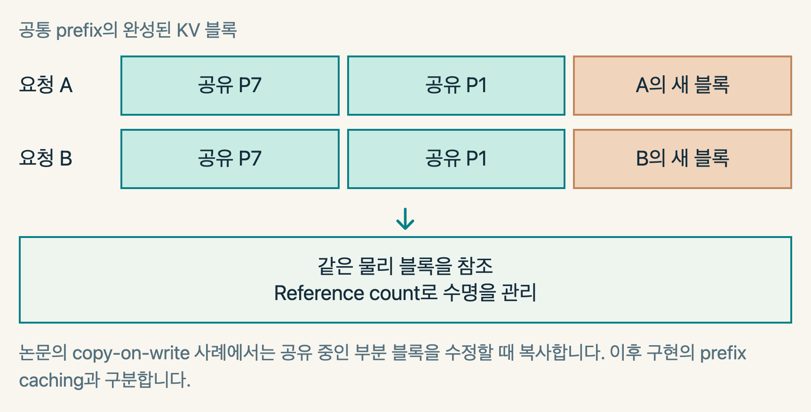

*그림 7-9. 공통 프롬프트 구간인 블록 0과 1은 물리 블록을 공유하고 토큰이 갈라지는 블록 2에서만 Copy-on-Write가 발동하여 별도 물리 블록으로 분기하는 구조. 출처: 직접 제작*

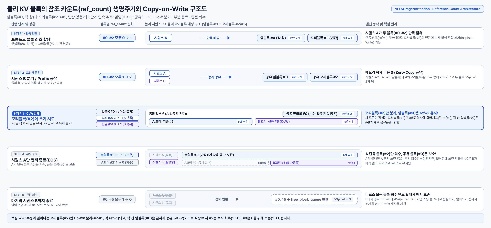

*그림 7-10. 물리 KV 블록의 참조 카운트(`ref_count`) 5단계 생명주기(① `0->1` 단독 할당, ② `1->2` 공유, ③ CoW 복제 분기, ④ `2->1` 시퀀스 A 선종료 시 시퀀스 B 보호, ⑤ `1->0` 시퀀스 B 종료 후 가용 풀 반환) 구조도. 출처: 직접 제작*

### 2.3 KV 캐시 매니저 심층 분석: 블록 크기(16)와 선점 정책

#### 가용 블록 풀(Pool) 크기 산출 공식

엔진이 초기화될 때 `KVCacheManager`는 프로파일링을 통해 가용 GPU 메모리를 측정하고, 고정 크기 물리 블록 풀을 한 번에 사전 할당합니다 [4].

$$\text{가용 KV 메모리} = \text{전체 VRAM} \times \text{gpu\_memory\_utilization} - \text{모델 가중치} - \text{피크 Activation 및 Workspace}$$

$$\text{총 물리 블록 수} = \left\lfloor \frac{\text{가용 KV 메모리}}{\text{블록 1개당 메모리 크기}} \right\rfloor$$

$$\text{블록 1개당 메모리 (Bytes)} = 2 \times \text{num\_layers} \times \text{num\_kv\_heads} \times \text{head\_dim} \times 16 \times \text{dtype\_bytes}$$

#### 각 블록이 16개 토큰을 저장하도록 최적화된 하드웨어적 이유

블록 크기를 1토큰으로 설정하면 마지막 블록의 내부 단편화도 0%가 될 수 있으나, 기본 블록 크기를 16토큰으로 설정하는 이유는 GPU 메모리 대역폭 접근 효율과 내부 단편화 억제 사이의 최적점(Sweet Spot)이기 때문입니다 [1] [2].

1. **GPU 워프(Warp)의 128 바이트 메모리 병합 접근 (Coalesced Memory Access)**:
   - GPU에서는 32개의 스레드(1 Warp)가 동시에 메모리를 요청하며, GPU HBM 메모리의 기본 읽기 트랜잭션 단위는 128 바이트입니다.
   - 32개의 스레드가 각자 4 바이트(예: FP16 원소 2개)씩 읽을 때, 이 32개 스레드가 요청한 주소들이 연속된 128 바이트 구간(`4 Bytes × 32 스레드 = 128 Bytes`) 안에 나란히 모여 있으면 하드웨어가 이를 단 1번의 128 바이트 메모리 트랜잭션으로 병합(Coalescing)하여 한 번에 읽어 옵니다.
   - 반면에 블록 크기가 1토큰이어서 토큰마다 물리 메모리 주소가 흩어져 있으면, 32개 스레드가 읽어야 할 데이터가 서로 멀리 떨어진 32곳의 주소에 나뉘게 됩니다. 이 경우 하드웨어가 요청을 하나로 묶지 못하므로 스레드마다 128 바이트 트랜잭션을 각자 발생시켜 총 32번 따로 메모리를 읽어야 합니다. 그 결과 한 번에 128 바이트를 읽어 4 바이트만 쓰고 나머지 124 바이트는 버리게 되어, 실효 메모리 대역폭이 1/32(3.1%) 수준으로 급락합니다. 16토큰 단위로 묶으면 연속된 캐시 라인을 빈틈없이 병합하여 읽을 수 있습니다.
2. **Tensor Core 행렬 곱셈 타일 규격 ($16 \times 16$)과의 일치**:
   - NVIDIA GPU Tensor Core의 기본 행렬 곱셈·누적(MMA) 타일 규격이 $16 \times 16$이므로, 16토큰 블록은 어텐션 커널의 타일 연산 단위에 정확히 부합합니다.
3. **블록 테이블 조회 및 메타데이터 오버헤드 1/16 감소**:
   - 2,048 토큰 시퀀스를 처리할 때 블록 테이블을 2,048번 조회하는 대신 128번($2048 / 16$)만 조회하면 되므로, CPU-GPU 간 메타데이터 전송량과 커널 인덱싱 비용이 1/16로 줄어듭니다.
4. **내부 단편화 억제**:
   - 반대로 블록 크기를 64나 128 토큰으로 너무 크게 잡으면, 요청이 일찍 끝났을 때 마지막 블록에서 최대 63~127 토큰분의 메모리가 버려집니다. 16토큰은 마지막 블록의 최대 낭비를 15토큰 이하(전체 메모리의 4% 미만)로 억제합니다 [1].

| 블록 크기 | GPU 워프 메모리 병합 접근 | 블록 테이블 크기 | 내부 단편화 낭비 | 종합 평가 |
|:---:|---|---|---|---|
| **1 토큰** | 최악 (32 스레드가 32번 따로 트랜잭션 발생, 대역폭 1/32 급락) | 매우 큼 (주소록 비대) | **0% (낭비 없음)** | 메모리 대역폭 병목으로 추론 속도가 심각하게 저하됩니다. |
| **16 토큰 (표준)** | **최적 (128B 캐시 라인 1회 병합 로드 및 16×16 타일 일치)** | **작음 (1/16 크기)** | **4% 미만 (최대 15토큰)** | **GPU 메모리 대역폭 효율과 공간 절약의 최적 균형점입니다.** |
| **128 토큰** | 최적 (16토큰과 대역폭 효율 유사) | 매우 작음 | **심각 (최대 127토큰)** | 내부 단편화가 급증하여 동시 배치 수용량이 크게 줄어듭니다. |

#### 선점(Preemption) 정책: Recompute와 Swap 비교 및 V1 단일화 이유

동시 요청이 급증하여 GPU VRAM의 빈 블록이 고갈되었을 때 스케줄러가 실행 중인 요청을 일시 중단시키는 선점 정책에는 전통적으로 `Recompute`와 `Swap` 두 가지가 있었습니다 [1] [3].

| 비교 항목 | `Recompute` (삭제 후 재계산: **vLLM 기본값 & V1 유일 표준**) | `Swap` (CPU RAM 대피 후 복원: V0 레거시) |
|---|---|---|
| **동작 원리** | 선점 즉시 물리 블록을 해제($O(1)$)하고, 재스케줄링될 때 원래 프롬프트 + 생성된 토큰들을 묶어 1회의 병렬 Prefill로 일괄 복구합니다. | 선점 시 GPU 블록을 PCIe 버스를 통해 CPU RAM으로 복사하고, 복귀 시 다시 GPU로 복사해 옵니다. |
| **주요 병목** | **GPU 연산력 (Tensor Core FLOPs)** | **PCIe 버스 대역폭 (32~64 GB/s로 HBM보다 수십 배 느림)** |
| **선점 속도** | **즉시 완료 (데이터 이동 없음)** | 느림 (수백 MB~수 GB 텐서의 PCIe 왕복 전송 지연) |
| **유리한 경우** | **단일 시퀀스 요청 (`n = 1`)**, Prefix Caching 및 Chunked Prefill 적용 환경 | 과거 V0에서 다중 시퀀스가 블록을 공유하던 빔 서치 (`n > 1`) |
| **V1 엔진 현황** | **vLLM V1의 유일한 표준 선점 정책으로 단일화되었습니다 [3] [4].** | **V1 스케줄러에서 제거되었습니다** (CPU 메모리 활용은 `KVConnector` 오프로딩으로 분리). |

> **왜 처음부터 다시 계산하는 `Recompute`가 복사해 두는 `Swap`보다 빠를까요?**
>
> 100토큰 프롬프트에 50토큰을 한 글자씩(Decode 50회) 생성하다가 선점되었을 때, 복귀 시 다시 50번 디코딩하는 것이 아니라 총 150토큰 전체를 단 1번의 병렬 행렬 연산(Prefill GEMM)으로 수 밀리초 만에 계산하기 때문입니다. 특히 vLLM V1에서는 앞부분 블록이 Prefix Caching으로 보존되고 재계산도 Chunked Prefill로 분할 처리되므로, 느린 PCIe 버스로 무거운 KV 텐서를 왕복 복사하는 `Swap`보다 `Recompute`가 유리하여 V1에서는 `Recompute` 단일 정책으로 통일되었습니다 [3].

### 2.4 연속 배칭(Continuous Batching)과 단일 GPU 배치 추론

#### 정적 배칭 vs 연속 배칭 (Iteration-Level Scheduling)

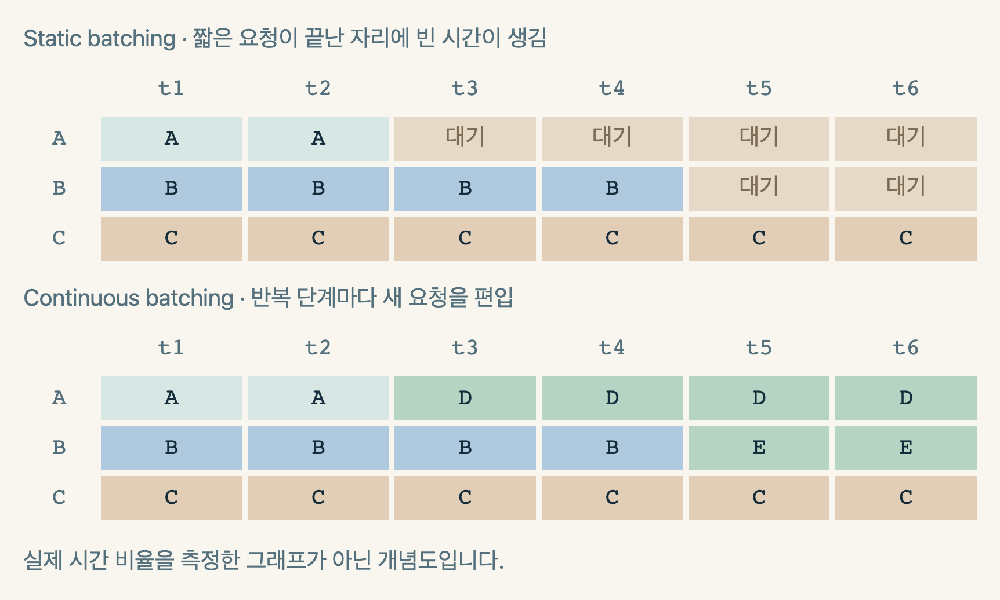

*그림 7-11. 정적 배칭과 연속 배칭의 시간축 비교. 연속 배칭은 매 스텝(Iteration)마다 종료된 요청(A, B)의 블록을 즉시 회수하고 대기 중인 새 요청(D, E)을 투입합니다. 출처: 직접 제작*

| 비교 항목 | 정적 배칭 (Static Batching) | 연속 배칭 (Continuous Batching, Orca / vLLM) |
|---|---|---|
| **스케줄링 주기** | 배치 안의 모든 요청이 끝날 때까지 새 요청 투입이 불가능합니다. | **매 Iteration(토큰 1개 생성 스텝)마다 배치를 동적으로 재구성합니다.** |
| **GPU 유휴 시간** | 일찍 끝난 요청의 슬롯은 가장 긴 요청이 끝날 때까지 패딩 연산만 수행하며 대기합니다. | 요청이 완료되는 즉시 물리 블록을 회수하고 대기 큐의 새 요청을 바로 투입합니다. |
| **처리량 (TPS)** | **41 TPS** (단일/정적 처리 기준) | **793 TPS** (vLLM 연속 배칭 기준, **약 19배 향상**) [2] |
| **P99 지연시간** | 673 ms | **80 ms** [2] |

#### 단일 GPU에서 배치 추론이 가능하고 처리량이 19배 향상되는 원리

단일 GPU 환경에서도 배치 추론을 통한 속도 향상 효과가 크게 나타나는 이유는 다음과 같습니다 [3] [2].

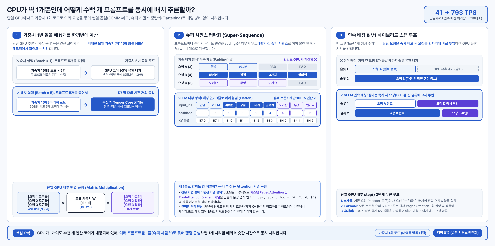

*그림 7-12. 단일 GPU 배치 추론의 내부 동작 원리. 출처: 직접 제작*

1. **가중치 1회 로드로 $N$개 요청 동시 행렬 곱셈 (GEMV $\to$ GEMM 전환)**:
   - 디코딩 단계에서 가장 오래 걸리는 작업은 수십 GB의 모델 가중치(예: 16GB)를 느린 HBM에서 연산 코어(SRAM)로 읽어 오는 메모리 전달 시간입니다.
   - 요청 5개를 하나씩 순서대로 처리하면 16GB 가중치를 5번(총 80GB) 읽어야 하지만, 5개 요청을 하나의 배치로 묶으면 16GB 가중치를 단 1번만 읽어 온 뒤 5개 요청의 토큰들과 동시에 행렬 곱셈(GEMM)을 수행합니다. 즉, 1개를 처리하는 시간과 거의 같은 시간에 5개의 응답 토큰이 동시에 계산됩니다.
2. **슈퍼 시퀀스 평탄화 (Super-Sequence Flattening)와 전용 Attention 커널**:
   - 길이가 서로 다른 문장들(예: 2토큰, 4토큰, 3토큰)을 2차원 직사각형 텐서로 맞추기 위해 빈칸(`PAD`)을 채우지 않고, `[total_tokens]` 크기의 1차원 슈퍼 시퀀스로 빈틈없이 이어 붙여 연산력 낭비를 0%로 만듭니다 [3].
   - 1줄로 합쳐도 문장끼리 섞이지 않는 이유는 vLLM이 내부적으로 전용 커스텀 Attention 커널(`PagedAttention` 및 `flash_attn_varlen_func`)을 구현하여, 각 문장의 시작과 끝 위치 인덱스(`query_start_loc = [0, 2, 6, 9]`)와 블록 테이블을 커널에 함께 전달함으로써 하드웨어 수준에서 자기 문장 범위 안의 토큰만 참조하도록 격리하기 때문입니다 [3] [4].
3. **토큰 레벨 마이크로 배칭 (Prefill + Decode 혼합 실행)**:
   - 연산 집약적인 신규 요청의 Prefill 토큰들과 메모리 대역폭 집약적인 기존 요청의 Decode 토큰들을 한 스텝 안에서 함께 묶어 실행함으로써, GPU의 Tensor Core와 HBM 메모리 대역폭을 동시에 가동합니다.

### 2.5 Prefix Caching과 Chunked Prefill

#### 해시 체인과 지연 무효화(Lazy Invalidation) 동작 원리

공통 시스템 프롬프트, Few-shot 예시, 혹은 긴 RAG 문서를 공유하는 요청들에서 앞부분 블록의 KV 캐시를 재계산 없이 즉시 재사용하는 기법입니다 [3] [2].

- **16토큰 블록 해시 체인 (`BlockHash`)**:
  - 16개 토큰으로 꽉 찬 완전 블록마다 `hash(부모 블록 해시 + 현재 16개 토큰 ID + 추가 메타데이터)` 형태로 사슬처럼 연결된 해시값을 생성합니다. 앞선 문맥이 단 1토큰이라도 다르면 이후 모든 블록의 해시가 달라지므로 문맥이 100% 일치할 때만 정확히 캐시 히트(Cache Hit)가 발생합니다 [3] [4].
- **지연 무효화 (Lazy Invalidation / Eviction)**:
  - 요청이 종료되어 블록의 `ref_count`가 `0`이 되더라도 해시 테이블에서 즉시 지우지 않고 `free_block_queue`의 뒤쪽에 보관합니다. 메모리가 부족해져 다른 새 요청이 해당 물리 블록을 실제로 덮어쓰기 직전까지 캐시 데이터를 살려 두어 재사용 확률을 극대화합니다 [3] [4].

#### 긴 입력을 잘게 쪼개는 Chunked Prefill

수천 토큰짜리 긴 프롬프트(예: 8,192 토큰)가 들어왔을 때 이를 한 번에 통째로 Prefill하면, 수백 ms 동안 GPU가 Prefill 연산에 독점되어 기존에 글자를 생성 중이던 Decode 요청들이 일제히 멈추는 현상(Head-of-Line Blocking)이 발생합니다 [2].

```text
# [Chunked Prefill 미적용] 대형 Prefill이 끝날 때까지 기존 Decode 요청이 전면 중단됩니다
Step 1: [8192 토큰 대형 Prefill 단독 실행]  <-- 기존 Decode 사용자들에게 심각한 지연(ITL 급등) 발생
Step 2: [Decode 재개]

# [Chunked Prefill 적용] 긴 프롬프트를 2048 토큰 청크로 쪼개어 기존 Decode와 매 스텝 함께 처리합니다
Step 1: [신규 프롬프트 청크 1 (2048)] + [기존 요청들 Decode (각 1토큰)]
Step 2: [신규 프롬프트 청크 2 (2048)] + [기존 요청들 Decode (각 1토큰)]
Step 3: [신규 프롬프트 청크 3 (2048)] + [기존 요청들 Decode (각 1토큰)]
Step 4: [신규 프롬프트 청크 4 (2048)] + [기존 요청들 Decode (각 1토큰)] -> 신규 요청 첫 토큰 출력
```

```python
from vllm import LLM

llm = LLM(
    model="meta-llama/Llama-3.1-8B-Instruct",
    enable_chunked_prefill=True,
    max_num_batched_tokens=2048  # 한 스텝(Iteration)당 처리할 최대 토큰 예산 상한
)
```

## 3. 내부 아키텍처 딥다이브

### 3.1 전체 아키텍처 개요와 SOSP 2023 Figure 4 해부

#### V1 엔진 구조도와 컴포넌트 책임 분리

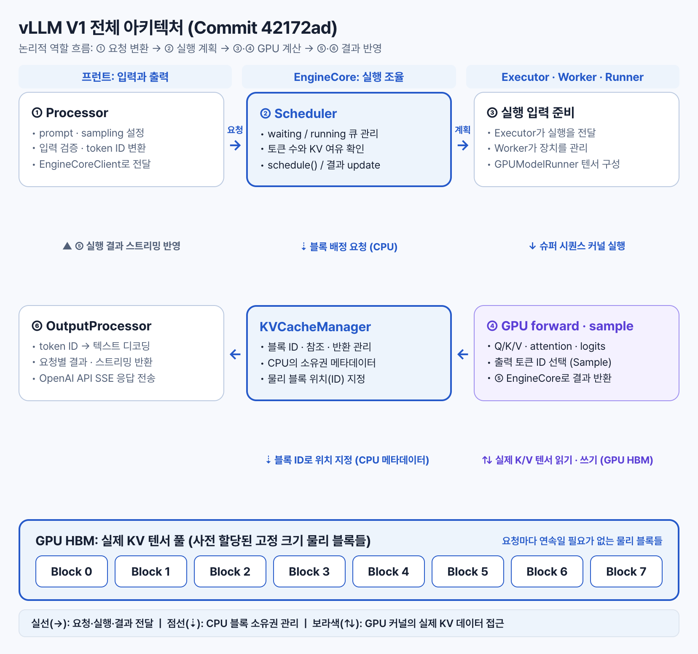

*그림 7-13. vLLM V1의 컴포넌트 간 책임 분리 구조. CPU는 스케줄링과 논리·물리 블록 매핑 장부를 관리하고, GPU Worker는 실제 텐서 연산과 물리 KV 캐시 읽고 쓰기를 전담합니다. 출처: 직접 제작*

| 컴포넌트 | 실행 위치 | 핵심 책임 | 주요 입출력 |
|---|---|---|---|
| **Processor** | CPU (Frontend) | 사용자 입력 검증 및 토크나이징을 수행합니다. | 문자열 $\to$ `EngineCoreRequest` |
| **EngineCore** | CPU (Core Process) | 스케줄러와 모델 실행기 사이의 `step()` 루프를 조율합니다. | `EngineCoreRequest` $\to$ 스케줄링 $\to$ 모델 실행 호출 |
| **Scheduler** | CPU | 토큰 예산과 KV 용량을 검사하고 요청 상태(`waiting`/`running`)를 전이합니다. | `SchedulerOutput` |
| **KVCacheManager** | CPU | 물리 블록 장부(`req_to_blocks`, `free_block_queue`, `ref_count`)를 관리합니다. | 가용 물리 블록 ID 할당 및 CoW 복제 지시 |
| **ModelRunner** | GPU (Worker) | 입력 버퍼를 1차원으로 평탄화하고 `slot_mapping` 생성, Forward 및 샘플링을 수행합니다. | 메타데이터 + 텐서 $\to$ `ModelRunnerOutput` |
| **OutputProcessor** | CPU (Frontend) | 생성된 토큰 ID를 텍스트로 디토크나이징하고 종료 조건을 검사하여 스트리밍합니다. | 출력 토큰 ID $\to$ 사용자 HTTP SSE 청크 |

#### 다중 GPU 환경에서 중앙 블록 매니저가 1개만 존재하는 이유

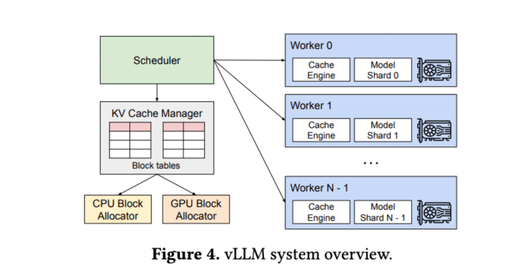

*그림 7-14. vLLM 시스템 전체 구조도. 출처: [1] Figure 4*

vLLM 아키텍처의 핵심 설계 원칙은 두뇌(스케줄링 및 블록 주소 계산: CPU)와 근육(대규모 행렬 연산 및 물리 VRAM 저장: GPU Workers)을 명확히 분리한 **중앙 집중형 제어 평면(Centralized Control Plane) + 분산 데이터 평면(Distributed Data Plane)** 구조에 있습니다 [1] [5].

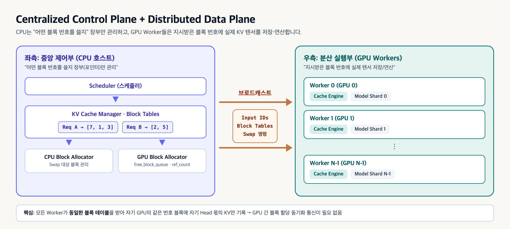

*그림 7-15. CPU 중앙 제어부(Scheduler, KV Cache Manager, Block Allocator)가 Input IDs와 Block Table을 브로드캐스트하면 각 GPU Worker의 Cache Engine이 동일한 물리 블록 번호에 자기 Shard 몫의 KV를 저장하는 구조. 출처: 직접 제작*

> **SPMD (Single Program, Multiple Data)와 Zero Synchronization Overhead**
>
> SPMD는 모든 GPU 워커가 100% 동일한 프로그램(같은 실행 코드, 같은 입력 토큰 시퀀스, 같은 블록 번호표 `[7, 1, 3]`)을 동시에 실행하되, 각자 맡은 데이터 조각(모델 가중치 및 Attention Head 샤드)만 나누어 처리하는 병렬 실행 모델입니다 [3].

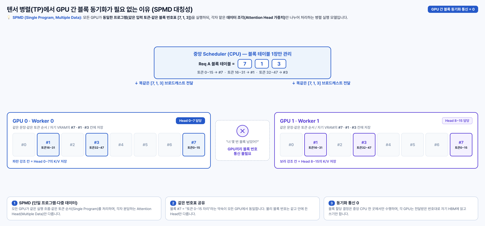

*그림 7-16. CPU가 블록 테이블 `[7, 1, 3]` 1장을 모든 GPU에 똑같이 전달하면 GPU 0은 Head 0~7의 KV를, GPU 1은 Head 8~15의 KV를 각자 VRAM의 동일한 번호 칸(`#7, #1, #3`)에 저장하는 구조. 출처: 직접 제작*

1. **완벽한 SPMD 대칭성**:
   - 텐서 병렬화(TP)에서 `Worker 0`부터 `Worker N-1`까지는 모델의 Attention Head(가중치 열/행)만 쪼개어 가질 뿐, 매 스텝 처리하는 요청과 토큰의 개수 및 순서는 모든 GPU에서 100% 동일합니다.
2. **동일한 블록 테이블 공유**:
   - `Worker 0`이 자기 VRAM의 `7번` 물리 블록에 Head 0~7의 KV를 기록할 때, `Worker 1`도 자기 VRAM의 `7번` 물리 블록에 Head 8~15의 KV를 기록합니다. 즉, 물리 디바이스만 다르고 사용하는 블록 번호표(`[7, 1, 3]`)는 전 GPU에 걸쳐 동일합니다.
3. **GPU 간 블록 할당 통신 비용 0 (Zero Synchronization Overhead)**:
   - 모든 GPU의 블록 사용 상태가 거울처럼 똑같이 움직이므로, GPU들끼리 빈 블록 번호를 확인하기 위해 서로 통신할 필요가 없습니다. 중앙 CPU의 `KVCacheManager` 단 1개가 블록 번호표를 결정해 브로드캐스트하면 모든 GPU가 즉시 실행합니다 [1] [3].

#### V1 엔진 초기화 3단계와 메모리 예산 프로파일링 (Workspace의 의미)

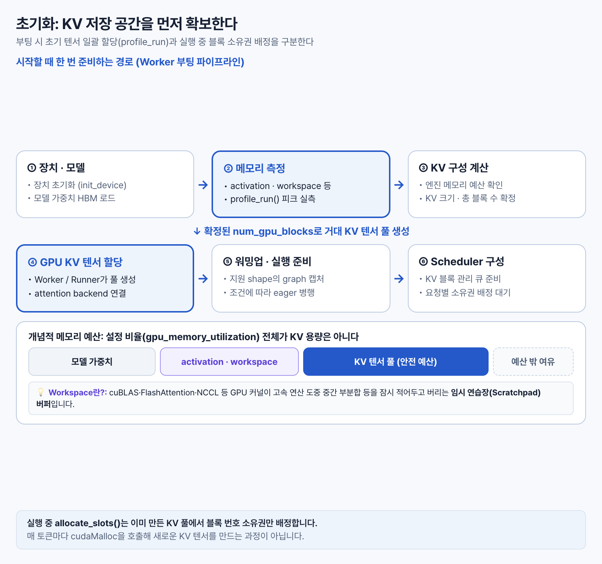

*그림 7-17. 워커 초기화 시 더미 Forward 실행으로 가중치·Activation·Workspace 피크 메모리를 먼저 실측하여 차감한 뒤 남은 가용 VRAM 전체를 고정 크기 물리 KV 블록 풀로 일괄 할당하는 과정. 출처: 직접 제작*

1. **1단계 (디바이스 초기화)**: CUDA 컨텍스트와 NCCL 분산 통신 그룹을 생성하고, `GPUModelRunner`와 CPU 측 `InputBatch` 버퍼를 초기화합니다 [3] [4].
2. **2단계 (모델 로드)**: 모델 가중치를 분할(TP/PP)하거나 양자화 재포장(`Weight Repacking`)하여 GPU VRAM에 적재합니다 (`model.eval()`).
3. **3단계 (KV 캐시 프로파일링 및 CUDA Graph 캡처)**:
   - 최대 배치 크기(`max_num_batched_tokens`)로 더미(Dummy) Forward를 실제 실행하여 추론 중 순간적으로 치솟는 **피크 Activation**과 **Workspace** 메모리 크기를 정확히 실측하고 그만큼의 여유 공간을 비워 둡니다 (서비스 도중 OOM 원천 방지) [3].
     - **Activation (활성화 텐서)**: 레이어와 레이어 사이를 흐르는 모델의 입출력 은닉 상태 텐서(`hidden_states`, `Q, K, V` 등)입니다.
     - **Workspace (커널 임시 작업 공간)**: `cuBLAS`(행렬 곱셈 부분합), `FlashAttention`/`FlashInfer`(타일 Softmax 중간 통계량), `NCCL`(분산 통신 버퍼) 등 저수준 GPU 연산 라이브러리가 고속 계산을 수행하는 도중에만 잠깐 데이터를 적어 두고 버리는 임시 스크래치패드(Scratchpad) 버퍼입니다.
   - 실측 후 남은 안전 VRAM을 블록 1개 크기로 나누어 총 물리 블록 수를 확정하고, 거대한 빈 텐서 버퍼로 물리 KV 풀을 고정 할당한 뒤 배치 크기별 **CUDA Graph**를 사전 캡처합니다 [3] [4].

### 3.2 스케줄러(Scheduler)와 희생양 선점 3원칙

#### 토큰 예산(FLOPs) vs KV 캐시 용량(Memory)의 독립적 2단계 검사

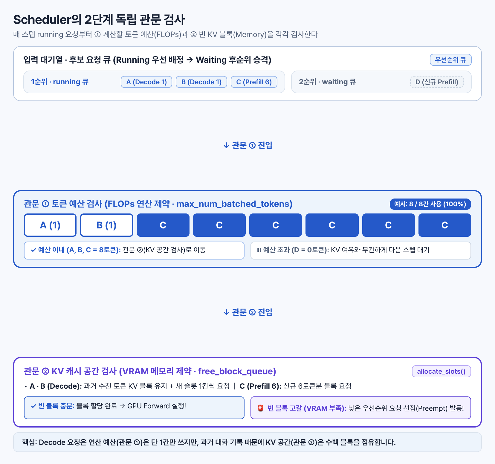

*그림 7-18. 스케줄러가 매 스텝 `running` 큐의 요청부터 시작하여 ① 계산 예산(토큰 수) 관문과 ② 저장 공간(빈 KV 블록) 관문을 순서대로 통과시키는 과정. 출처: 직접 제작*

토큰 예산과 KV 캐시 블록 공간을 따로 검사해야 하는 이유는 **이번 스텝에 새로 계산할 토큰 수(연산량)**와 **지금까지 대화하며 VRAM에 쌓아 둔 누적 토큰 수(메모리 용량)**가 비례하지 않기 때문입니다. 예를 들어 이미 8,000토큰을 주고받은 디코딩 요청 `A`는 이번 스텝에 새로 계산할 토큰이 단 1개(예산 1칸)뿐이지만, VRAM에서는 8,000토큰분의 KV 블록을 차지하고 있습니다 [3].

| 검사 순서 | 검사 항목 | 무엇을 확인하는가? | 통과 실패 시 동작 |
|:---:|---|---|---|
| **관문 ①** | **계산 제약 (토큰 예산 / FLOPs)** | 이번 스텝에 새로 계산할 토큰들의 합이 `max_num_batched_tokens` 상한 이내인가? (그림 예시: `A(1) + B(1) + C(6) = 8칸` 소진) | 예산 초과분은 잘라서(Chunked Prefill) 넣거나 다음 스텝으로 보류합니다 (`D` 대기). |
| **관문 ②** | **저장 제약 (KV 공간 / Memory)** | 이번 스텝에 새로 생성될 KV를 기록할 빈 물리 블록(`free_block_queue`)이 VRAM에 남아 있는가? | 신규(`waiting`) 요청은 대기하고, 실행 중(`running`) 요청은 즉시 선점(Preempt)을 발동합니다. |

#### GPU 메모리 부족 시 스케줄러의 희생양 선점 3원칙

디코딩 도중 빈 물리 블록이 바닥났을 때, 스케줄러는 다음 세 가지 원칙에 따라 자원을 확보합니다 [3] [4].

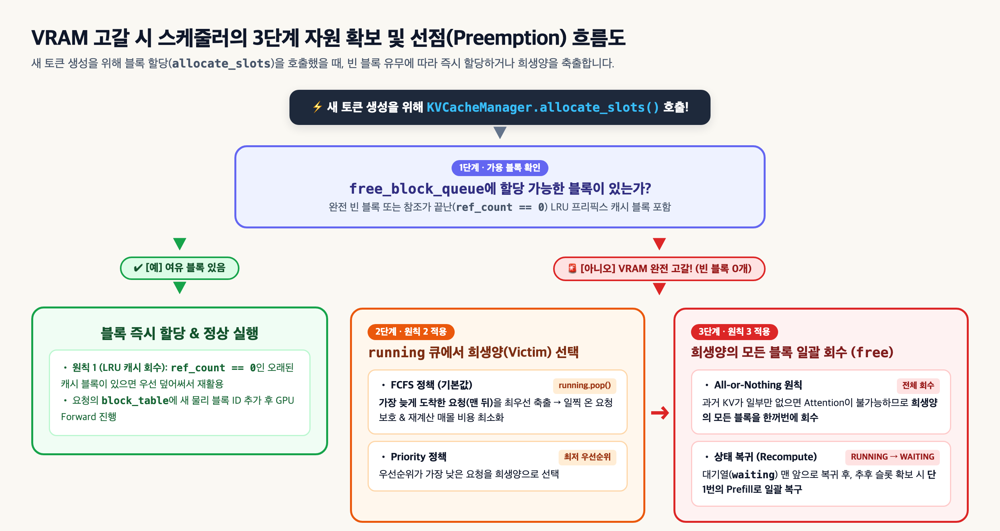

*그림 7-19. VRAM 고갈 시 스케줄러의 3단계 자원 확보 및 선점 흐름도. 출처: 직접 제작*

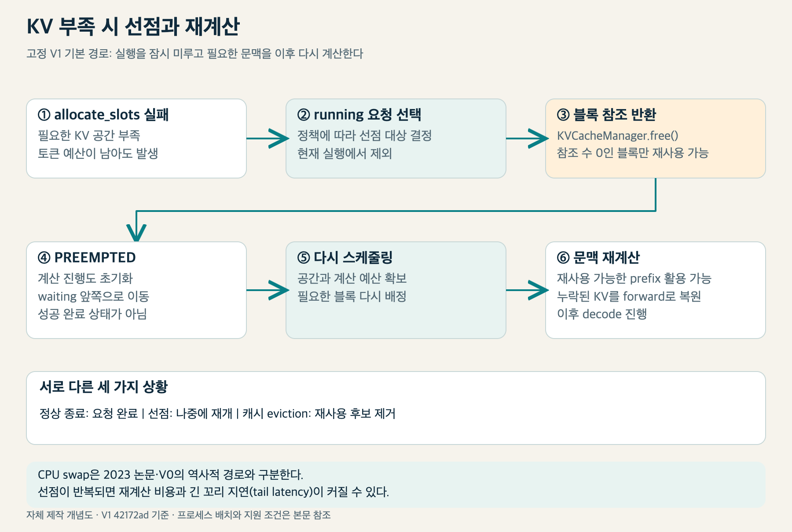

*그림 7-20. 선점된 희생양 요청이 보유 블록을 모두 반환하고 `waiting` 큐로 돌아간 뒤 이후 블록 여유가 생겼을 때 병렬 Prefill(`Recompute`)로 일괄 복구되는 흐름도. 출처: 직접 제작*

1. **원칙 1: 미사용 프리픽스 캐시 블록 LRU 최우선 회수 (`ref_count == 0`)**:
   - 현재 실행 중인 요청을 중단시키기 전에, 이미 종료된 이전 요청들이 캐시 재사용을 위해 남겨 둔 블록(`ref_count == 0`) 중 가장 오래전에 사용된 것(LRU, Least Recently Used)부터 먼저 덮어써서 할당합니다.
2. **원칙 2: FCFS 기준 가장 늦게 도착한 막내 요청(`running.pop()`) 우선 축출 (LIFO 선점)**:
   - **LIFO (Last-In, First-Out) 선점**: 요청을 실행할 때는 선착순(FCFS)으로 넣지만, 메모리가 부족해 요청을 중단시켜야 할 때는 가장 늦게 들어온 막내 요청(`running` 큐 맨 뒤)부터 먼저 빼낸다(`pop()`)는 원칙입니다 [4].
   - **P99 지연시간(상위 1% 최악 응답 지연) 보호**: 일찍 도착해 오랫동안 생성해 온 선임 요청을 끝까지 보호하여, 일부 사용자가 겪는 극단적인 응답 지연(Tail Latency)을 막습니다.
   - **재계산 매몰 비용 최소화**: 가장 늦게 시작한 요청일수록 지금까지 생성한 토큰 수가 적기 때문에, 나중에 다시 스케줄링되어 재계산(`Recompute`)할 때 드는 연산 비용도 가장 적습니다.
3. **원칙 3: All-or-Nothing (요청 단위 전체 블록 일괄 회수)**:
   - Self-Attention은 과거 토큰의 KV 블록이 단 1개라도 빠지면 다음 토큰을 계산할 수 없습니다. 따라서 여러 요청에서 블록을 1개씩 나누어 회수하지 않고, 희생양으로 선택된 요청 1개의 모든 물리 블록을 한꺼번에 회수하여 살아남은 앞선 요청들이 안전하게 생성을 끝마치도록 보장합니다 [1] [3].

### 3.3 모델 실행기(Model Executor)와 슈퍼 시퀀스 평탄화

#### 슈퍼 시퀀스 평탄화 시 문장 간 격리 원리와 `slot_mapping` 시작 오프셋

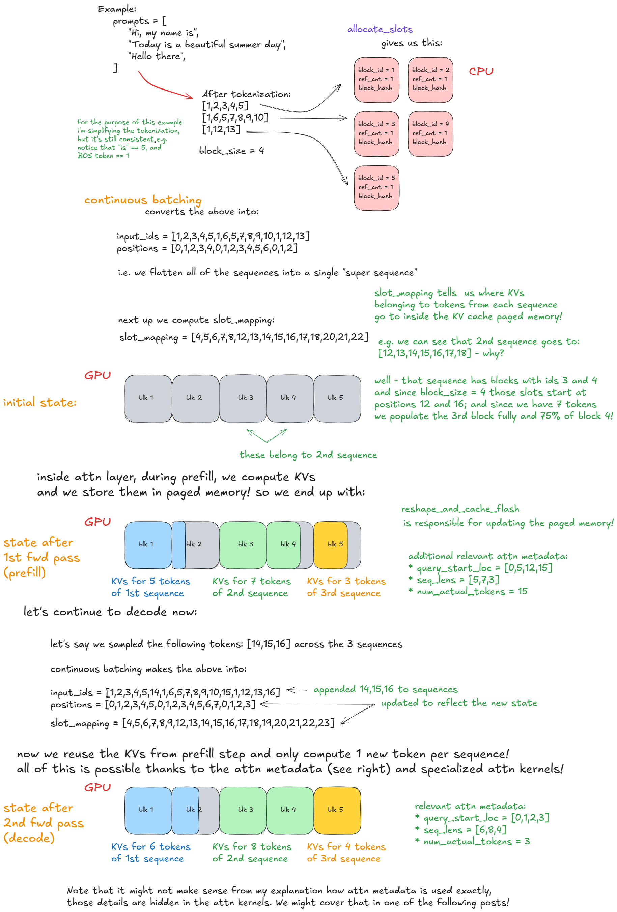

*그림 7-21. V1 Forward 패스 다이어그램. 길이가 5, 7, 3인 세 문장을 빈칸 패딩(`PAD`) 없이 길이 15짜리 1차원 슈퍼 시퀀스로 평탄화하여 처리합니다. 출처: [3]*

> **다이어그램에서 `slot_mapping` 값이 `0, 1, 2, 3`이 아니라 `4`부터 시작하고 중간에 `9, 10, 11`이나 `19`가 건너뛰는 이유**
>
> 1. **`0~3`번 슬롯이 없는 이유 (`null_block` 예약)**: vLLM V1에서는 0번 물리 블록(`block_id = 0`, 블록 크기 4 기준 슬롯 `0, 1, 2, 3`)을 특수 더미 블록(`null_block`, 패딩이나 마스킹 처리용 블록)으로 고정 예약해 둡니다 [3] [4]. 따라서 실제 사용자 요청에는 항상 `block_id = 1`(슬롯 `4 = 1 × 4 + 0`)부터 할당됩니다.
> 2. **중간 슬롯 번호(`9, 10, 11` 및 `19`)가 건너뛰는 이유**: 각 문장의 마지막 물리 블록 안에 아직 채워지지 않은 빈 슬롯(내부 여유 공간)이 남아 있기 때문입니다. 예를 들어 길이 5인 첫 문장은 블록 2개(총 8칸: 슬롯 `4~7`, `8~11`)를 배정받아 5칸(`4, 5, 6, 7, 8`)만 채웠으므로, 나머지 빈칸인 `9, 10, 11`번 슬롯은 이 첫 문장이 다음 Decode 스텝에서 새 토큰을 생성할 때 채워 넣을 예약석으로 비어 있게 됩니다 [3].

트랜스포머 레이어를 통과할 때 1줄로 합쳐진 문장들이 서로 섞이지 않는 이유는 다음과 같습니다 [3] [4].

| 트랜스포머 레이어 | 1줄 슈퍼 시퀀스 입력 시 동작 원리 | 다른 문장과 정보가 섞이지 않는 이유 |
|---|---|:---:|
| **Linear (`QKV`, `FFN`) 및 `RMSNorm`** | 모든 요청의 토큰을 $[N_{\text{total}} \times D]$ 행렬 하나로 묶어 단 1번의 대형 GEMM을 수행합니다. | 선형 투영과 정규화는 원래 토큰 1개(행 1줄) 단위로 완전히 독립 계산되므로 옆 토큰과 정보가 섞일 일이 없습니다. |
| **위치 인코딩 (`RoPE`)** | 문장이 바뀔 때마다 `positions` 배열 값을 다시 `0, 1, 2...`로 리셋하여 전달합니다. | 슈퍼 시퀀스의 5번째 칸에 있는 토큰이라도 `position = 0`을 부여받아 새 문장의 첫 단어로 정확히 회전 인코딩됩니다. |
| **KV 캐시 저장 (`reshape_and_cache`)** | $\text{slot} = \text{block\_id} \times \text{block\_size} + \text{offset}$ 공식으로 계산된 `slot_mapping` 배열을 참조합니다. | 각 토큰의 K, V 벡터가 자기 문장에 배정된 물리 블록 슬롯 위치로 정확히 찾아가 저장됩니다. |
| **Attention 계산 (`PagedAttention` / `FlashAttention`)** | 전용 커스텀 커널에 문장 경계 인덱스인 `query_start_loc = [0, 5, 12, 15]`와 블록 테이블을 전달합니다. | 커널 내부 루프가 자기 문장의 시작~끝 범위(`0~4`, `5~11`, `12~14`) 안에서만 내적과 Softmax를 수행하도록 하드웨어 수준에서 격리합니다. |

### 3.4 분산 실행 모델(Distributed Execution)과 병렬화 4대 축

#### 프로세스 간 통신 (ZMQ IPC, RPC, Shared Memory Queue)

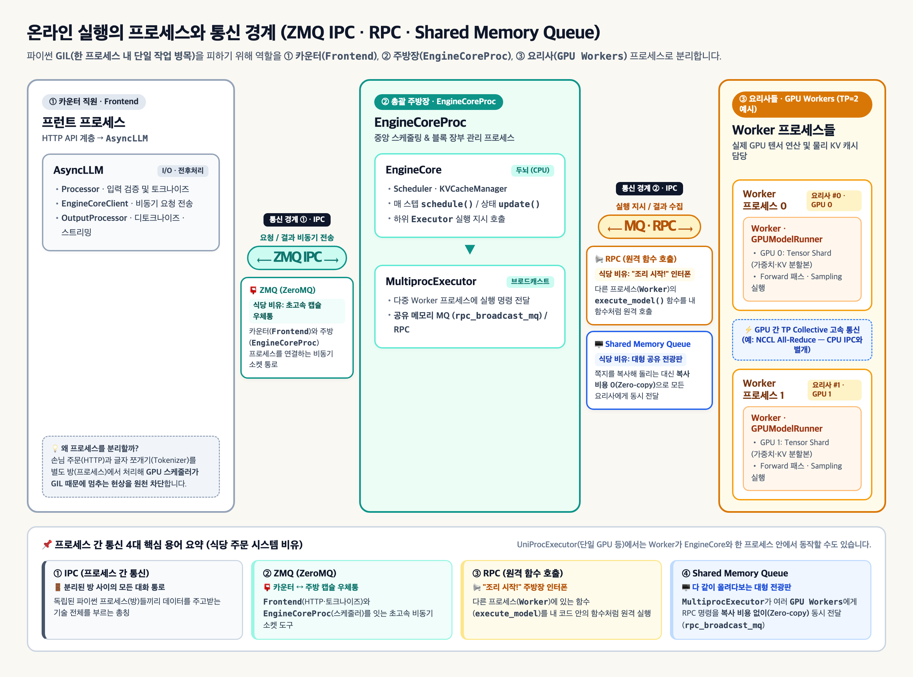

*그림 7-22. 파이썬 GIL 병목을 제거하기 위해 분리된 3대 프로세스(Frontend, EngineCoreProc, GPU Workers)와 ZMQ IPC 및 공유 메모리 큐 통신 구조. 출처: 직접 제작*

파이썬의 GIL(Global Interpreter Lock, 하나의 프로세스 안에서 한 번에 1개의 파이썬 스레드만 실행 허용) 때문에 HTTP 요청 처리, 스케줄링, GPU 실행을 한 프로세스에 넣으면 CPU가 병목이 되어 GPU가 유휴 상태에 빠집니다. 이를 해결하기 위해 vLLM V1은 역할을 ① 카운터(`Frontend`), ② 주방장(`EngineCoreProc`), ③ 요리사(`GPU Workers`)의 독립 프로세스로 분리했습니다 [3] [4].

| 통신 용어 | 직관적 비유 (식당 모델) | vLLM V1에서의 구체적 역할 |
|---|---|---|
| **IPC** (프로세스 간 통신) | 분리된 방(독립 프로세스) 사이에 뚫어 놓은 모든 대화 통로 | 서로 메모리를 공유하지 않는 독립 파이썬 프로세스들끼리 데이터를 주고받는 기술 총칭입니다. |
| **ZMQ** (ZeroMQ) | 카운터와 주방 사이를 연결하는 초고속 비동기 캡슐 우체통 | `Frontend`(HTTP 수신·토크나이징)와 `EngineCoreProc`(스케줄러) 사이에서 요청과 응답 토큰을 비동기로 주고받는 소켓 라이브러리입니다. |
| **RPC** (원격 프로시저 호출) | 주방장이 인터폰으로 조리 시작을 지시해 요리사를 움직이는 것 | `EngineCoreProc`가 다른 프로세스인 `GPU Worker` 내부의 파이썬 메서드(`execute_model`)를 원격 실행시키는 방식입니다. |
| **Shared Memory Queue** | 주문서를 일일이 복사해 나눠 주는 대신 모든 요리사가 함께 보는 대형 전광판 | `MultiprocExecutor`가 여러 `GPU Workers`에게 매 스텝의 `SchedulerOutput`(블록 테이블 등)을 메모리 복사 비용 없이(Zero-Copy) 동시에 브로드캐스트(`rpc_broadcast_mq`)하는 공유 RAM 영역입니다. |

#### 병렬화 4대 축: TP, PP, DP, EP 비교

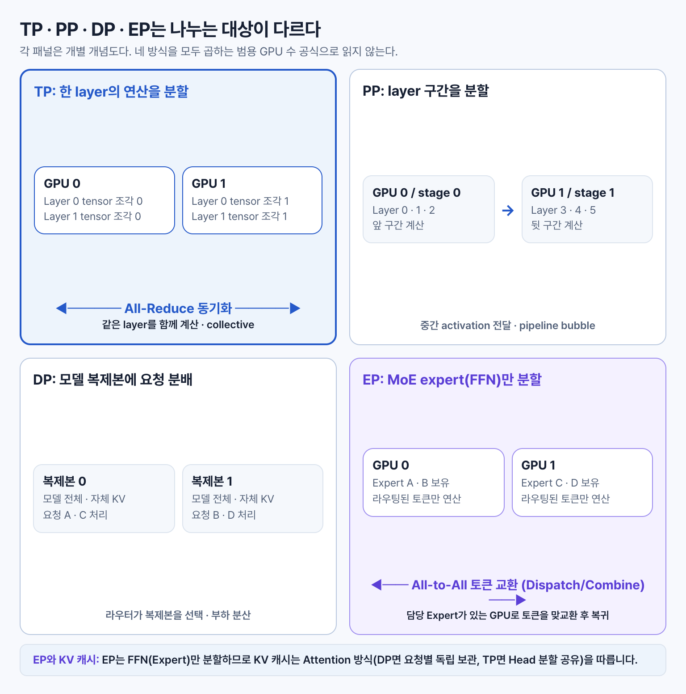

*그림 7-23. 모델 가중치, 레이어, 요청 데이터, MoE 전문가를 분할하는 4가지 병렬화 방식. 출처: 직접 제작*

| 병렬화 방식 | 분할 대상 | 주요 통신 패턴 및 병목 | 주 적용 환경 |
|---|---|---|---|
| **TP (Tensor Parallelism)** | 각 레이어 내부의 가중치 행렬 (`Linear`, `Attention Head`) | 매 레이어 Attention·FFN 직후 고속 `All-Reduce` 동기화 (NVLink 권장) | 단일 서버(노드) 내 다중 GPU (가장 기본) |
| **PP (Pipeline Parallelism)** | 모델의 층(Layer) 묶음 (예: 1~40층 vs 41~80층) | 스테이지 경계에서 중간 결과(`Activation`) P2P 1회 전달 | 초대형 모델의 멀티 노드(서버 간) 연결 |
| **DP (Data Parallelism)** | 독립된 모델 복제본(Replica)에 서로 다른 사용자 요청 배정 | 앞단 라우터의 실시간 부하 분산(Load Balancing) | 고처리량 대규모 서빙 클러스터 |
| **EP (Expert Parallelism)** | MoE(Mixture-of-Experts) 모델의 전문가(Expert FFN) 계층 | 토큰을 담당 전문가 GPU로 보내고 돌려받는 `All-to-All` 라우팅 통신 | DeepSeek-V3/R1, Mixtral, Qwen-MoE 등 |

#### EP(Expert Parallelism)의 All-to-All 토큰 라우팅과 KV 캐시 관리

1. **All-to-All 토큰 라우팅 통신**:
   - MoE 모델에서 전문가 병렬화(EP)를 적용하면 GPU마다 보유한 전문가(Expert)가 다릅니다 (예: `GPU 0`은 전문가 0~3번, `GPU 1`은 전문가 4~7번 보유).
   - 각 GPU에서 처리하던 토큰들이 게이팅 네트워크(Router)를 통과한 뒤 다른 GPU의 전문가를 지목하면, 모든 GPU가 자기 토큰들을 해당 전문가가 있는 타깃 GPU로 일제히 맞교환 전송(`Dispatch` All-to-All)합니다.
   - 그다음 각 GPU가 자기 전문가 FFN 연산을 마친 뒤, 계산된 결과 벡터를 다시 원래 토큰이 있던 GPU로 돌려주는(`Combine` All-to-All) 양방향 전체 교환 통신이 All-to-All 토큰 라우팅입니다 [2].
2. **EP 환경에서의 KV 캐시 관리**:
   - 핵심 원리는 **EP는 오직 FFN(MoE 전문가) 계층만 분할하며, KV 캐시는 Attention 계층에만 존재한다**는 점입니다.
   - 따라서 KV 캐시 관리 방식은 Attention 계층이 어떤 병렬화(`DP` 또는 `TP`)를 쓰느냐에 따라 결정됩니다.
     - **Attention이 `DP`(데이터 병렬)인 경우**: 각 GPU(DP 랭크)는 자신이 맡은 요청(문장)들의 KV 캐시만 자기 VRAM에 독립적으로 보관하고 각자 블록 테이블을 관리합니다.
     - **Attention이 `TP`(텐서 병렬)인 경우**: 앞서 살펴본 SPMD 방식 그대로 모든 GPU가 동일한 블록 테이블을 공유하며 KV Head만 나누어 저장합니다.
   - 즉, MoE(EP) 계층에 진입할 때는 무거운 KV 캐시는 원래 GPU 자리에 그대로 두고, 현재 스텝 토큰의 가벼운 은닉 벡터(`Hidden States`, 토큰당 수 KB)만 All-to-All로 잠시 다른 GPU의 전문가에게 다녀오는 구조이므로 KV 캐시 이동 비용은 발생하지 않습니다 [3] [2].

> **멀티 노드 DP 라우팅 점수 공식**
>
> vLLM V1의 데이터 병렬 로드밸런서(`DPLBAsyncMPClient.get_core_engine_for_request`)는 `DPCoordinator`가 약 100ms 주기로 수집한 각 엔진 복제본(Replica)의 큐 상태를 바탕으로 부하 점수를 계산해 점수가 가장 낮은 엔진으로 새 요청을 라우팅합니다 [3] [4].
>
> $$\text{score} = \text{waiting} \times 4 + \text{running}$$
>
> `running`(Decode 단계)은 매 스텝 토큰 1개만 계산하지만, `waiting`(Prefill 대기)은 긴 프롬프트 전체 연산과 대량의 신규 KV 블록 할당을 유발하므로 4배의 가중치(페널티)를 부여해 특정 엔진에 Prefill 요청이 쏠리는 현상을 방지합니다 [3].

## 4. 심화: 분산 추론, 양자화, 고급 디코딩 및 P/D 분리

### 4.1 분산 추론 실전: TP + PP 하이브리드 병렬화

vLLM에서는 텐서 병렬화(TP)와 파이프라인 병렬화(PP)를 동시에 결합(`총 GPU 수 = TP × PP`)하여 사용할 수 있습니다 [6].

| 구분 | 설정 옵션 | 권장 적용 범위 | 아키텍처적 이유 |
|---|---|---|---|
| **노드 내부 (Intra-node)** | `--tensor-parallel-size` (`-tp`) | 1대 물리 서버(노드) 안의 GPU 개수 (예: `TP=8`) | 매 레이어마다 `All-Reduce` 동기화가 2회씩 발생하므로 초고속 NVLink로 직결된 같은 서버 안에서만 묶는 것이 유리합니다. |
| **노드 간 (Inter-node)** | `--pipeline-parallel-size` (`-pp`) | 연결된 물리 서버(노드) 대수 (예: `PP=2`) | 서버 간 네트워크(InfiniBand/이더넷)는 상대적으로 느리므로, 레이어 묶음(Stage) 경계에서 Activation 텐서만 단 1회 전달하는 PP로 연결합니다. |

> **TP의 매 레이어 `All-Reduce` 동기화 vs PP의 경계 1회 통신 비교**
>
> - **TP에서 매 레이어 `All-Reduce`가 발생하는 이유**: Megatron-LM 방식의 텐서 병렬화는 거대한 가중치 행렬을 열(Column) 분할 후 행(Row) 분할로 쪼개어 계산합니다. 행 분할 곱셈이 끝난 직후 각 GPU가 들고 있는 값은 완성된 출력이 아니라 자기 몫의 부분합($Y_0, Y_1$)입니다. 바로 다음에 오는 잔차 연결(Residual Add)과 LayerNorm(전체 벡터의 평균·분산 계산)을 수행하려면 반드시 $Y = Y_0 + Y_1$ 전체 합계를 먼저 완성해야 하므로, 매 레이어의 Attention 직후 1번 + FFN 직후 1번(레이어당 총 2번) 모든 GPU가 부분합을 더해서 나눠 갖는 `All-Reduce` 통신이 필수적으로 발생합니다 [2].
> - **PP에서 서버 간 통신이 단 1회뿐인 이유**: 80개 레이어 모델을 서버 1(Stage 0: 1~40번 층)과 서버 2(Stage 1: 41~80번 층)로 나누면(`PP=2`), 서버 1은 1번부터 40번 층까지 서버 2와 통신하지 않고 내부 GPU들끼리만 계산합니다. 그리고 40번 층이 끝나는 경계선(Stage Boundary)에서 단 1번, 40번 층을 통과해 나온 중간 결과물(Activation 텐서)만 네트워크로 서버 2의 41번 층에 넘겨주면 끝납니다 (80층 모델 기준 토큰 1개당 서버 간 통신 횟수 비교: TP는 160번 vs PP는 단 1번) [6] [2].

```bash
# [예시 1] 단일 노드 (GPU 4장 서버 1대): TP=4 단독 사용 (70B 모델)
vllm serve meta-llama/Llama-3.1-70B-Instruct --tensor-parallel-size 4 --gpu-memory-utilization 0.92

# [예시 2] 멀티 노드 (8-GPU 서버 × 2대 = 총 16 GPU): TP=8 + PP=2 하이브리드 사용 (405B 초대형 모델)
# Step 1. 단일 서버의 기본 mp 백엔드는 다른 서버의 GPU를 볼 수 없으므로, 먼저 두 서버를 Ray 클러스터로 묶습니다.
#   [서버 1 (Head 노드)]   : ray start --head --port=6379
#   [서버 2 (Worker 노드)] : ray start --address='<head_ip>:6379'

# Step 2. Head 노드에서 Ray 백엔드를 지정하여 TP=8(서버 내부 NVLink) + PP=2(서버 간 P2P)로 서빙을 실행합니다.
vllm serve meta-llama/Llama-3.1-405B-Instruct --tensor-parallel-size 8 --pipeline-parallel-size 2 --distributed-executor-backend ray
```

### 4.2 모델 가중치 및 KV 캐시 양자화 (Marlin & Weight Repacking)

메모리 절감과 대역폭 가속을 위한 양자화(quantization)는 모델 가중치 양자화와 KV 캐시 양자화로 나뉩니다 [2].

| 양자화 기법 | 적용 대상 | 데이터 크기 | 주요 특징 및 효과 |
|---|---|:---:|---|
| **AWQ** | 모델 가중치 (Weights) | 4-bit (INT4) | 활성화값(Activation) 중요도를 기반으로 중요 가중치 채널의 스케일을 보존하여 정확도 손실을 최소화합니다. |
| **GPTQ** | 모델 가중치 (Weights) | 4-bit (INT4) | 2차 미분(Hessian) 오차 보정을 통해 가중치를 양자화하며, 사전 양자화된 체크포인트가 널리 보급되어 있습니다. |
| **FP8 (W8A8)** | 가중치 + Activation | 8-bit (FP8) | H100/Ada 이상 GPU의 FP8 전용 Tensor Core에서 역양자화 없이 2배 빠른 속도로 직접 행렬 곱셈을 수행합니다. |
| **FP8 KV Cache** | 요청별 K, V 캐시 블록 | 8-bit (1 Byte) | KV 캐시 메모리 용량을 50% 절감하여 동시 수용 가능한 배치 크기를 2배로 확장합니다 (`--kv-cache-dtype fp8`). |

#### 양자화 모델을 고속 실행하기 위한 4대 내부 최적화와 Weight Repacking의 원리

단순히 가중치 용량만 4비트로 줄여서 저장하면 연산할 때 다시 16비트로 푸는 과정에서 오히려 추론 속도가 느려질 수 있습니다. vLLM은 이를 해결하기 위해 다음 네 가지 내부 엔진 최적화를 수행합니다 [4] [2].

1. **배달은 4비트로 가볍게, 압축 해제는 칩 안(레지스터)에서 즉시 (`Marlin` W4A16 커널)**:
   - 가중치를 VRAM(HBM)에서 미리 16비트로 풀면 메모리 용량도 다시 커지고 가장 큰 병목인 HBM 전달 시간도 전혀 줄어들지 않습니다.
   - vLLM의 **Marlin 커널**은 느린 HBM 통로를 지날 때는 4비트 압축 상태 그대로 4배 빠르게 전달한 뒤, GPU 연산 코어 바로 앞(레지스터)에 도착한 순간에만 비트 연산(`LOP3`)으로 16비트(FP16)로 즉석 압축 해제(On-the-fly Dequantization)하여 Tensor Core에 공급합니다.
2. **모델 로드 시 가중치 비트 배열 자동 재포장 (`Weight Repacking`: 스레드 간 레지스터 교환 제거 및 고속 압축 해제)**:
   - **핵심 개념 ("창고 보관용 상자"를 "작업자별 조립 키트"로 다시 싸기)**:
     - HuggingFace에 배포된 원본 GPTQ/AWQ 파일은 가중치를 단순히 행·열 번호순(`0, 1, 2, 3, 4, 5, 6, 7`)으로 담은 창고 보관용 포장에 가깝습니다. 반면 GPU의 행렬 연산기(Tensor Core)에서 일하는 32개 스레드(작업자)는 각자 정해진 번호의 가중치만 자기 레지스터(손)에 들고 있어야 작동합니다.
     - vLLM은 서버를 처음 부팅할 때(`process_weights_after_loading`) 단 1번, 원본 가중치 상자들을 뜯어 **각 스레드가 읽자마자 자기 몫의 가중치만 손에 들어오도록 미리 재포장(`gptq_marlin_repack` / `awq_marlin_repack`)**해 둡니다.
   - **재포장이 필요한 이유 ① — 스레드 간 레지스터 교환(`Warp Shuffle`) 제거**:
     - GPU 메모리의 최소 읽기 단위는 4비트가 아니라 **32비트(`int32` 상자 1칸 = 4비트 × 8개)**이며, 원본 GPTQ/AWQ 파일은 한 열의 가중치 8개(`[w0, w1, w2, w3, w4, w5, w6, w7]`)를 32비트 상자 1칸에 일렬로 담아 둡니다.
     - 그러나 NVIDIA Tensor Core 명령어(`mma.sync.aligned.m16n8k16`)는 4개의 스레드(`T0~T3`)가 이 8개를 2개씩 나누어(`T0=[w0, w1]`, `T1=[w2, w3]`, `T2=[w4, w5]`, `T3=[w6, w7]`) 각자 자기 레지스터에 들고 있어야 작동합니다.
     - 재포장 없이 원본 상자를 그대로 읽으면 `T0` 스레드의 레지스터에 남의 몫인 `w2~w7`까지 함께 딸려 들어오므로, 매 추론 스텝마다 `T0`가 다른 스레드들에게 가중치를 나눠 주는 레지스터 교환(`__shfl_sync` Warp Shuffle)을 수행하느라 연산 코어가 대기하게 됩니다. 스레드별로 필요한 가중치 조각들만 모아서 전용 32비트 상자로 묶어 두면 추론 중 스레드 간 교환 비용이 **0(Zero)**이 됩니다.
   - **재포장이 필요한 이유 ② — 왜 상자 안에서도 `[0, 1, 2, 3, 4, 5, 6, 7]`이 아니라 `[0, 2, 4, 6, 1, 3, 5, 7]`로 섞어 놓을까? (`half2` 2개 동시 압축 해제)**:
     - Tensor Core에 넣기 직전, 스레드는 32비트 레지스터 안의 4비트 정수 8개를 16비트 실수(FP16) 8개로 변환해야 합니다. 이때 GPU는 16비트 1개씩 변환하는 대신, 32비트 레지스터 하나에 16비트 실수 2개를 나란히 담은 **`half2` 포맷(`[ 16비트 | 16비트 ]`)으로 한 번에 2개씩** 변환합니다.
     - 이를 위해 Marlin은 32비트(16비트 × 2칸) 상자 안에 짝수 번호(`0, 2, 4, 6`)와 홀수 번호(`1, 3, 5, 7`)를 16비트 간격으로 나누어 배치합니다.
     - 이렇게 배치하면 ① 마스크(`0x000F000F`)와 `LOP3` 명령어 1번으로 각 16비트 칸의 끝에 있는 **`(w0, w1)` 두 개를 동시에 뽑아** `[FP16(w0) | FP16(w1)]` 쌍을 만들고, ② 오른쪽으로 4비트 밀어서(`>> 4`) **`(w2, w3)` 두 개를 동시에**, ③ 또 4비트 밀어서(`>> 8`) **`(w4, w5)`를 동시에**, ④ 마지막 4비트 밀어서(`>> 12`) **`(w6, w7)`을 동시에** 추출할 수 있습니다. 즉, 단 4번의 시프트와 `LOP3` 연산만으로 8개의 4비트 가중치가 순서대로 FP16 쌍으로 풀려 나와 Tensor Core로 직행합니다.
3. **8비트 전용 Tensor Core 직결 연산 (`W8A8` FP8 / INT8 CUTLASS 커널)**:
   - 가중치와 Activation을 모두 8비트(`FP8`)로 맞춘 경우, 16비트로 푸는 과정조차 생략하고 8비트 전용 Tensor Core에서 16비트 대비 2배 빠른 속도로 직접 행렬 곱셈을 수행합니다 [7].
4. **PagedAttention 커널 내부의 FP8 KV 양자화 융합 (`Fused FP8 KV Cache`)**:
   - **`kv_scale`(축소·복원 비율)**: 16비트(`FP16`) 숫자를 8비트(`FP8`) 물리 블록 슬롯에 담을 때 값의 범위를 맞춰 주는 스케일 비율입니다 (저장할 때는 나누어 축소하고, 읽을 때는 `× kv_scale`을 곱해 원래 크기로 복원합니다).
   - **커널 융합(Kernel Fusion)**: 8비트 변환을 별도 커널로 분리하면 느린 HBM 메모리를 두 번씩 왕복해야 합니다. vLLM은 ① 캐시에 기록하는 `reshape_and_cache` 커널이 슬롯에 넣는 동시에 8비트로 축소하고, ② 캐시를 읽는 `PagedAttention` 커널이 HBM에서 8비트로 꺼내 온 직후 레지스터 안에서 `× kv_scale`을 곱해 복원한 뒤 즉시 어텐션 내적을 계산하도록 하나로 융합(Fusion)하여, 변환 오버헤드 없이 KV 메모리 50% 절감과 대역폭 2배 가속을 동시에 달성합니다.

```text
[원본 GPTQ/AWQ의 32비트 상자: 단순 번호순 배치]
┌─────┬─────┬─────┬─────┬─────┬─────┬─────┬─────┐
│  w0 │  w1 │  w2 │  w3 │  w4 │  w5 │  w6 │  w7 │  (스레드 몫이 섞여 있고 1개씩만 추출 가능)
└─────┴─────┴─────┴─────┴─────┴─────┴─────┴─────┘

[Weight Repacking 후 Marlin의 32비트 상자: 짝수·홀수 16비트 간격 배치]
  ◀─── 상위 16비트 칸 ───▶   ◀─── 하위 16비트 칸 ───▶
┌─────┬─────┬─────┬─────╥─────┬─────┬─────┬─────┐
│  w6 │  w4 │  w2 │  w0 ║  w7 │  w5 │  w3 │  w1 │
└─────┴─────┴─────┴─────╨─────┴─────┴─────┴─────┘
                     ▲                       ▲
         각 16비트 칸의 맨 끝에 w0와 w1이 나란히 위치하여 한 번에 추출
```

### 4.3 추측적 디코딩(Speculative) 및 구조화 출력(Guided FSM)

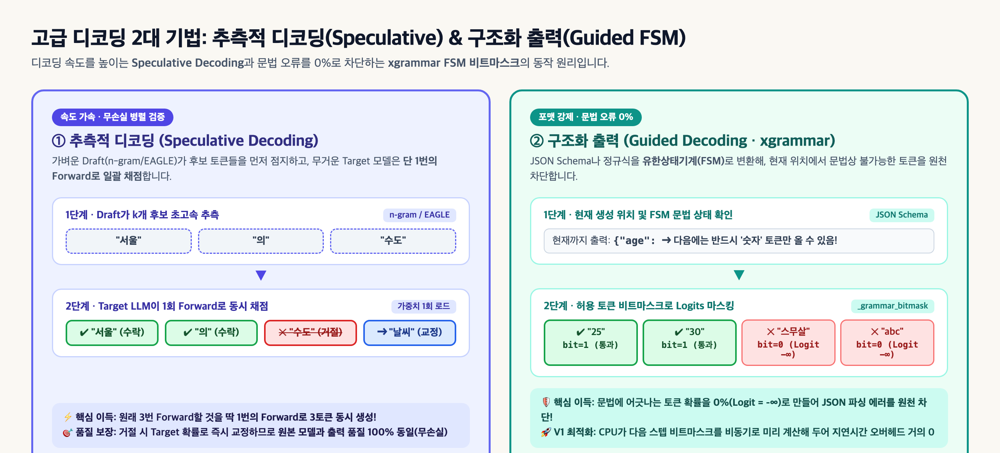

*그림 7-24. 추측적 디코딩(가벼운 Draft가 $k$개 토큰을 추측하고 무거운 Target이 1회 Forward로 일괄 검증)과 구조화 출력(XGrammar FSM 비트마스크로 문법 위반 토큰을 원천 차단)의 동작 원리. 출처: 직접 제작*

- **추측적 디코딩 (Speculative Decoding)**:
  - 디코딩 단계는 메모리 대역폭이 병목이라 토큰 1개를 넣든 5개를 묶어 넣든 거대 모델(Target)의 가중치를 1번 읽어 오는 시간은 거의 같습니다.
  - 이를 이용해 가벼운 Draft 메커니즘(`n-gram`, `EAGLE`, `Medusa`, 소형 모델 등)이 미래 토큰 $k$개를 빠르게 추측해 놓으면, 본 모델(Target)이 단 1번의 Forward 패스로 $k$개 토큰을 동시에 검증하여 수학적 출력 분포 손실 없이 생성 속도를 2~3배 가속합니다 [2].
- **구조화 출력 (Guided Decoding / FSM: `XGrammar`, `Outlines`)**:
  - 사용자가 지정한 JSON Schema나 정규식(Regex)을 유한상태기계(FSM, Finite State Machine)로 컴파일하여, 현재 상태에서 문법상 올 수 없는 토큰들의 확률(Logits)을 $-\infty$(확률 0%)로 마스킹함으로써 포맷 에러를 원천 차단합니다 [3] [2].
  - **외부 문법 엔진 활용 + vLLM 스케줄러 통합**: FSM 문법 변환 알고리즘 자체는 `XGrammar`(MLC 팀 개발, vLLM V1 기본 백엔드)나 `Outlines` 같은 외부 오픈소스 라이브러리를 사용하며, vLLM은 이를 연속 배칭 서버에서 병목 없이 구동하기 위해 ① 백그라운드 비동기 FSM 컴파일(`WAITING_FOR_FSM` 스케줄러 상태 관리)과 ② 어휘집 크기를 1/32로 압축한 비트마스크 텐서(`_grammar_bitmask`) GPU 마스킹 파이프라인(`StructuredOutputManager`)을 자체 구현하여 통합했습니다 [3] [4].

### 4.4 Prefill/Decode 분리(Disaggregated P/D) 및 내부 코드 이원화

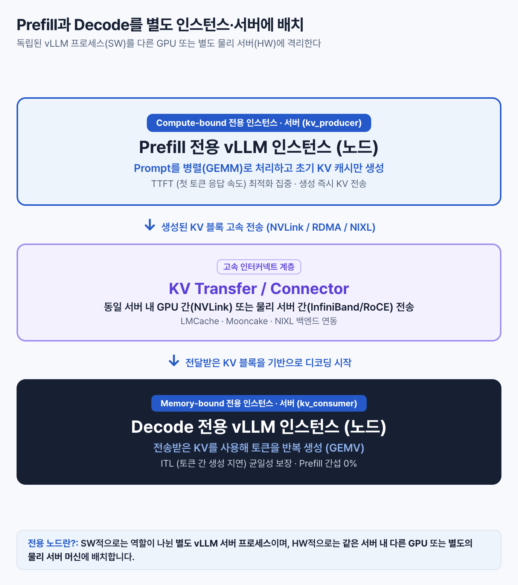

*그림 7-25. Prefill 전용 vLLM 인스턴스에서 생성된 초기 KV 캐시 블록을 고속 인터커넥트(NVLink / RDMA / NIXL)를 통해 Decode 전용 vLLM 인스턴스로 전송하는 Disaggregated P/D 구조. 출처: 직접 제작*

#### 클러스터 수준의 Disaggregated P/D: 소프트웨어 프로세스와 물리 서버 구성

기본(Default) 설정에서 vLLM은 1개의 엔진 인스턴스가 Prefill과 Decode를 함께 처리(Colocated)하지만, 대규모 프로덕션 환경에서는 첫 토큰 응답 시간(TTFT)과 토큰 간 생성 지연(ITL)의 상호 간섭을 없애기 위해 `--kv-transfer-config` 옵션으로 Prefill 전용 노드와 Decode 전용 노드를 분리 배포할 수 있습니다 [2]. 이때 전용 노드(인스턴스)의 의미는 다음과 같습니다.

1. **소프트웨어 측면 (필수 조건: 독립된 vLLM 서버 프로세스)**:
   - `--kv-transfer-config` 옵션에서 역할(`kv_producer` = Prefill 전용 vs `kv_consumer` = Decode 전용)을 나누어 실행한 별개의 독립된 vLLM 서버 프로세스(인스턴스)를 뜻합니다.
2. **하드웨어·서버 측면 (유연한 배치: 단일 서버 내 GPU 분할 또는 물리 서버 분리)**:
   - **단일 물리 서버 내 GPU 분리**: 8-GPU 서버 1대 안에서 `GPU 0~3`에는 Prefill 전용 vLLM 프로세스를, `GPU 4~7`에는 Decode 전용 vLLM 프로세스를 띄워 서버 내부 초고속 NVLink / P2P로 KV 캐시를 넘겨줄 수 있습니다.
   - **별도 물리 서버(Node) 간 분리**: 물리적인 GPU 서버 머신 자체를 Prefill 서버군과 Decode 서버군으로 나누어 배치하고, 서버 간 초고속 네트워크인 RDMA (InfiniBand / RoCE) 및 NVIDIA NIXL / LMCache / Mooncake 커넥터를 통해 완성된 KV 블록을 스트리밍 전송할 수도 있습니다 [2].

#### 단일 vLLM 엔진 내부에서의 Prefill/Decode 실행 경로 2대 이원화

클러스터를 외부적으로 분리하지 않은 단일 vLLM 인스턴스 내부에서도, Compute-bound인 Prefill과 Memory-bound인 Decode의 상반된 하드웨어 특성을 극대화하기 위해 `AttentionBackend`와 `GPUModelRunner`의 실행 경로가 두 가지 핵심 영역에서 이원화되어 있습니다 [3] [4].

| 내부 이원화 영역 | **Prefill 단계** (Compute-bound · 토큰 $N$개 동시 입력) | **Decode 단계** (Memory-bound · 요청당 토큰 1개 입력) |
|---|---|---|
| **① 어텐션 커널 분기** (`AttentionBackend`) | **행렬×행렬(GEMM) 특화 타일 커널 호출**: `flash_attn_varlen_func` 등을 호출하여 $N \times N$ 행렬 연산에 Tensor Core를 집중 가동합니다. | **벡터×행렬(GEMV) 메모리 로드 특화 커널 호출**: 과거 KV 블록들을 여러 조각으로 쪼개어 수백 개 SM 코어가 HBM에서 동시에 읽어 오는 `Split-KV` 전용 커널(`PagedAttention Decode` / `FlashInfer Decode`)을 호출합니다. |
| **② CUDA Graph 분리** (`GPUModelRunner`, 엔진 기본값: Graph 켜짐) | **일반 `Eager 모드` 또는 `Piecewise CUDA Graph` 실행**: 요청마다 프롬프트 토큰 길이가 달라 전체를 고정 그래프에 맞출 수 없으므로, 가변 길이 영향을 받는 Attention은 Eager로 실행하고 앞뒤 Linear·RMSNorm은 Piecewise CUDA Graph로 실행합니다. | **사전 캡처된 `CUDA Graph` 즉시 재생**: 요청당 입력 토큰이 항상 `1개`로 고정되어 있고 커널 실행 시간이 수 $\mu s$로 짧으므로, 부팅 시 배치 크기별로 미리 녹화해 둔 CUDA Graph를 단 1회 `cudaGraphLaunch`로 재생하여 CPU 커널 런치 오버헤드를 제거합니다. |

#### Decode 단계에서 `Split-KV` 커널을 사용하는 이유와 부분합 병합 원리

1. **Decode 단계에서 `Split-KV`를 사용하는 이유 (유휴 GPU SM 코어 총동원)**:
   - 최신 GPU(예: A100 108개, H100 132개) 안에는 100개 이상의 연산 코어 블록(SM, Streaming Multiprocessor)이 들어 있으며, 이 모든 SM이 동시에 메모리를 읽어 들여야 HBM의 최대 대역폭(2~3 TB/s)을 끌어낼 수 있습니다 [7].
   - **Prefill 단계**는 새로 들어온 Query 토큰이 수천 개이므로, Query 토큰들을 쪼개어 100개 이상의 SM에 골고루 나눠 주면 모든 코어가 동시에 가동됩니다.
   - 반면 **Decode 단계**는 새로 들어온 Query 토큰이 요청당 단 1개뿐이어서 Query 방향으로는 작업을 쪼갤 수 없습니다. 만약 스레드 블록(SM 1개)이 혼자서 과거 KV 캐시 블록 1번~100번을 처음부터 끝까지 순서대로 읽으면, 나머지 100여 개 SM 코어는 유휴 상태가 되고 메모리 읽기 시간이 크게 길어집니다. 따라서 과거 KV 캐시 블록들을 여러 조각(Split/Partition)으로 쪼개어 여러 SM 코어가 동시에 나눠 읽게 하는 `Split-KV`(FlashDecoding / PagedAttention V2) 기법을 사용합니다.
2. **단일 Query 토큰에 대해 과거 블록 1~100을 분할 계산하는 원리 (Online Softmax 부분합 병합)**:
   - 어텐션 수식($\text{Attention} = \frac{\sum_{i=1}^{100} e^{q \cdot k_i} v_i}{\sum_{i=1}^{100} e^{q \cdot k_i}}$)은 본질적으로 1번부터 100번 블록까지의 합산($\sum$)입니다.
   - 1개의 SM이 혼자 1번부터 100번까지 순서대로 읽으며 더하는 대신, 10개의 SM 코어가 동시에 10블록씩(`SM 1`은 1~10번, `SM 2`는 11~20번, ..., `SM 10`은 91~100번) 나눠 읽고 각자 부분합(Partial Sum: 구역 최댓값 $m_i$, 분모 지수합 $l_i$, 분자 가중치합 $o_i$)을 구한 뒤 마지막에 10개의 부분합만 하나로 합칩니다(Reduce).
   - 이를 통해 1~100번 블록 전체를 한 번에 읽은 것과 수학적으로 동일한 결과를 얻으면서 HBM 메모리 읽기 시간을 1/10로 단축합니다 (결합 수식은 5.1절을 참고합니다).

#### GPU 내부 `CUDA Core`와 `Tensor Core`의 역할 분담

GPU 칩(SM) 안에는 역할이 다른 두 종류의 연산 유닛이 함께 들어 있으며, 트랜스포머 레이어 안에서 교대로 분업합니다 [7]. ([2장](02-npu-hw-architecture-basic.md)에서 살펴본 NPU의 Vector Processor와 Tensor Processor의 분업 구조와 직접 대응됩니다.)

| 비교 항목 | **CUDA Core** (범용 스칼라 연산기) | **Tensor Core** (행렬 곱셈 전용 연산기) |
|---|---|---|
| **1클럭당 처리 단위** | 숫자 1개 $\times$ 숫자 1개 + 숫자 1개 ($a \times b + c$ 단건 스칼라 연산) | 행렬 타일 $\times$ 행렬 타일 + 행렬 ($D = A \times B + C$, 예: `16×16` 행렬 타일 일괄 계산) |
| **NPU 대응 유닛 ([2장](02-npu-hw-architecture-basic.md))** | Vector Processor (SIMD 원소 단위 연산) | Tensor / Matrix Processor (MAC Array / Systolic Array) |
| **수행 가능한 연산** | 사칙연산, 나눗셈, $\sqrt{x}$, $\exp(x)$, $\sin/\cos$, 비트 연산(`LOP3`), 조건문 등 모든 수학 연산 | 행렬 곱셈·누적(MMA) 연산 전용 (나눗셈이나 지수 함수 등은 불가능) |
| **연산 속도 (H100 SXM 기준)** | 약 **67 TFLOPS** (FP32) [7] | 약 **989 TFLOPS** (FP16) / **1,979 TFLOPS** (FP8) [7] |
| **vLLM / LLM 내 담당 업무** | 행렬 곱셈이 아닌 나머지 연산: `LayerNorm` / `RMSNorm`, `RoPE` ($\sin, \cos$), `SiLU` / `GeLU` 활성화 함수, `Softmax` ($\exp$), `Marlin` 4비트 즉석 압축 해제 및 `kv_scale` 복원 | 전체 연산량(FLOPs)의 90% 이상을 차지하는 행렬 곱셈(GEMM): `Q, K, V, Output` 선형 투영, `FFN` (`Up / Gate / Down`), `FlashAttention` 내부의 $Q \times K^T$ 및 $\text{Score} \times V$ |

```text
[토큰 입력]
  │
  ├─► [Tensor Core 가동] Q, K, V 가중치 행렬 곱셈 (Linear GEMM)
  ├─► [CUDA Core 가동]   RoPE 위치 회전 각도(sin, cos) 적용 및 FP8 kv_scale 압축/복원
  ├─► [Tensor Core 가동] Attention 내적 (Q × K^T 행렬 타일 곱셈)
  ├─► [CUDA Core 가동]   Online Softmax 지수(exp), 최댓값 보정 및 분모 나눗셈 계산
  ├─► [Tensor Core 가동] Attention 출력(Score × V) 및 FFN 거대 행렬 곱셈
  └─► [CUDA Core 가동]   SiLU 활성화 함수 및 RMSNorm(제곱평균제곱근 정규화)
```

## 5. 심화 부록

### 5.1 분할 Attention Softmax 결합 수식 원리

KV 블록들이 메모리상에 비연속적으로 흩어져 있거나 Decode 단계에서 `Split-KV`로 과거 블록(예: 1~50번 블록 파티션 1과 51~100번 블록 파티션 2)을 나누어 읽었을 때, 각 파티션의 부분합(Partial Sum)을 수학적 오차 없이 하나로 합치는 Online Softmax 리덕션 공식입니다.

각 파티션 $i \in \{1, 2\}$에서 구한 지역 최대 로짓(Max Logit)을 $m_i$, 지역 지수 합(Sum of Exponentials)을 $l_i = \sum_{j \in \text{Part } i} \exp(s_j - m_i)$, 지역 부분 출력 벡터를 $o_i$라 할 때, 두 파티션을 병합한 전체 최댓값 $m$, 전체 분모 $l$, 최종 어텐션 출력 벡터 $O$는 다음과 같이 계산됩니다.

$$m = \max(m_1, m_2)$$

$$l = \exp(m_1 - m) \cdot l_1 + \exp(m_2 - m) \cdot l_2$$

$$O = \frac{\exp(m_1 - m) \cdot l_1 \cdot o_1 + \exp(m_2 - m) \cdot l_2 \cdot o_2}{l}$$

이 수식을 통해 FP16/BF16 지수 연산($\exp$)의 오버플로우를 방지하면서도, 1~100번 블록 전체를 한 번에 읽어서 Softmax를 구한 것과 수학적으로 100% 동일한 결과를 얻을 수 있습니다.

### 5.2 2023 PagedAttention 원 논문 수치 및 KV 바이트 산술

SOSP 2023 원 논문 [1]에 제시된 OPT-13B 모델 기준 토큰 1개당 KV 캐시 바이트 산술은 다음과 같습니다.

$$\text{토큰 1개당 KV 크기} = 2 \text{ (K, V)} \times 40 \text{ layers} \times 5120 \text{ hidden dim} \times 2 \text{ bytes (FP16)} = 819,200 \text{ Bytes} = 800 \text{ KiB/token}$$

$$2,048 \text{ tokens 기준 요청당 예약 크기} = 800 \text{ KiB} \times 2048 = 1.5625 \text{ GiB}$$

기존 시스템에서는 요청마다 1.56 GiB의 연속 공간을 미리 잡아 두어 60~80%의 VRAM이 낭비되었으나, PagedAttention은 이를 16토큰(12.5 MiB) 블록 단위의 요구 페이징으로 전환하여 낭비율을 4% 미만으로 낮추고 서빙 처리량을 2~4배 이상 끌어올렸습니다 [1].

### 5.3 vLLM V1 소스 코드 탐색 가이드 (Commit `42172ad`)

주요 컴포넌트별 vLLM V1 소스 파일 위치는 다음과 같습니다 [3] [4].

1. [`vllm/v1/engine/core.py`](https://github.com/vllm-project/vllm/blob/42172ad/vllm/v1/engine/core.py): `EngineCore.step()` 파이프라인(Schedule $\to$ Model Execute $\to$ Postprocess)의 전체 루프를 조율합니다.
2. [`vllm/v1/core/sched/scheduler.py`](https://github.com/vllm-project/vllm/blob/42172ad/vllm/v1/core/sched/scheduler.py): 통합 토큰 예산 검사, `waiting`/`running` 큐 상태 전이 및 `Recompute` LIFO 선점 로직을 담당합니다.
3. [`vllm/v1/core/kv_cache_manager.py`](https://github.com/vllm-project/vllm/blob/42172ad/vllm/v1/core/kv_cache_manager.py): `allocate_slots`, `free_block_queue`, 참조 카운트(`ref_count`) 및 16토큰 Prefix 해시 체인을 관리합니다.
4. [`vllm/v1/worker/gpu_model_runner.py`](https://github.com/vllm-project/vllm/blob/42172ad/vllm/v1/worker/gpu_model_runner.py): 1차원 슈퍼 시퀀스 평탄화, `query_start_loc` 경계 인덱스 구성, Prefill/Decode 어텐션 메타데이터 생성 및 CUDA Graph 캡처·재생을 수행합니다.
5. [`vllm/v1/worker/block_table.py`](https://github.com/vllm-project/vllm/blob/42172ad/vllm/v1/worker/block_table.py): 논리 블록을 물리 슬롯 좌표로 변환하는 `compute_slot_mapping` 산술 커널을 포함합니다.
6. [`vllm/v1/engine/core_client.py`](https://github.com/vllm-project/vllm/blob/42172ad/vllm/v1/engine/core_client.py): 멀티 프로세스 ZMQ 클라이언트 및 데이터 병렬 로드밸런싱(`DPLBAsyncMPClient`) 라우팅을 수행합니다.

### 5.4 핵심 용어 정리

- **Prefill**: 사용자 프롬프트의 전체 토큰을 한꺼번에 병렬로 연산하여 초기 KV 캐시를 생성하는 Compute-bound(GEMM) 단계입니다.
- **Decode**: 직전에 생성된 단 1개의 토큰을 입력받아 다음 토큰을 1개씩 자기회귀적으로 생성하는 Memory-bound(GEMV) 단계입니다.
- **Continuous Batching**: 정적 배치가 모두 끝날 때까지 기다리지 않고, 매 토큰 생성 스텝(Iteration)마다 완료된 요청을 빼고 대기 요청을 즉시 투입하는 스케줄링 기법입니다.
- **CoW (Copy-on-Write)**: 여러 시퀀스가 동일한 물리 블록을 읽기 전용으로 공유하다가, 특정 시퀀스가 블록에 새로운 데이터를 덮어쓰려 할 때만 새 물리 블록으로 복제하여 분기하는 기법입니다.
- **Super-Sequence Flattening**: 길이가 다른 여러 문장을 빈칸 패딩(`PAD`) 없이 1차원 텐서로 이어 붙이고 `query_start_loc` 경계 인덱스로 구분하여 연산 낭비를 없애는 기법입니다.
- **SPMD (Single Program, Multiple Data)**: 텐서 병렬화(TP)에서 모든 워커가 동일한 코드와 동일한 입력 토큰 및 블록 테이블을 실행하되 각자 맡은 가중치(Head) 샤드만 계산하는 병렬 실행 모델입니다.
- **Weight Repacking**: 4비트 양자화 가중치(GPTQ/AWQ)를 모델 로드 시점에 워프와 Tensor Core 레지스터 레이아웃에 맞는 타일 순서로 미리 재배열하여 추론 중 스레드 간 레지스터 교환(Shuffle) 오버헤드를 제거하는 최적화 기법입니다.
- **Split-KV**: Decode 단계에서 1개의 Query 토큰에 대해 긴 과거 KV 캐시 블록들을 여러 조각으로 쪼개어 다수의 연산 코어가 병렬로 읽고 부분합을 구한 뒤 병합하는 디코드 어텐션 가속 기법입니다.

## 정리

- LLM 서빙에서 Prefill 단계는 연산력(Compute-bound)이, Decode 단계는 가중치와 KV 캐시를 읽어 오는 메모리 대역폭 및 용량(Memory-bound)이 핵심 병목이 됩니다.
- vLLM의 PagedAttention은 KV 캐시를 16토큰 고정 크기 비연속 블록으로 매핑하고 참조 카운트(`ref_count`) 기반 Copy-on-Write를 적용하여 메모리 낭비율을 60~80%에서 4% 미만으로 줄였습니다.
- 연속 배칭(Continuous Batching)과 1차원 슈퍼 시퀀스 평탄화(Super-Sequence Flattening)는 패딩 낭비 없이 매 스텝 동적으로 배치를 재구성하여 처리량을 극대화합니다.
- vLLM V1 아키텍처는 중앙 제어 평면(CPU 스케줄러·블록 매니저)과 분산 데이터 평면(워커)을 분리하고, 통합 토큰 예산 스케줄링, `Recompute` 단일 선점, Weight Repacking, Disaggregated P/D를 통해 프로덕션 서빙 효율을 높였습니다.

## 참고

1. Woosuk Kwon et al., [Efficient Memory Management for Large Language Model Serving with PagedAttention](https://arxiv.org/abs/2309.06180), SOSP, 2023.
2. 위키독스, [vLLM 완벽 가이드 Part 1~6](https://wikidocs.net/337217), 위키독스, 2026-11-10 확인.
3. Aleksa Gordić, [RosettaLens: vLLM V1 Architecture Deep Dive](https://rosettalens.com/s/ko/vllm), RosettaLens, 2026-11-10 확인.
4. vLLM Team, [vLLM V1 Source Code](https://github.com/vllm-project/vllm/tree/42172ad), GitHub Commit 42172ad, 2025.
5. 판교알토, [PagedAttention 논문 리뷰](https://pangyoalto.com/pagedattetion-review/), 판교알토 기술 블로그, 2026-11-10 확인.
6. vLLM Team, [vLLM Distributed Serving Documentation](https://docs.vllm.ai/en/latest/serving/distributed_serving.html), vLLM Documentation, 2026-11-10 확인.
7. NVIDIA, [NVIDIA H100 Tensor Core GPU Architecture Whitepaper](https://resources.nvidia.com/en-us-tensor-core), v1.04, 2022.
