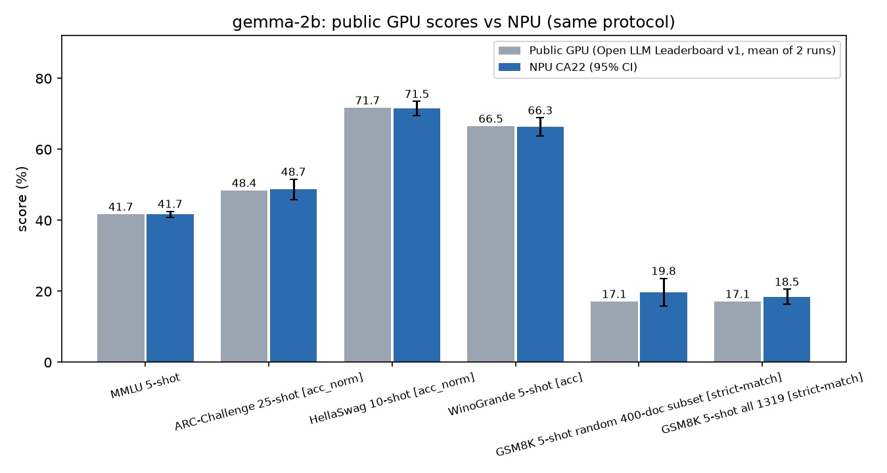
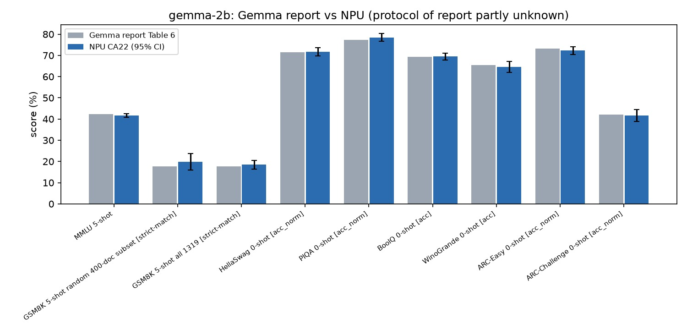

# 10. 벤치마크 모음

## 개요

랩에서 측정한 벤치마크를 한곳에 모읍니다. 모두 추정이 아닌 실제 측정값이며, 측정 조건을 함께 적어 재현 가능하게 합니다.

## 1. 측정 방법(공통)

모든 결과는 같은 기준으로 측정합니다.

> 📝 실습 채움: 측정 도구, 입력 크기, 반복 횟수, latency/throughput 정의.

## 2. 모델별 결과

> 📝 실습 채움: 표로 누적

| 모델 | 정밀도 | 배치 | latency | throughput | 비고 |
|---|---|---|---|---|---|
| (예) ResNet-50 | INT8 | 1 | - | - | - |

## 3. LLM 서빙 결과

> 📝 실습 채움: 파라미터별(max_num_seqs 등) 처리량/지연 비교.

## 4. gemma-2b 결정론적 벤치마크: 공개 GPU 수치와 비교

GPU에서 평가된 gemma-2b의 공개 벤치마크 점수가 NPU에서 같은 프로토콜로 돌려도 나오는지 확인한 절입니다. 소규모 정확도 비교는 [05. 비전·NLP 모델 구동기](05-vision-nlp.md)에서 다뤘습니다.

### 4.1 공개 수치와 프로토콜

공개 수치는 서로 프로토콜이 달라 두 표로 나눕니다. 표 4-1과 표 4-2는 섞어 비교하지 않습니다. 평가 날짜는 2026-11-02입니다.

Hugging Face Open LLM Leaderboard v1(아카이브)의 `google/gemma-2b` 결과 JSON 2개에서 가져온 값입니다[1]. 평가 도구는 EleutherAI lm-evaluation-harness의 특정 커밋(`b281b0921b636bc36ad05c0b0b0763bd6dd43463`)이고, 실행 환경은 H100 8장 한 노드로 적혀 있습니다[2]. 두 실행의 차이는 모델 dtype으로, 02-16 실행은 bfloat16, 02-22 실행은 float16입니다. 같은 모델을 두 번 돌려도 점수가 이만큼 움직인다는 것이 GPU 쪽 재현성 폭입니다.

| 벤치마크 | few-shot | 지표 | 실행 1 (bf16) | 실행 2 (fp16) | 두 실행 평균 |
|---|---|---|---|---|---|
| ARC-Challenge | 25 | acc_norm | 48.46 | 48.38 | 48.42 |
| HellaSwag | 10 | acc_norm | 71.65 | 71.77 | 71.71 |
| MMLU (57과목 단순 평균) | 5 | acc | 41.68 | 41.77 | 41.73 |
| WinoGrande | 5 | acc | 66.77 | 66.30 | 66.53 |
| GSM8K | 5 | acc | 17.36 | 16.91 | 17.13 |
| TruthfulQA | 0 | mc2 | 33.13 | 33.08 | 33.10 |

*표 4-1. Open LLM Leaderboard v1의 gemma-2b 결과(실행 2회). MMLU는 JSON의 57개 과목 acc를 직접 단순 평균했습니다. 출처: [1]*

Gemma 기술 보고서의 값입니다[3]. 보고서는 평가 도구, 프롬프트 형식, 지표(acc 또는 acc_norm)를 명시하지 않아 이 항목들은 확인하지 못했습니다.

| 벤치마크 | 표에 적힌 설정 | Gemma 2B |
|---|---|---|
| MMLU | 5-shot, top-1 | 42.3 |
| HellaSwag | 0-shot | 71.4 |
| PIQA | 0-shot | 77.3 |
| BoolQ | 0-shot | 69.4 |
| WinoGrande | partial scoring (shot 수 미기재) | 65.4 |
| ARC-e | 설정 미기재 | 73.2 |
| ARC-c | 설정 미기재 | 42.1 |
| GSM8K | maj@1 (shot 수 미기재) | 17.7 |

*표 4-2. Gemma 기술 보고서의 Gemma 2B 결과. 출처: [3] Table 6*

같은 프로토콜로 맞춰 볼 수 있는 쌍은 리더보드와 같은 few-shot 설정의 MMLU 5-shot, ARC-Challenge 25-shot, HellaSwag 10-shot, WinoGrande 5-shot, GSM8K 5-shot입니다(표 4-1). MMLU는 표 4-2도 5-shot이지만 채점과 프롬프트 세부는 확인하지 못했습니다.

### 4.2 평가 방법

EleutherAI lm-evaluation-harness 0.4.13에 NPU용 모델 래퍼를 붙여, 정답 판정에 LLM 심판이 필요 없는 결정론적 벤치마크(객관식 로그우도, GSM8K 정답 일치)만 평가했습니다. few-shot 시드는 1234이고 각 평가는 한 번씩 실행했습니다. 모든 프롬프트에 BOS 토큰을 붙였습니다.

- 장치와 환경: Rebellions RBLN-CA22 1장, rebel-compiler·optimum-rbln 0.10.1, torch 2.9.0+cpu, transformers 4.57.6. 05장과 같은 컴파일 모델 두 개(마지막 위치 로짓 모델, 전체 위치 로짓 모델)를 썼고 새로 컴파일하지 않았습니다. 서버에는 GPU가 없습니다.
- 판정 기준: |NPU − 공개| ≤ 1.96 × √(SE_NPU² + SE_공개²)이면 "일치"로 봅니다. SE는 정답률의 이항 표준오차이고 공개 쪽 표본 수는 원 벤치마크 전체 문항 수입니다. 두 평가가 같은 문항을 푼 값이므로 실제 오차는 이보다 작아 보수적인 기준입니다.
- HellaSwag는 전체 10,042문항 중 시드 42로 뽑은 2,000문항만 평가했습니다.
- 내부 기준선으로, NPU 실행에 쓴 프롬프트를 CPU PyTorch fp32 모델로 다시 채점했습니다. GPU 실측이 없어 CPU fp32가 같은 프롬프트의 기준 역할을 합니다.

### 4.3 프로토콜 A: 리더보드와 같은 few-shot·지표

| 벤치마크 | 문항 수 | NPU 점수 (95% CI, %p) | 공개 GPU 평균 (실행 1 / 실행 2) | 차이 | 허용 폭 | 판정 |
|---|---|---|---|---|---|---|
| MMLU 5-shot (57과목 단순 평균, acc) | 14,042 | 41.71 ± 0.82 | 41.73 (41.68 / 41.77) | -0.02 | ±1.15 | 일치 |
| ARC-Challenge 25-shot (acc_norm) | 1,172 | 48.72 ± 2.86 | 48.42 (48.46 / 48.38) | +0.30 | ±4.05 | 일치 |
| HellaSwag 10-shot (acc_norm) | 2,000 | 71.55 ± 1.98 | 71.71 (71.65 / 71.77) | -0.16 | ±2.16 | 일치 |
| WinoGrande 5-shot (acc) | 1,267 | 66.30 ± 2.60 | 66.53 (66.77 / 66.30) | -0.24 | ±3.68 | 일치 |
| GSM8K 5-shot (strict-match) | 1,319 | 18.50 ± 2.10 | 17.13 (17.36 / 16.91) | +1.36 | ±2.92 | 일치 |
| GSM8K 5-shot (flexible-extract) | 1,319 | 18.42 ± 2.09 | 17.13 (17.36 / 16.91) | +1.29 | ±2.92 | 일치 |

*표 4-3. gemma-2b의 NPU 점수와 리더보드 v1 공개 점수(두 실행 평균) 비교. 공개 수치 출처: [1]*

*그림 4-1. 프로토콜 A의 NPU와 공개 GPU 점수 비교. 출처: 직접 제작*

- 표의 5개 벤치마크가 모두 허용 폭 안에서 일치했습니다. GSM8K는 strict-match 행을 기준으로 셉니다.
- 차이는 -0.24~+1.36%p입니다. 리더보드가 같은 모델을 두 번 돌린 결과끼리의 차이(0.1~0.5%p)와 비교하면 MMLU, HellaSwag, WinoGrande는 같은 규모이고 ARC-Challenge(+0.30)와 GSM8K(+1.36)는 더 큽니다. 이 차이가 NPU 때문인지 하네스와 few-shot 예시 차이 때문인지는 가르지 못했습니다.
- GSM8K는 정답이 약 18%여서 1,319문항으로는 표준오차가 크고, 허용 폭이 ±2.92%p로 넓어 변별력이 약합니다.
- MMLU는 문항 전체 가중 평균(micro)이 40.97%이고 57과목 단순 평균이 41.71%입니다. 리더보드 값은 단순 평균이므로 표에는 단순 평균을 실었습니다.
- MMLU 57과목 각각도 공개 값과 비교했습니다. 과목별 절대차는 평균 0.89%p, 최대 3.50%p(high_school_computer_science)이고 상관계수는 0.993이며 57과목 모두 표본오차(1.96σ) 안이었습니다. 리더보드 두 실행 사이의 과목별 절대차 평균은 0.76%p여서, NPU와 GPU의 차이가 GPU끼리 재실행한 차이와 비슷한 크기입니다.

### 4.4 프로토콜 B: Gemma 기술 보고서

보고서는 평가 도구, 프롬프트, 지표를 밝히지 않아 프로토콜이 같다는 보장이 없습니다. 보고서가 적은 shot 수에 맞춰 lm-eval 기본 프롬프트로 돌린 결과와의 참고 비교입니다. ARC-Easy와 ARC-Challenge는 shot 수도 적혀 있지 않아 0-shot으로 돌렸습니다. 지표가 확정되지 않은 항목은 acc와 acc_norm을 모두 적었습니다.

| 벤치마크 | 문항 수 | NPU 점수 (95% CI, %p) | Gemma 보고서 | 차이 | 허용 폭 | 판정 |
|---|---|---|---|---|---|---|
| MMLU 5-shot (acc) | 14,042 | 41.71 ± 0.82 | 42.30 | -0.59 | ±1.15 | 일치 |
| GSM8K 5-shot (strict-match) | 1,319 | 18.50 ± 2.10 | 17.70 | +0.80 | ±2.94 | 일치 |
| GSM8K 5-shot (flexible-extract) | 1,319 | 18.42 ± 2.09 | 17.70 | +0.72 | ±2.94 | 일치 |
| HellaSwag 0-shot (acc_norm) | 2,000 | 71.75 ± 1.97 | 71.40 | +0.35 | ±2.16 | 일치 |
| HellaSwag 0-shot (acc) | 2,000 | 54.10 ± 2.18 | 71.40 | -17.30 | ±2.36 | 불일치 (지표 차이로 추정, 비교 부적합) |
| PIQA 0-shot (acc) | 1,838 | 77.09 ± 1.92 | 77.30 | -0.21 | ±2.71 | 일치 |
| PIQA 0-shot (acc_norm) | 1,838 | 78.45 ± 1.88 | 77.30 | +1.15 | ±2.68 | 일치 |
| BoolQ 0-shot (acc) | 3,270 | 69.48 ± 1.58 | 69.40 | +0.08 | ±2.23 | 일치 |
| WinoGrande 0-shot (acc) | 1,267 | 64.64 ± 2.63 | 65.40 | -0.76 | ±3.71 | 일치 |
| ARC-Easy 0-shot (acc) | 2,376 | 74.07 ± 1.76 | 73.20 | +0.87 | ±2.51 | 일치 |
| ARC-Easy 0-shot (acc_norm) | 2,376 | 72.31 ± 1.80 | 73.20 | -0.89 | ±2.53 | 일치 |
| ARC-Challenge 0-shot (acc_norm) | 1,172 | 41.64 ± 2.82 | 42.10 | -0.46 | ±3.99 | 일치 |
| ARC-Challenge 0-shot (acc) | 1,172 | 40.87 ± 2.81 | 42.10 | -1.23 | ±3.99 | 일치 |

*표 4-4. gemma-2b의 NPU 점수와 Gemma 기술 보고서 점수 비교. 보고서 수치 출처: [3] Table 6*

*그림 4-2. 프로토콜 B의 NPU와 보고서 점수 비교. 지표가 확정되지 않은 항목은 acc_norm이 있으면 acc_norm을, 없으면 acc를 표시했습니다. 출처: 직접 제작*

- HellaSwag 0-shot의 비정규화 acc(54.10%)는 보고서 71.4%와 크게 다르고, 길이 정규화 acc_norm(71.75%)은 일치합니다. 보고서가 acc_norm 계열 지표를 썼을 것으로 추정하지만 보고서에 지표가 없어 확인하지 못했습니다. 그래서 비정규화 행은 비교 부적합으로 표시했습니다.
- PIQA와 ARC-Easy는 acc와 acc_norm이 갈리지만 두 지표 모두 허용 폭 안입니다.
- 보고서 MMLU(42.3%)와 NPU 값(41.71%)의 차이 -0.59%p는 허용 폭 안이며 원인은 확인하지 못했습니다.

### 4.5 내부 기준선: 같은 프롬프트의 NPU와 CPU fp32

NPU 실행에 기록된 프롬프트(few-shot 문맥 포함)를 CPU fp32로 그대로 다시 채점했습니다. 문항은 NPU 문항 중 시드 42 순열의 앞 n개입니다. CPU 연산이 느려 문항 수가 작으므로 일치율의 오차는 큽니다.

| 벤치마크 | 지표 | 문항 수 | NPU 정확도 (%) | CPU fp32 정확도 (%) | 예측 일치율 | NPU만 정답 / CPU만 정답 | 로그우도 평균 절대차 (nat) | 로그우도 최대 절대차 (nat) |
|---|---|---|---|---|---|---|---|---|
| ARC-Challenge 25-shot | acc | 200 | 48.0 | 49.0 | 98.5% | 0 / 2 | 0.058 | 0.318 |
| ARC-Challenge 25-shot | acc_norm | 200 | 47.5 | 47.5 | 99.5% | 0 / 0 | 0.058 | 0.318 |
| ARC-Easy 0-shot | acc | 100 | 67.0 | 68.0 | 99.0% | 0 / 1 | 0.061 | 0.289 |
| ARC-Easy 0-shot | acc_norm | 100 | 71.0 | 73.0 | 98.0% | 0 / 2 | 0.061 | 0.289 |
| BoolQ 0-shot | acc | 100 | 71.0 | 69.0 | 98.0% | 2 / 0 | 0.031 | 0.144 |
| GSM8K 5-shot | strict | 10 | 30.0 | 30.0 | 100.0% | 0 / 0 | | |
| HellaSwag 10-shot | acc | 84 | 51.2 | 51.2 | 100.0% | 0 / 0 | 0.109 | 0.661 |
| HellaSwag 10-shot | acc_norm | 84 | 64.3 | 64.3 | 100.0% | 0 / 0 | 0.109 | 0.661 |
| MMLU 5-shot | acc | 250 | 40.0 | 40.0 | 92.8% | 4 / 4 | 0.019 | 0.165 |
| PIQA 0-shot | acc | 100 | 76.0 | 74.0 | 98.0% | 2 / 0 | 0.122 | 0.801 |
| PIQA 0-shot | acc_norm | 100 | 76.0 | 77.0 | 99.0% | 0 / 1 | 0.122 | 0.801 |
| WinoGrande 5-shot | acc | 100 | 59.0 | 59.0 | 98.0% | 1 / 1 | 0.057 | 0.313 |

*표 4-5. 같은 프롬프트에서 NPU와 CPU fp32의 비교. 출처: 직접 측정*

- MMLU는 보기 4개의 확률이 서로 가까운 문항이 많아 일치율이 92.8%로 가장 낮습니다. CPU 기준 1·2위 로그확률 차가 0.1nat 미만인 문항이 32.8%였고, 갈라진 문항의 차이 중앙값은 0.015nat이었습니다. NPU만 맞힌 문항 4개와 CPU만 맞힌 문항 4개가 같아 정확도는 같았습니다.
- ARC-Challenge 25-shot은 1·2위 차가 0.1nat 미만인 문항이 4.0%뿐이어서 일치율이 98.5%로 높았습니다.
- GSM8K는 10문항을 생성시켜 비교했고 생성 텍스트가 같은 문항이 70%, 정답 판정이 같은 문항이 100%였습니다. 문항이 너무 적어 참고로만 봅니다.
- 로그우도 평균 절대차는 0.019~0.122nat이며, 05장의 wikitext-2 perplexity 차이(+0.04%)와 모순되지 않습니다.
- 점수가 일치한다는 것이 문항별 답이 같다는 뜻은 아닙니다. 근소한 차이 문항은 NPU와 CPU가 다르게 고르고, 이 차이가 평균 점수에서는 양방향으로 상쇄되었습니다.

### 4.6 한계

- GPU에서 직접 돌린 값은 없습니다. 공개 수치만 비교했으므로 플랫폼 차이와 프로토콜 차이를 같은 프롬프트의 GPU 실측으로 나누지 못했습니다. CPU fp32 기준선으로 NPU 쪽 수치 편차만 확인했습니다.
- 리더보드는 lm-evaluation-harness 커밋 `b281b09`를, 이 평가는 0.4.13을 썼습니다. few-shot 예시 선택, 프롬프트 세부, 데이터셋 사본이 다를 수 있습니다. 이 차이를 분리한 실험은 하지 않았습니다. 이 평가에는 BOS 토큰을 붙였고 리더보드의 BOS 처리는 확인하지 못했습니다.
- HellaSwag는 NPU로 2,000문항(전체의 약 20%)만 평가했습니다. GSM8K는 전체 문항이지만 허용 폭이 넓습니다. 공개 GSM8K 값의 채점 방식이 lm-eval 0.4.13의 strict-match와 flexible-extract와 같은지는 확인하지 못했습니다.
- CPU 기준선은 문항 수가 작습니다. HellaSwag 10-shot, WinoGrande 5-shot, GSM8K는 CPU 연산이 느려 특히 작게 잡았습니다.
- 각 평가는 시드를 고정해 한 번씩 실행했습니다. NPU 모델 두 경로(마지막 위치와 전체 위치 로짓)를 섞어 쓴 영향을 경로별로 분리해 평가하지 않았습니다. 두 경로의 로그확률 차는 무작위 토큰 조합에서 최대 약 0.3nat이었습니다.
- NPU 내부 연산 정밀도는 확인하지 못했습니다. 컴파일 설정의 dtype은 float32입니다.
- TruthfulQA는 평가하지 않았습니다. 속도와 전력은 이 절의 범위가 아닙니다.

## 참고

1. Hugging Face, [open-llm-leaderboard-old/results, google/gemma-2b 결과 JSON 2개](https://huggingface.co/datasets/open-llm-leaderboard-old/results/tree/main/google/gemma-2b), 2024-02-16·2024-02-22 실행, 2026-11-02 확인.
2. Hugging Face, [Open LLM Leaderboard (old) About](https://huggingface.co/spaces/open-llm-leaderboard-old/open_llm_leaderboard/raw/main/src/display/about.py), 2026-11-02 확인.
3. Gemma Team, [Gemma: Open Models Based on Gemini Research and Technology](https://arxiv.org/abs/2403.08295), Table 6, 2024.
