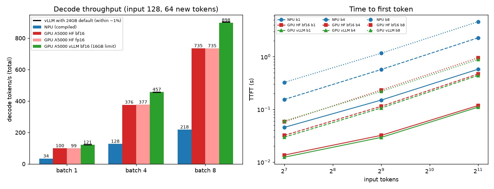
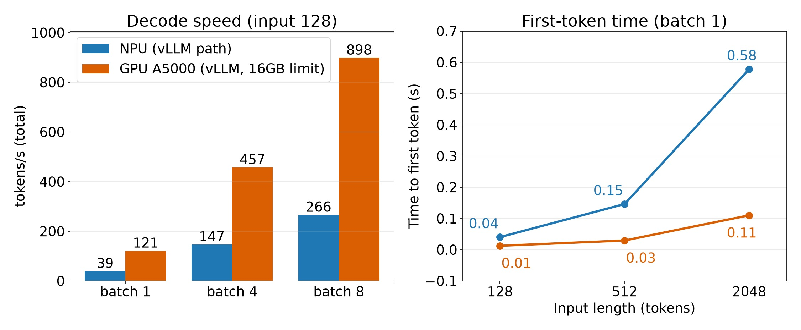
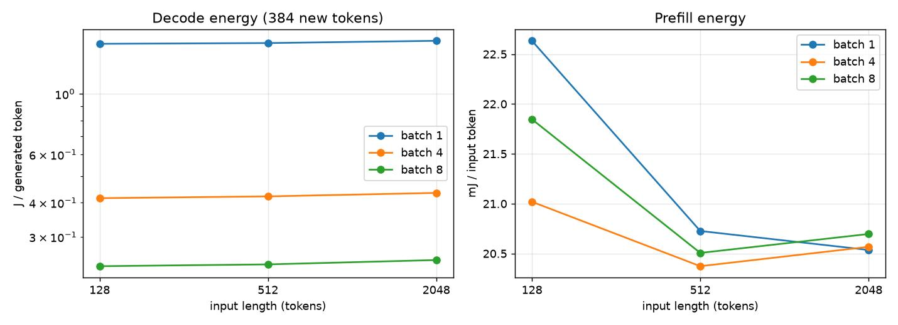
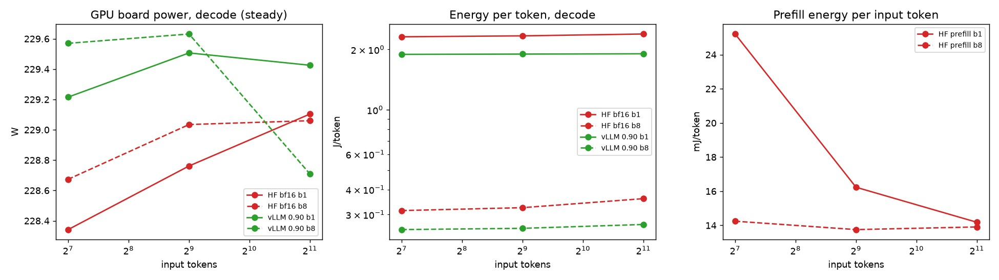
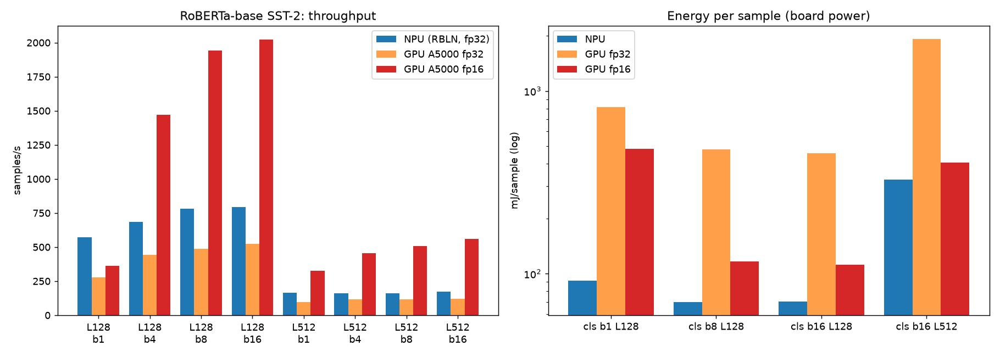

# 10. 벤치마크 모음

## 개요

랩에서 측정한 벤치마크를 한곳에 모읍니다. 모두 추정이 아닌 실제 측정값이며, 측정 조건을 함께 적어 재현 가능하게 합니다.

## 1. 측정 방법(공통)

모든 결과는 같은 기준으로 측정합니다.

> 📝 실습 채움: 측정 도구, 입력 크기, 반복 횟수, latency/throughput 정의.

## 2. 모델별 결과

> 📝 실습 채움: 표로 누적

| 모델 | 정밀도 | 배치 | latency | throughput | 비고 |
|---|---|---|---|---|---|
| (예) ResNet-50 | INT8 | 1 | - | - | - |

## 3. LLM 서빙 결과

> 📝 실습 채움: 파라미터별(max_num_seqs 등) 처리량/지연 비교.

## 4. gemma-2b 결정론적 벤치마크: 공개 GPU 수치와 비교

GPU에서 평가된 gemma-2b의 공개 벤치마크 점수가 NPU에서 같은 프로토콜로 돌려도 나오는지 확인한 절입니다. 소규모 정확도 비교는 [05. 비전·NLP 모델 구동기](05-vision-nlp.md)에서 다뤘습니다.

### 4.1 공개 수치와 프로토콜

공개 수치는 서로 프로토콜이 달라 두 표로 나눕니다. 표 4-1과 표 4-2는 섞어 비교하지 않습니다. 평가 날짜는 2026-11-02입니다.

Hugging Face Open LLM Leaderboard v1(아카이브)의 `google/gemma-2b` 결과 JSON 2개에서 가져온 값입니다[1]. 평가 도구는 EleutherAI lm-evaluation-harness의 특정 커밋(`b281b0921b636bc36ad05c0b0b0763bd6dd43463`)이고, 실행 환경은 H100 8장 한 노드로 적혀 있습니다[2]. 두 실행의 차이는 모델 dtype으로, 02-16 실행은 bfloat16, 02-22 실행은 float16입니다. 같은 모델을 두 번 돌려도 점수가 이만큼 움직인다는 것이 GPU 쪽 재현성 폭입니다.

| 벤치마크 | few-shot | 지표 | 실행 1 (bf16) | 실행 2 (fp16) | 두 실행 평균 |
|---|---|---|---|---|---|
| ARC-Challenge | 25 | acc_norm | 48.46 | 48.38 | 48.42 |
| HellaSwag | 10 | acc_norm | 71.65 | 71.77 | 71.71 |
| MMLU (57과목 단순 평균) | 5 | acc | 41.68 | 41.77 | 41.73 |
| WinoGrande | 5 | acc | 66.77 | 66.30 | 66.53 |
| GSM8K | 5 | acc | 17.36 | 16.91 | 17.13 |
| TruthfulQA | 0 | mc2 | 33.13 | 33.08 | 33.10 |

*표 4-1. Open LLM Leaderboard v1의 gemma-2b 결과(실행 2회). MMLU는 JSON의 57개 과목 acc를 직접 단순 평균했습니다. 출처: [1]*

Gemma 기술 보고서의 값입니다[3]. 보고서는 평가 도구, 프롬프트 형식, 지표(acc 또는 acc_norm)를 명시하지 않아 이 항목들은 확인하지 못했습니다.

| 벤치마크 | 표에 적힌 설정 | Gemma 2B |
|---|---|---|
| MMLU | 5-shot, top-1 | 42.3 |
| HellaSwag | 0-shot | 71.4 |
| PIQA | 0-shot | 77.3 |
| BoolQ | 0-shot | 69.4 |
| WinoGrande | partial scoring (shot 수 미기재) | 65.4 |
| ARC-e | 설정 미기재 | 73.2 |
| ARC-c | 설정 미기재 | 42.1 |
| GSM8K | maj@1 (shot 수 미기재) | 17.7 |

*표 4-2. Gemma 기술 보고서의 Gemma 2B 결과. 출처: [3] Table 6*

같은 프로토콜로 맞춰 볼 수 있는 쌍은 리더보드와 같은 few-shot 설정의 MMLU 5-shot, ARC-Challenge 25-shot, HellaSwag 10-shot, WinoGrande 5-shot, GSM8K 5-shot입니다(표 4-1). MMLU는 표 4-2도 5-shot이지만 채점과 프롬프트 세부는 확인하지 못했습니다.

### 4.2 평가 방법

EleutherAI lm-evaluation-harness 0.4.13에 NPU용 모델 래퍼를 붙여, 정답 판정에 LLM 심판이 필요 없는 결정론적 벤치마크(객관식 로그우도, GSM8K 정답 일치)만 평가했습니다. few-shot 시드는 1234이고 각 평가는 한 번씩 실행했습니다. 모든 프롬프트에 BOS 토큰을 붙였습니다.

- 장치와 환경: Rebellions RBLN-CA22 1장, rebel-compiler·optimum-rbln 0.10.1, torch 2.9.0+cpu, transformers 4.57.6. 05장과 같은 컴파일 모델 두 개(마지막 위치 로짓 모델, 전체 위치 로짓 모델)를 썼고 새로 컴파일하지 않았습니다. NPU를 단 서버에는 GPU가 없습니다.
- 판정 기준: |NPU − 공개| ≤ 1.96 × √(SE_NPU² + SE_공개²)이면 "일치"로 봅니다. SE는 정답률의 이항 표준오차이고 공개 쪽 표본 수는 원 벤치마크 전체 문항 수입니다. 두 평가가 같은 문항을 푼 값이므로 실제 오차는 이보다 작아 보수적인 기준입니다.
- HellaSwag는 전체 10,042문항 중 시드 42로 뽑은 2,000문항만 평가했습니다.
- 내부 기준선으로, NPU 실행에 쓴 프롬프트를 CPU PyTorch fp32 모델로 다시 채점했습니다. GPU에서 정확도를 직접 재지 않았으므로 CPU fp32가 같은 프롬프트의 기준 역할을 합니다.

### 4.3 프로토콜 A: 리더보드와 같은 few-shot·지표

| 벤치마크 | 문항 수 | NPU 점수 (95% CI, %p) | 공개 GPU 평균 (실행 1 / 실행 2) | 차이 | 허용 폭 | 판정 |
|---|---|---|---|---|---|---|
| MMLU 5-shot (57과목 단순 평균, acc) | 14,042 | 41.71 ± 0.82 | 41.73 (41.68 / 41.77) | -0.02 | ±1.15 | 일치 |
| ARC-Challenge 25-shot (acc_norm) | 1,172 | 48.72 ± 2.86 | 48.42 (48.46 / 48.38) | +0.30 | ±4.05 | 일치 |
| HellaSwag 10-shot (acc_norm) | 2,000 | 71.55 ± 1.98 | 71.71 (71.65 / 71.77) | -0.16 | ±2.16 | 일치 |
| WinoGrande 5-shot (acc) | 1,267 | 66.30 ± 2.60 | 66.53 (66.77 / 66.30) | -0.24 | ±3.68 | 일치 |
| GSM8K 5-shot (strict-match) | 1,319 | 18.50 ± 2.10 | 17.13 (17.36 / 16.91) | +1.36 | ±2.92 | 일치 |
| GSM8K 5-shot (flexible-extract) | 1,319 | 18.42 ± 2.09 | 17.13 (17.36 / 16.91) | +1.29 | ±2.92 | 일치 |

*표 4-3. gemma-2b의 NPU 점수와 리더보드 v1 공개 점수(두 실행 평균) 비교. 공개 수치 출처: [1]*

*그림 4-1. 프로토콜 A의 NPU와 공개 GPU 점수 비교. 출처: 직접 제작*

- 표의 5개 벤치마크가 모두 허용 폭 안에서 일치했습니다. GSM8K는 strict-match 행을 기준으로 셉니다.
- 차이는 -0.24~+1.36%p입니다. 리더보드가 같은 모델을 두 번 돌린 결과끼리의 차이(0.1~0.5%p)와 비교하면 MMLU, HellaSwag, WinoGrande는 같은 규모이고 ARC-Challenge(+0.30)와 GSM8K(+1.36)는 더 큽니다. 이 차이가 NPU 때문인지 하네스와 few-shot 예시 차이 때문인지는 가르지 못했습니다.
- GSM8K는 정답이 약 18%여서 1,319문항으로는 표준오차가 크고, 허용 폭이 ±2.92%p로 넓어 변별력이 약합니다.
- MMLU는 문항 전체 가중 평균(micro)이 40.97%이고 57과목 단순 평균이 41.71%입니다. 리더보드 값은 단순 평균이므로 표에는 단순 평균을 실었습니다.
- MMLU 57과목 각각도 공개 값과 비교했습니다. 과목별 절대차는 평균 0.89%p, 최대 3.50%p(high_school_computer_science)이고 상관계수는 0.993이며 57과목 모두 표본오차(1.96σ) 안이었습니다. 리더보드 두 실행 사이의 과목별 절대차 평균은 0.76%p여서, NPU와 GPU의 차이가 GPU끼리 재실행한 차이와 비슷한 크기입니다.

### 4.4 프로토콜 B: Gemma 기술 보고서

보고서는 평가 도구, 프롬프트, 지표를 밝히지 않아 프로토콜이 같다는 보장이 없습니다. 보고서가 적은 shot 수에 맞춰 lm-eval 기본 프롬프트로 돌린 결과와의 참고 비교입니다. ARC-Easy와 ARC-Challenge는 shot 수도 적혀 있지 않아 0-shot으로 돌렸습니다. 지표가 확정되지 않은 항목은 acc와 acc_norm을 모두 적었습니다.

| 벤치마크 | 문항 수 | NPU 점수 (95% CI, %p) | Gemma 보고서 | 차이 | 허용 폭 | 판정 |
|---|---|---|---|---|---|---|
| MMLU 5-shot (acc) | 14,042 | 41.71 ± 0.82 | 42.30 | -0.59 | ±1.15 | 일치 |
| GSM8K 5-shot (strict-match) | 1,319 | 18.50 ± 2.10 | 17.70 | +0.80 | ±2.94 | 일치 |
| GSM8K 5-shot (flexible-extract) | 1,319 | 18.42 ± 2.09 | 17.70 | +0.72 | ±2.94 | 일치 |
| HellaSwag 0-shot (acc_norm) | 2,000 | 71.75 ± 1.97 | 71.40 | +0.35 | ±2.16 | 일치 |
| HellaSwag 0-shot (acc) | 2,000 | 54.10 ± 2.18 | 71.40 | -17.30 | ±2.36 | 불일치 (지표 차이로 추정, 비교 부적합) |
| PIQA 0-shot (acc) | 1,838 | 77.09 ± 1.92 | 77.30 | -0.21 | ±2.71 | 일치 |
| PIQA 0-shot (acc_norm) | 1,838 | 78.45 ± 1.88 | 77.30 | +1.15 | ±2.68 | 일치 |
| BoolQ 0-shot (acc) | 3,270 | 69.48 ± 1.58 | 69.40 | +0.08 | ±2.23 | 일치 |
| WinoGrande 0-shot (acc) | 1,267 | 64.64 ± 2.63 | 65.40 | -0.76 | ±3.71 | 일치 |
| ARC-Easy 0-shot (acc) | 2,376 | 74.07 ± 1.76 | 73.20 | +0.87 | ±2.51 | 일치 |
| ARC-Easy 0-shot (acc_norm) | 2,376 | 72.31 ± 1.80 | 73.20 | -0.89 | ±2.53 | 일치 |
| ARC-Challenge 0-shot (acc_norm) | 1,172 | 41.64 ± 2.82 | 42.10 | -0.46 | ±3.99 | 일치 |
| ARC-Challenge 0-shot (acc) | 1,172 | 40.87 ± 2.81 | 42.10 | -1.23 | ±3.99 | 일치 |

*표 4-4. gemma-2b의 NPU 점수와 Gemma 기술 보고서 점수 비교. 보고서 수치 출처: [3] Table 6*

*그림 4-2. 프로토콜 B의 NPU와 보고서 점수 비교. 지표가 확정되지 않은 항목은 acc_norm이 있으면 acc_norm을, 없으면 acc를 표시했습니다. 출처: 직접 제작*

- HellaSwag 0-shot의 비정규화 acc(54.10%)는 보고서 71.4%와 크게 다르고, 길이 정규화 acc_norm(71.75%)은 일치합니다. 보고서가 acc_norm 계열 지표를 썼을 것으로 추정하지만 보고서에 지표가 없어 확인하지 못했습니다. 그래서 비정규화 행은 비교 부적합으로 표시했습니다.
- PIQA와 ARC-Easy는 acc와 acc_norm이 갈리지만 두 지표 모두 허용 폭 안입니다.
- 보고서 MMLU(42.3%)와 NPU 값(41.71%)의 차이 -0.59%p는 허용 폭 안이며 원인은 확인하지 못했습니다.

### 4.5 내부 기준선: 같은 프롬프트의 NPU와 CPU fp32

NPU 실행에 기록된 프롬프트(few-shot 문맥 포함)를 CPU fp32로 그대로 다시 채점했습니다. 문항은 NPU 문항 중 시드 42 순열의 앞 n개입니다. CPU 연산이 느려 문항 수가 작으므로 일치율의 오차는 큽니다.

| 벤치마크 | 지표 | 문항 수 | NPU 정확도 (%) | CPU fp32 정확도 (%) | 예측 일치율 | NPU만 정답 / CPU만 정답 | 로그우도 평균 절대차 (nat) | 로그우도 최대 절대차 (nat) |
|---|---|---|---|---|---|---|---|---|
| ARC-Challenge 25-shot | acc | 200 | 48.0 | 49.0 | 98.5% | 0 / 2 | 0.058 | 0.318 |
| ARC-Challenge 25-shot | acc_norm | 200 | 47.5 | 47.5 | 99.5% | 0 / 0 | 0.058 | 0.318 |
| ARC-Easy 0-shot | acc | 100 | 67.0 | 68.0 | 99.0% | 0 / 1 | 0.061 | 0.289 |
| ARC-Easy 0-shot | acc_norm | 100 | 71.0 | 73.0 | 98.0% | 0 / 2 | 0.061 | 0.289 |
| BoolQ 0-shot | acc | 100 | 71.0 | 69.0 | 98.0% | 2 / 0 | 0.031 | 0.144 |
| GSM8K 5-shot | strict | 10 | 30.0 | 30.0 | 100.0% | 0 / 0 | | |
| HellaSwag 10-shot | acc | 84 | 51.2 | 51.2 | 100.0% | 0 / 0 | 0.109 | 0.661 |
| HellaSwag 10-shot | acc_norm | 84 | 64.3 | 64.3 | 100.0% | 0 / 0 | 0.109 | 0.661 |
| MMLU 5-shot | acc | 250 | 40.0 | 40.0 | 92.8% | 4 / 4 | 0.019 | 0.165 |
| PIQA 0-shot | acc | 100 | 76.0 | 74.0 | 98.0% | 2 / 0 | 0.122 | 0.801 |
| PIQA 0-shot | acc_norm | 100 | 76.0 | 77.0 | 99.0% | 0 / 1 | 0.122 | 0.801 |
| WinoGrande 5-shot | acc | 100 | 59.0 | 59.0 | 98.0% | 1 / 1 | 0.057 | 0.313 |

*표 4-5. 같은 프롬프트에서 NPU와 CPU fp32의 비교. 출처: 직접 측정*

- MMLU는 보기 4개의 확률이 서로 가까운 문항이 많아 일치율이 92.8%로 가장 낮습니다. CPU 기준 1·2위 로그확률 차가 0.1nat 미만인 문항이 32.8%였고, 갈라진 문항의 차이 중앙값은 0.015nat이었습니다. NPU만 맞힌 문항 4개와 CPU만 맞힌 문항 4개가 같아 정확도는 같았습니다.
- ARC-Challenge 25-shot은 1·2위 차가 0.1nat 미만인 문항이 4.0%뿐이어서 일치율이 98.5%로 높았습니다.
- GSM8K는 10문항을 생성시켜 비교했고 생성 텍스트가 같은 문항이 70%, 정답 판정이 같은 문항이 100%였습니다. 문항이 너무 적어 참고로만 봅니다.
- 로그우도 평균 절대차는 0.019~0.122nat이며, 05장의 wikitext-2 perplexity 차이(+0.04%)와 모순되지 않습니다.
- 점수가 일치한다는 것이 문항별 답이 같다는 뜻은 아닙니다. 근소한 차이 문항은 NPU와 CPU가 다르게 고르고, 이 차이가 평균 점수에서는 양방향으로 상쇄되었습니다.

### 4.6 한계

- 정확도는 GPU에서 직접 돌린 값이 없습니다. 공개 수치만 비교했으므로 플랫폼 차이와 프로토콜 차이를 같은 프롬프트의 GPU 실측으로 나누지 못했습니다. CPU fp32 기준선으로 NPU 쪽 수치 편차만 확인했습니다.
- 리더보드는 lm-evaluation-harness 커밋 `b281b09`를, 이 평가는 0.4.13을 썼습니다. few-shot 예시 선택, 프롬프트 세부, 데이터셋 사본이 다를 수 있습니다. 이 차이를 분리한 실험은 하지 않았습니다. 이 평가에는 BOS 토큰을 붙였고 리더보드의 BOS 처리는 확인하지 못했습니다.
- HellaSwag는 NPU로 2,000문항(전체의 약 20%)만 평가했습니다. GSM8K는 전체 문항이지만 허용 폭이 넓습니다. 공개 GSM8K 값의 채점 방식이 lm-eval 0.4.13의 strict-match와 flexible-extract와 같은지는 확인하지 못했습니다.
- CPU 기준선은 문항 수가 작습니다. HellaSwag 10-shot, WinoGrande 5-shot, GSM8K는 CPU 연산이 느려 특히 작게 잡았습니다.
- 각 평가는 시드를 고정해 한 번씩 실행했습니다. NPU 모델 두 경로(마지막 위치와 전체 위치 로짓)를 섞어 쓴 영향을 경로별로 분리해 평가하지 않았습니다. 두 경로의 로그확률 차는 무작위 토큰 조합에서 최대 약 0.3nat이었습니다.
- NPU 내부 연산 정밀도는 확인하지 못했습니다. 컴파일 설정의 dtype은 float32입니다.
- TruthfulQA는 평가하지 않았습니다. 속도와 전력은 이 절의 범위가 아니며 5절에서 다룹니다.

## 5. gemma-2b 속도와 에너지: NPU 대 GPU

이 비교의 중심은 NPU 대 GPU입니다. CPU(6 vCPU 가상 머신)는 [05장](05-vision-nlp.md)에서 잰 참고용 기준선이고, NPU 서버가 가상 머신이라 CPU 전력은 측정하지 못했습니다. GPU는 속도와 전력(에너지)만 재었고 정확도는 직접 재지 않았습니다. 정확도 비교는 4절의 공개 GPU 점수 인용뿐입니다.

결과를 먼저 요약하면 다음과 같습니다. 모두 이 조건(gemma-2b, batch 8 이하, 입력 2048 이하)에서의 값입니다.

- 속도: 모든 조건에서 GPU(RTX A5000)가 빨랐습니다. Hugging Face `generate` 기준으로 디코드 처리량은 2.8~3.4배, 첫 토큰까지의 시간(TTFT)은 3.4~5.6배입니다. vLLM을 쓰면 GPU가 1.2~1.3배 더 빨라져 NPU 대비 3.5~4.1배입니다.
- NPU도 vLLM 경로(vllm-rbln)로 돌리면 같은 컴파일본에서 디코드 처리량이 15~22% 높았습니다. 그래도 GPU vLLM과는 약 3.0~3.4배 차이입니다.
- 디코드 에너지: 센서 지연을 보정한 뒤에는 NPU가 토큰당 에너지가 낮았습니다(HF GPU 대비 0.66~0.75배, vLLM GPU 대비 0.80~0.93배). 프리필 에너지는 반대로 GPU가 입력 토큰당 낮았습니다.

### 5.1 측정 환경과 방법

| 항목 | NPU | GPU |
|---|---|---|
| 장치 | Rebellions RBLN-CA22(ATOM) 1장 | NVIDIA RTX A5000 24GB[5], 2장 서버에서 1장만 사용 |
| 메모리 대역폭 | 256GB/s[4] | 768GB/s[5] |
| 소프트웨어 | rebel-compiler·optimum-rbln 0.10.1, torch 2.9.0+cpu, transformers 4.57.6 / vllm-rbln 0.10.1.post2(vLLM 0.13.0) | PyTorch 2.6.0+cu124, transformers 5.22.1, 드라이버 595.84 / vLLM 0.33.0(torch 2.14.0+cu130, transformers 5.20.2, 별도 가상환경) |
| 호스트 | AMD EPYC 9254, 6 vCPU 가상 머신 | AMD Ryzen 9 7950X, 32코어 서버 |
| 측정일 | 속도 2026-11-01, 에너지와 vllm-rbln 2026-11-04 | 2026-11-04 |

> 📝 확인 필요: NPU 카드의 메모리 용량(16GB)은 서버에서 확인한 값이며 제품 문서로 확인하지 못했습니다. 출처를 붙여야 합니다.

속도는 05장의 NPU 측정과 같은 프로토콜을 GPU(Hugging Face `generate`)에 옮겼습니다.

- 입력은 고정 시드 랜덤 토큰(BOS 포함)이고, batch가 b이면 같은 시퀀스를 b개 복사했습니다. 새 토큰 64개를 강제로 생성하고 `do_sample=False`입니다.
- `StoppingCriteria`로 토큰마다 시각을 기록해, TTFT는 호출 시작부터 첫 토큰까지로, 디코드 시간은 첫 토큰부터 마지막 토큰까지를 (토큰 수 − 1)로 나눈 값으로 구했습니다. tok/s는 batch 전체의 합입니다.
- GPU는 비동기로 실행되므로 시각을 찍는 순간마다 `torch.cuda.synchronize()`를 넣었습니다.
- 조건마다 워밍업 1회 뒤 5회 반복의 중앙값입니다. 조건은 batch 1/4/8과 입력 128/512/2048입니다. NPU에서 잰 입력 1024는 GPU에서 재지 않아 비교에서 뺐습니다.
- batch의 뜻이 장치마다 다릅니다. NPU는 컴파일 때 고정한 batch(1, 4, 8을 각각 따로 컴파일)이고, GPU HF는 입력 텐서의 batch입니다. vLLM은 동시 요청 수이며 `max_num_seqs`도 같은 값으로 두었습니다.
- 측정 전에 `nvidia-smi`로 사용한 GPU에 다른 프로세스가 없음을 확인했습니다. 모델 가중치는 NPU 서버의 파일을 복사했고 safetensors 두 파일의 sha256이 같음을 확인했습니다.
- GPU 정밀도는 bf16과 fp16을 모두 재서 표시했습니다. NPU 컴파일본의 `rbln_config.json`에는 `dtype: float32`로 적혀 있지만, 컴파일 안에서 가중치가 어떤 정밀도로 저장되고 연산되는지는 확인하지 못했습니다. 그래서 어느 쪽이 같은 정밀도인지 단정하지 않습니다.

### 5.2 NPU(optimum-rbln)와 GPU(HF generate)의 속도

NPU 값은 05장과 같은 2026-11-01 측정이고 수정하지 않았습니다. "NPU ÷ GPU TTFT"는 NPU TTFT를 GPU TTFT로 나눈 값이고(클수록 NPU가 느림), "GPU ÷ NPU 처리량"은 GPU bf16 tok/s를 NPU tok/s로 나눈 값입니다(클수록 GPU가 빠름). tok/s는 모두 batch 전체의 합입니다.

| batch | 입력 | NPU TTFT (s) | GPU TTFT bf16 (s) | NPU ÷ GPU TTFT | NPU tok/s | GPU bf16 tok/s | GPU fp16 tok/s | GPU ÷ NPU 처리량 |
|---|---|---|---|---|---|---|---|---|
| 1 | 128 | 0.045 | 0.014 | 3.4 | 34.0 | 99.7 | 99.0 | 2.93 |
| 1 | 512 | 0.150 | 0.032 | 4.7 | 34.3 | 97.9 | 97.7 | 2.86 |
| 1 | 2048 | 0.578 | 0.118 | 4.9 | 33.6 | 95.9 | 95.7 | 2.86 |
| 4 | 128 | 0.154 | 0.032 | 4.8 | 127.6 | 376.3 | 376.9 | 2.95 |
| 4 | 512 | 0.571 | 0.114 | 5.0 | 126.6 | 370.6 | 371.2 | 2.93 |
| 4 | 2048 | 2.285 | 0.469 | 4.9 | 123.9 | 348.2 | 348.5 | 2.81 |
| 8 | 128 | 0.325 | 0.058 | 5.6 | 218.4 | 735.2 | 735.1 | 3.37 |
| 8 | 512 | 1.165 | 0.233 | 5.0 | 219.7 | 710.4 | 710.7 | 3.23 |
| 8 | 2048 | 4.619 | 0.954 | 4.8 | 215.6 | 639.9 | 639.7 | 2.97 |

*표 5-1. gemma-2b의 NPU(optimum-rbln 컴파일본)와 GPU(Hugging Face `generate`) 속도 비교, 새 토큰 64개, 5회 중앙값. 출처: 직접 측정*

- 측정한 9개 조건 모두에서 GPU가 빨랐습니다. 디코드 처리량은 2.8~3.4배, TTFT는 3.4~5.6배입니다. 이번 범위(batch 8 이하, 입력 2048 이하)에서 뒤집히는 조건은 없었습니다. 더 큰 batch, 더 긴 입력, NPU 컴파일 설정을 바꾼 경우는 재지 않았으므로 말할 수 없습니다.
- GPU 디코드는 step당 약 10.0~12.5ms였고 NPU는 29.4~37.1ms였습니다.
- NPU는 입력 길이가 늘어도 디코드 시간이 거의 일정합니다. 정적 KV 캐시 4096 전체를 처리하기 때문으로 추정합니다. GPU는 입력 2048에서 줄어들어(batch 8: 735에서 640 tok/s) 격차가 조금 줄지만(3.37배에서 2.97배), 2048에서도 GPU가 앞섭니다.
- NPU는 batch가 커지면 프리필이 시퀀스별로 순차 실행되어 TTFT가 batch배로 늘어나는 것으로 보입니다. TTFT 격차가 디코드 격차보다 큰 데에는 이 영향이 있을 수 있지만 따로 확인하지 않았습니다.
- GPU의 반복 간 편차는 1% 안팎으로 작았습니다. bf16과 fp16의 tok/s 차이는 1% 안이고, TTFT는 최대 약 12% 차이가 났습니다.
- 메모리 용량은 gemma-2b에서 제약이 아닙니다. 가중치는 약 5GB(HF 체크포인트 `total_size` 5.012GB)이고 GPU 측정의 피크 할당 메모리는 7.2GB여서, NPU 카드와 A5000 모두 모델과 KV 캐시가 들어갑니다. 속도 차이를 용량 차이로 설명할 수는 없습니다.

### 5.3 GPU vLLM과 메모리 조건

Hugging Face `generate`가 GPU의 상한이 아닐 수 있어 최적화된 서빙 엔진인 vLLM으로도 쟀습니다. 독립된 가상환경에 vLLM 0.33.0, torch 2.14.0+cu130, transformers 5.20.2, Python 3.12를 설치했습니다. HF 측정에 쓴 PyTorch 2.6.0 환경과는 별개입니다.

- 정밀도: NPU의 내부 정밀도를 확인하지 못했으므로 원본 체크포인트의 dtype인 bf16을 기본으로 정했습니다.
- 막혔던 곳: 첫 시험이 `FileNotFoundError: 'ninja'`로 실패했습니다. 샘플링 단계에서 FlashInfer가 JIT 컴파일(ninja와 nvcc)을 시도했기 때문입니다. 컴파일은 CPU를 오래 써서 같은 서버의 다른 측정에 영향을 줄 수 있어 `VLLM_USE_FLASHINFER_SAMPLER=0`으로 FlashInfer 샘플러를 껐습니다. 이후 어텐션은 `FLASH_ATTN` 백엔드로 동작했습니다.
- 측정 조건: `max_model_len` 4096(NPU 컴파일본의 `max_seq_len`과 같음), 새 토큰 64개, `ignore_eos`, `temperature=0`, prefix caching 끔, 워밍업 1회 뒤 5회 중앙값입니다.
- **HF와 측정 방식이 다릅니다.** vLLM의 오프라인 `generate()`는 토큰별 콜백이 없습니다. 그래서 TTFT는 같은 배치를 `max_tokens=1`로 돌린 호출 시간(토크나이즈 제외, 프리필과 샘플링과 호스트 오버헤드 포함)으로 근사했고, 디코드 시간은 (64토큰 호출 시간 − 1토큰 호출 시간) ÷ 63으로 계산했습니다. 입력은 BOS와 시드 0의 파이썬 `random` 토큰이라 길이와 형식은 같지만 HF·NPU의 토큰 값과는 다릅니다. 따라서 HF와 NPU 사이처럼 같은 입력, 같은 측정 방법의 비교가 아닙니다.
- 메모리 조건: 비교의 주 조건은 NPU 카드 용량(16GB)에 맞춘 제한으로, `gpu_memory_utilization`을 0.66(= 16/24)으로 둔 설정입니다. 24GB 기본에 가까운 0.90도 재서 비교했습니다.

| batch | 입력 | HF bf16 tok/s | vLLM tok/s (0.66) | vLLM TTFT 근사 (s) | vLLM ÷ HF | vLLM ÷ NPU |
|---|---|---|---|---|---|---|
| 1 | 128 | 99.7 | 121.4 | 0.012 | 1.22 | 3.57 |
| 1 | 512 | 97.9 | 120.7 | 0.029 | 1.23 | 3.52 |
| 1 | 2048 | 95.9 | 120.0 | 0.110 | 1.25 | 3.57 |
| 4 | 128 | 376.3 | 457.2 | 0.030 | 1.21 | 3.58 |
| 4 | 512 | 370.6 | 446.3 | 0.106 | 1.20 | 3.53 |
| 4 | 2048 | 348.2 | 428.2 | 0.440 | 1.23 | 3.46 |
| 8 | 128 | 735.2 | 898.5 | 0.060 | 1.22 | 4.11 |
| 8 | 512 | 710.4 | 882.8 | 0.219 | 1.24 | 4.02 |
| 8 | 2048 | 639.9 | 841.0 | 0.884 | 1.31 | 3.90 |

*표 5-2. GPU vLLM(`gpu_memory_utilization` 0.66)과 HF generate의 속도, 새 토큰 64개, 5회 중앙값. "vLLM ÷ NPU"의 NPU는 표 5-1의 optimum-rbln 값입니다. 출처: 직접 측정*

- vLLM은 HF generate보다 1.2~1.3배 빨랐고 NPU(optimum-rbln) 대비 3.5~4.1배입니다. HF generate는 GPU의 상한이 아니므로, 최적화된 GPU와의 격차는 더 벌어집니다.
- `gpu_memory_utilization` 0.90(24GB 기본)과 0.66의 속도 차이는 9개 조건 모두 0.5% 이내였습니다. 반복 편차 범위 안입니다.
- vLLM의 TTFT는 호출 시간으로 근사한 값이라 HF·NPU의 TTFT와 같은 정의가 아닙니다. 입력 2048, batch 8에서 vLLM 0.884초, HF 0.954초로 비슷했습니다.

*그림 5-1. NPU(optimum-rbln), GPU HF(bf16, fp16), GPU vLLM(16GB 제한)의 디코드 처리량과 입력 길이별 TTFT. 막대 위 검은 선은 24GB 기본(0.90) 값(약 1% 이내)입니다. 출처: 직접 제작*

메모리 제한이 실제로 무엇을 바꿨는지는 아래와 같습니다.

HF generate에서는 `torch.cuda.set_per_process_memory_fraction`으로 16GiB 상한을 걸고(bf16, batch 1/8, 입력 128/2048, 5회 중앙값) 같은 시점에 24GB 기본 설정도 다시 쟀습니다.

| batch | 입력 | 24GB 원 측정 tok/s | 24GB 재측정 tok/s | 16GB 제한 tok/s | 16GB 제한 TTFT (s) | 24GB 원 TTFT (s) |
|---|---|---|---|---|---|---|
| 1 | 128 | 99.7 | 98.8 | 99.4 | 0.0135 | 0.0135 |
| 1 | 2048 | 95.9 | 95.6 | 95.8 | 0.1187 | 0.1181 |
| 8 | 128 | 735.2 | 729.9 | 732.2 | 0.0583 | 0.0579 |
| 8 | 2048 | 639.9 | 636.8 | 639.2 | 0.9526 | 0.9542 |

*표 5-3. HF generate의 GPU 메모리 16GB 제한 전후 속도. 출처: 직접 측정*

속도는 1% 이내로 같았습니다. 이 조건의 `max_memory_allocated`는 7.22GB, `nvidia-smi` 최대 사용량은 7,839MiB로 제한(16GiB)에 닿지 않았습니다. 모델이 5GB여서 제한이 걸리지 않은 것이므로 "16GB로도 같은 속도"는 당연한 결과입니다.

| 설정 | `nvidia-smi` 최대 사용 | KV 캐시 가용 메모리 (batch 1/4/8 엔진) | KV 캐시 토큰 수 (batch 1/4/8 엔진) | 4096토큰 요청 최대 동시성 |
|---|---|---|---|---|
| 0.90 | 22,739MiB | 16.0 / 15.4 / 15.4GiB | 932,192 / 895,968 / 894,688 | 약 227 / 219 / 218 |
| 0.66 | 16,977MiB | 10.4 / 9.9 / 9.9GiB | 603,184 / 577,888 / 576,608 | 약 147 / 141 / 141 |

*표 5-4. vLLM `gpu_memory_utilization` 설정별 메모리. 출처: 직접 측정*

0.66 설정에서 가용 KV 토큰 수는 0.90보다 약 35% 줄었지만(932k에서 603k) 최대 동시성이 147배여서 batch 8에서는 어느 쪽도 제약이 아니었습니다.

> 이 16GB 제한은 16GB 카드를 쓴 것이 아닙니다. A5000(24GB)의 일부만 쓰도록 한 것이어서 칩과 메모리 대역폭(768GB/s)은 그대로입니다. 메모리와 대역폭이 비슷한 같은 급 GPU와의 비교가 아닙니다. 또한 0.66 설정의 `nvidia-smi` 최대 사용량은 16,977MiB(약 16.6GiB)로, vLLM이 계산하는 한도(0.66 × 24,564MiB ≈ 16,212MiB) 위에 CUDA 컨텍스트 등이 더해져 16GiB(16,384MiB)를 약 4% 넘었습니다. 정확히 16GB 이하는 아닙니다.

### 5.4 NPU의 vLLM 경로(vllm-rbln)

NPU에서도 vLLM 계열 엔진으로 같은 측정을 했습니다. vllm-rbln 0.10.1.post2(vLLM 0.13.0)는 새로 컴파일하지 않고 5.2에서 쓴 컴파일본(batch 1, 4, 8, `max_seq_len` 4096)을 그대로 불러왔습니다. 따라서 optimum-rbln `generate()`와 같은 컴파일본을 쓰는 두 실행 경로의 비교입니다.

- 엔진 인자: `LLM(model=<컴파일본>, max_model_len=4096, max_num_seqs=batch, enable_prefix_caching=False)`입니다. vllm-rbln이 `rbln_config.json`을 보고 `max_num_seqs`를 컴파일본의 batch로 덮어씁니다. 환경변수는 건드리지 않았고(optimum 경로), 오프라인 `LLM` 클래스를 같은 프로세스에서 호출했습니다.
- 측정 정의는 GPU vLLM과 같습니다. 입력, 새 토큰 64개, `ignore_eos`, TTFT를 1토큰 호출 시간으로 근사하는 방식과 디코드 시간 계산이 같습니다. 5회 중앙값입니다. `min_tokens`는 쓰지 않았습니다. 넣었더니 vllm-rbln의 샘플러가 스텝마다 재컴파일하다 한도에서 엔진이 죽었기 때문이며, `ignore_eos`와 `max_tokens`로도 생성 길이는 같습니다.
- 5.2의 optimum-rbln 측정은 토큰 시각 방식이라 정의가 다릅니다. 아래 표의 "optimum"과 "vllm-rbln" 열은 정의가 다른 값이라 일부는 정의 차이일 수 있습니다.

| batch | 입력 | NPU optimum tok/s | NPU vllm-rbln tok/s | GPU vLLM tok/s (0.66) | vllm-rbln ÷ optimum | GPU vLLM ÷ vllm-rbln | NPU optimum TTFT (s) | NPU vllm-rbln TTFT (s) | GPU vLLM TTFT 근사 (s) |
|---|---|---|---|---|---|---|---|---|---|
| 1 | 128 | 34.0 | 39.5 | 121.4 | 1.16 | 3.07 | 0.045 | 0.040 | 0.012 |
| 1 | 512 | 34.3 | 39.6 | 120.7 | 1.15 | 3.05 | 0.150 | 0.146 | 0.029 |
| 1 | 2048 | 33.6 | 39.3 | 120.0 | 1.17 | 3.05 | 0.578 | 0.578 | 0.110 |
| 4 | 128 | 127.6 | 146.6 | 457.2 | 1.15 | 3.12 | 0.154 | 0.157 | 0.030 |
| 4 | 512 | 126.6 | 145.2 | 446.3 | 1.15 | 3.07 | 0.571 | 0.581 | 0.106 |
| 4 | 2048 | 123.9 | 143.7 | 428.2 | 1.16 | 2.98 | 2.285 | 2.311 | 0.440 |
| 8 | 128 | 218.4 | 265.8 | 898.5 | 1.22 | 3.38 | 0.325 | 0.309 | 0.060 |
| 8 | 512 | 219.7 | 265.4 | 882.8 | 1.21 | 3.33 | 1.165 | 1.164 | 0.219 |
| 8 | 2048 | 215.6 | 258.2 | 841.0 | 1.20 | 3.26 | 4.619 | 4.612 | 0.884 |

*표 5-5. NPU의 두 경로(optimum-rbln, vllm-rbln)와 GPU vLLM의 속도, 새 토큰 64개. 라벨이 없는 값은 모두 디코드 처리량(batch 전체 합)입니다. 출처: 직접 측정*

*그림 5-2. NPU(vllm-rbln 경로)와 GPU(vLLM, 16GB 제한)의 디코드 속도(입력 128)와 batch 1의 TTFT 근사. 출처: 직접 제작*

- 9개 조건 모두 vllm-rbln이 optimum-rbln `generate()`보다 디코드 처리량이 15~22% 높았습니다. 컴파일된 디코드 그래프는 같으므로 NPU 연산 자체가 달라졌을 가능성은 낮고, 호출 바깥(파이썬 루프, 토큰 시각을 찍는 `StoppingCriteria`, 샘플링 경로, 엔진 프로세스 분리)의 차이로 짐작하지만 확인하지 못했습니다. 두 방식을 같은 정의로 다시 재야 확실해집니다.
- TTFT는 batch 4 이상에서 optimum과 같았습니다(비 0.95~1.02). 두 경로가 같은 컴파일된 프리필 그래프를 순서대로 돌리기 때문이라고 봅니다. batch 1, 입력 128만 0.040초로 optimum의 0.045초보다 낮았고, 호스트 오버헤드 비중이 큰 가장 짧은 조건입니다.
- GPU vLLM과의 격차는 optimum 경로(3.5~4.1배)보다 줄었지만 디코드 처리량은 여전히 약 3.0~3.4배 차이입니다. batch가 커져도 이 비율은 더 벌어지지 않고 비슷하게 유지되었습니다. TTFT는 GPU가 3~5배 짧습니다(batch 8, 입력 2048에서 4.6초 대 0.88초).
- 디코드 시간은 시퀀스당 batch 1 25.3ms, batch 4 27.3~27.8ms, batch 8 30.1~31.0ms이고 입력 길이에는 거의 무관했습니다(optimum은 29.4, 31.4, 36.6ms).
- 스케줄링 관찰(batch 8, 입력 128, 64토큰, 3회, `LLMEngine.step()` 루프 기록): 8개 요청의 첫 토큰이 약 38ms 간격으로 하나씩 나왔습니다(0.040, 0.078, 0.115, 0.153, 0.196, 0.233, 0.271, 0.309초). 마지막 요청의 첫 토큰이 표의 batch 8 TTFT(0.309초)와 같습니다. 즉 이 TTFT는 8개 프리필이 한 스텝에 하나씩 순서대로 처리된 총합이고, 요청별 TTFT는 0.04초에서 0.31초까지 벌어집니다. 처음 8개 스텝은 36~44ms(프리필), 이후는 약 30ms(디코드)였고 전체 스텝은 71개(프리필 8, 디코드 63)였습니다. 이 실험은 요청을 동시에 넣어서 프리필이 진행 중인 디코드를 막는 상황은 만들지 않았습니다.
- 이 경로에서는 `max_num_batched_tokens`가 컴파일본에 맞춰 4096으로 덮어써졌고, chunked prefill이 켜져 있다고 표시되지만 프롬프트 전체를 한 스텝에 처리했습니다(코드 읽기 결과와 일치하며 직접 검증하지는 않았습니다).

### 5.5 대역폭 정규화

디코드는 매 토큰마다 가중치 전체를 읽으므로 메모리 대역폭이 상한을 정합니다. 상한 = 대역폭 ÷ 가중치 크기이고, batch가 b이면 가중치를 한 번 읽고 b개 토큰을 만든다고 보고 b배로 계산했습니다. KV 캐시와 활성값을 넣지 않은 낙관적인 상한이며, 실제 도달 가능한 대역폭은 따로 재지 않았습니다. 가중치는 5.012GB, 대역폭은 NPU 256GB/s[4], A5000 768GB/s[5]입니다. 실측은 입력 128, 새 토큰 64개의 값입니다.

| batch | NPU 상한 (tok/s) | NPU optimum 실측 / 상한 | NPU vllm-rbln 실측 / 상한 | GPU 상한 (tok/s) | GPU HF 실측 / 상한 | GPU vLLM (0.66) 실측 / 상한 |
|---|---|---|---|---|---|---|
| 1 | 51.1 | 66.7% | 77.3% | 153.2 | 65.1% | 79.2% |
| 4 | 204.3 | 62.4% | 71.8% | 612.9 | 61.4% | 74.6% |
| 8 | 408.6 | 53.4% | 65.0% | 1,225.9 | 60.0% | 73.3% |

*표 5-6. 메모리 대역폭 기준 이론 상한 대비 실측 비율. 대역폭 출처: [4], [5]*

- 대역폭 비(768 ÷ 256 = 3.0배)와 batch 1의 실측 속도비(HF 99.7 ÷ 34.0 = 2.9배)가 거의 같습니다. batch 1에서 HF GPU와의 격차는 대부분 대역폭 차이로 설명되는 것으로 보이지만, 이는 사양값으로 계산한 추정이며 직접 검증하지 않았습니다. 이때 NPU optimum(66.7%)과 HF GPU(65.1%)가 상한의 비슷한 비율을 씁니다.
- batch가 커지면 대역폭만으로 설명되지 않습니다. batch 8의 속도 격차는 HF 3.37배, vLLM 4.1배로 대역폭 비 3.0배를 넘습니다. 상한 대비 비율이 NPU optimum은 53.4%까지 떨어지는데 HF GPU는 60.0%, GPU vLLM은 73.3%로 유지되기 때문입니다. 원인(KV 캐시 접근, 연산, 호스트 오버헤드)은 분리해서 재지 않았습니다.
- vllm-rbln 경로는 optimum 경로보다 모든 batch에서 상한 대비 비율이 높았습니다(batch 1에서 77.3% 대 66.7%).

### 5.6 에너지

#### GPU 전력 센서의 지연과 보정

NPU의 `card_power`가 실제 부하보다 약 2초 늦게 반응하는 것을 확인한 뒤, GPU(`nvidia-smi power.draw`)도 같은 문제가 있는지 쌓인 원자료로 확인했습니다. 있었습니다.

- `power.draw`는 0.1초 간격으로 읽어도 값은 0.5초마다 한 번씩만 바뀌었고, 도움말에 따르면 Ampere 이상에서 1초 평균입니다. 사실상 0.5초 해상도에 1초 평균 필터가 걸린 모양입니다.
- 30회 반복에서 추정한 센서 지연은 중앙값 1.02초(범위 0.80~1.24초)입니다. 올라갈 때와 내려갈 때가 모두 약 1초였고 HF와 vLLM, batch와 무관했습니다. 예를 들어 HF bf16, batch 1에서 전력은 81, 146, 211, 224, 229W로 약 2초에 걸쳐 올라갔습니다.
- 처음에는 디코드 구간(첫 토큰 +0.5초부터 종료까지)을 그대로 평균했습니다. 디코드가 3~4초로 짧아 올라가는 구간이 평균을 끌어내렸고, 평균 전력이 200~213W로 낮게 나왔습니다.
- 보정 방법: 디코드 구간 안쪽 정상 상태, 즉 첫 토큰 시각 +2.0초부터 종료까지의 샘플만 평균했습니다(조건당 샘플 35~85개). 센서 시각을 1.1초 앞당겨 맞춘 값은 정상 상태 값과 1~5W 차이였습니다.
- 보정 후 정상 상태의 보드 전력은 HF, vLLM, 모든 batch와 입력 길이에서 약 228~230W로 거의 같았습니다. A5000의 최대 전력 230W[6]에 붙어 있는 값입니다. 보정 전 값에 비해 J/토큰이 약 8~14% 높아졌습니다(HF bf16 batch 1은 2.064에서 2.322, batch 8은 0.284에서 0.314).
- 이 보정으로 처음 정리했던 "vLLM에서는 GPU와 NPU의 에너지가 같다"는 문장은 맞지 않게 되어 고쳤습니다. 아래가 보정한 값입니다.
- 한계: 전력이 항상 한도 근처이므로 GPU가 스로틀에 걸렸는지, 필요한 전력이 더 낮은지는 확인하지 못했습니다. 센서 필터의 지연과 GPU 클럭이 내려가는 실제 꼬리를 분리하지 못해, 에너지를 적분한 하한값(정상 상태 값보다 2~4% 낮은 방향)과 정상 상태 값 사이의 차이가 있을 수 있습니다. `power.draw.instant` 필드가 더 빨리 반응하는지는 부하를 걸어 확인하지 못했습니다.

#### 입력 128의 디코드 에너지

입력 128, 384토큰 생성, 3회 반복, 정상 상태 구간의 값입니다. J/토큰은 평균 전력을 tok/s(전체)로 나눈 값입니다. GPU 전력은 `nvidia-smi`의 보드 전력(0.1초 간격), NPU는 `rbln-stat`의 카드 전력(1초 간격, 약 2초 지연 보정)이며 두 값 모두 카드 전체 전력이라 유휴분이 포함됩니다. GPU 유휴 전력은 측정 때마다 달랐고(평균 19~28W, 일시적으로 튀는 값 포함) 그래서 유휴를 뺀 값은 쓰지 않았습니다. NPU 유휴는 25~26W입니다.

| 장치와 엔진 | batch | 평균 전력 (W) | tok/s | tokens/s per W | J/토큰 |
|---|---|---|---|---|---|
| NPU optimum-rbln | 1 | 52.8 | 34.7 | 0.656 | 1.523 |
| NPU vllm-rbln | 1 | 55.8 | 39.8 | 0.714 | 1.401 |
| GPU HF bf16 | 1 | 228.5 | 98.4 | 0.431 | 2.322 |
| GPU vLLM (0.66) | 1 | 229.3 | 121.2 | 0.528 | 1.892 |
| NPU optimum-rbln | 4 | 52.2 | 125.7 | 2.407 | 0.416 |
| GPU HF bf16 | 4 | 228.7 | 374.9 | 1.640 | 0.610 |
| NPU optimum-rbln | 8 | 51.1 | 218.2 | 4.267 | 0.234 |
| NPU vllm-rbln | 8 | 54.7 | 269.2 | 4.922 | 0.203 |
| GPU HF bf16 | 8 | 228.8 | 728.7 | 3.185 | 0.314 |
| GPU vLLM (0.66) | 8 | 229.2 | 911.0 | 3.974 | 0.252 |

*표 5-7. 디코드 에너지 비교(입력 128, 384토큰 생성). NPU vllm-rbln은 batch 4의 전력을 재지 않았습니다. 출처: 직접 측정*

- 에너지는 NPU가 낮았습니다. NPU optimum ÷ GPU HF의 J/토큰은 batch 1 0.66, batch 4 0.68, batch 8 0.75이고, NPU optimum ÷ GPU vLLM은 batch 1 0.80, batch 8 0.93입니다. batch 8에서 vLLM GPU와의 차이는 약 7%로 작고, 반복이 3회이고 센서 해상도를 감안하면 확실한 차이라고 단정하지 않겠습니다.
- 같은 vLLM 계열끼리(NPU vllm-rbln ÷ GPU vLLM)는 batch 1 0.74, batch 8 0.81입니다. NPU 평균 전력은 vllm-rbln에서 3~4W 높았지만 처리량이 더 늘어 J/토큰이 낮아졌습니다(vllm-rbln ÷ optimum은 batch 1 0.92, batch 8 0.87).
- tokens/s per W로는 NPU optimum이 HF GPU의 1.3~1.5배, GPU vLLM의 1.1~1.2배이고, NPU vllm-rbln은 GPU vLLM의 1.24~1.35배입니다.
- GPU는 속도가 약 3배(HF)이지만 전력이 약 4.3~4.5배여서 토큰당 에너지는 NPU가 낮았습니다. batch가 커질수록 두 장치 모두 전력은 거의 일정하고 처리량이 늘어 J/토큰이 크게 줄었습니다.

#### 입력 길이별 에너지

NPU는 batch를 고정하고 입력 길이를 128, 512, 2048로 바꿔 전력과 에너지가 어떻게 변하는지 봤습니다. 컴파일본은 05장과 같고, 모두 `max_seq_len=4096`이라 입력 2048에 생성 384토큰이 들어가서 다시 컴파일하지 않았습니다. 전력은 `rbln-stat -j`의 `card_power`를 1초마다 읽었습니다. 측정 전에 다른 프로세스가 없는 것을 확인했고, 조건 사이에는 10초 이상 쉬었습니다.

- 디코드: 384토큰을 생성하고(워밍업 1회 뒤 3회 반복) 첫 토큰부터 마지막 토큰까지 구간의 양끝 0.5초를 뺀 전력 샘플을 평균했습니다(조건당 24~33개).
- 프리필: 같은 입력으로 `generate(max_new_tokens=1)`을 30초 이상 연속 반복했습니다. 1회 에너지는 평균 전력에 1회 시간을 곱한 값이고, mJ/입력토큰은 이를 (batch × 입력 길이)로 나눈 값입니다.
- 센서 지연 보정: 부하 시작 후 40W를 넘는 첫 샘플까지의 지연을 27회 재서 중앙값 1.97초를 얻었고, 센서 시각에 이 값을 더해 구간을 맞춘 뒤 평균했습니다. 거친 추정입니다.
- 유휴 전력(모델 없이 30초): 측정 전 25.3W, 측정 후 26.1W입니다. 05장의 처음 측정(27.5W)은 튀는 값 하나가 평균을 올린 것이었습니다.

| batch | 입력 길이 | 평균 전력 (W) | 전력 범위 (W) | tok/s (전체, 중앙값) | tokens/s per W | J/토큰 |
|---|---|---|---|---|---|---|
| 1 | 128 | 52.8 | 52.0~53.5 | 34.7 | 0.656 | 1.523 |
| 1 | 512 | 53.4 | 52.8~54.0 | 34.9 | 0.652 | 1.533 |
| 1 | 2048 | 53.7 | 52.0~55.2 | 34.4 | 0.640 | 1.563 |
| 4 | 128 | 52.2 | 51.2~52.8 | 125.7 | 2.407 | 0.416 |
| 4 | 512 | 52.6 | 51.6~53.6 | 124.8 | 2.371 | 0.422 |
| 4 | 2048 | 53.0 | 52.2~54.6 | 122.1 | 2.302 | 0.434 |
| 8 | 128 | 51.1 | 50.3~51.6 | 218.2 | 4.267 | 0.234 |
| 8 | 512 | 51.5 | 50.9~52.1 | 216.6 | 4.202 | 0.238 |
| 8 | 2048 | 52.2 | 51.3~53.3 | 211.5 | 4.052 | 0.247 |

*표 5-8. NPU 디코드 구간의 입력 길이별 전력과 J/토큰(384토큰 생성). 출처: 직접 측정*

| batch | 입력 길이 | 호출 수 | 1회 시간 (s) | 평균 전력 (W) | 프리필 1회 에너지 (J) | mJ/입력토큰 |
|---|---|---|---|---|---|---|
| 1 | 128 | 673 | 0.045 | 65.0 | 2.90 | 22.6 |
| 1 | 512 | 201 | 0.149 | 71.1 | 10.6 | 20.7 |
| 1 | 2048 | 52 | 0.580 | 72.5 | 42.1 | 20.5 |
| 4 | 128 | 195 | 0.154 | 69.9 | 10.8 | 21.0 |
| 4 | 512 | 53 | 0.577 | 72.3 | 41.7 | 20.4 |
| 4 | 2048 | 14 | 2.296 | 73.4 | 168.5 | 20.6 |
| 8 | 128 | 91 | 0.330 | 67.7 | 22.4 | 21.8 |
| 8 | 512 | 26 | 1.172 | 71.7 | 84.0 | 20.5 |
| 8 | 2048 | 7 | 4.626 | 73.3 | 339.1 | 20.7 |

*표 5-9. NPU 프리필의 입력 길이별 에너지(생성 1토큰을 30초 이상 반복). 출처: 직접 측정*

*그림 5-3. 입력 길이별 NPU 에너지. 왼쪽은 디코드 J/토큰(세로축 로그), 오른쪽은 프리필 mJ/입력토큰(세로축이 20.4~22.6으로 확대되어 있음). 출처: 직접 제작*

05장의 처음 측정과 입력 128에서 비교하면 J/토큰은 사실상 같고(batch 1은 1.54에서 1.52, batch 4는 0.416, batch 8은 0.234), 평균 전력은 1~1.5W, tok/s는 약 1~2.4% 낮습니다. 공유 장치라 같은 조건이어도 날마다 조금 달라질 수 있습니다. 매 반복 전에 10초씩 쉬어서 장치가 충분히 달궈지지 않은 영향일 수 있다고 짐작하지만 확인하지 못했습니다.

- NPU 디코드: 입력이 16배(128에서 2048) 늘어도 카드 전력은 1W 남짓만 올랐고 tok/s는 1~3% 줄었습니다. 그래서 J/토큰은 3~5%만 늘었습니다(batch 1: 1.52에서 1.56, batch 8: 0.234에서 0.247). 05장에서 디코드 시간이 입력 길이에 거의 무관했던 것과 같은 결과입니다. 한 번의 측정이고 반복 간 범위(batch 8, 입력 2048의 tok/s는 210.4~212.7)를 고려하면 입력 128과 512의 차이는 잡음 수준에 가깝습니다.
- NPU 프리필: 입력 토큰당 에너지는 batch와 입력 길이에 거의 무관하게 약 20.4~22.6mJ입니다. 1회 시간이 입력 길이에 선형이고 전력이 65~73W로 거의 일정해서, 1회 에너지는 입력 길이에 비례해 늘었습니다. 가장 짧은 조건(batch 1, 입력 128)만 22.6mJ로 약간 높은데, 호출이 0.045초로 짧아 호스트 오버헤드 비중이 커서일 것으로 추정합니다.
- 프리필 전력(65~73W)은 디코드(51~54W)보다 높습니다. 프리필이 연산 위주여서 카드가 더 일하기 때문으로 보이지만 전력 구성은 측정하지 않았습니다.

GPU는 같은 조건(batch 1, 8 고정, 입력 128/512/2048, 디코드 384토큰 3회, 프리필은 같은 입력으로 생성 1토큰을 30초 연속 반복)에서 쟀고 batch 4는 재지 않았습니다. vLLM은 `gpu_memory_utilization` 0.90 한 설정만 재었고 프리필은 HF만 재었습니다. 모든 값은 위의 센서 지연 보정(정상 상태 구간)을 적용했습니다.

| 엔진 | batch | 입력 | 평균 전력 (W) | tok/s | tokens/s per W | J/토큰 | NPU optimum J/토큰 |
|---|---|---|---|---|---|---|---|
| HF bf16 | 1 | 128 | 228.3 | 98.7 | 0.432 | 2.315 | 1.523 |
| HF bf16 | 1 | 512 | 228.8 | 97.8 | 0.428 | 2.339 | 1.533 |
| HF bf16 | 1 | 2048 | 229.1 | 95.9 | 0.418 | 2.390 | 1.563 |
| HF bf16 | 8 | 128 | 228.7 | 728.2 | 3.184 | 0.314 | 0.234 |
| HF bf16 | 8 | 512 | 229.0 | 705.4 | 3.080 | 0.325 | 0.238 |
| HF bf16 | 8 | 2048 | 229.1 | 636.0 | 2.777 | 0.360 | 0.247 |
| vLLM (0.90) | 1 | 128 | 229.2 | 121.2 | 0.529 | 1.891 | 1.523 |
| vLLM (0.90) | 1 | 512 | 229.5 | 121.0 | 0.527 | 1.897 | 1.533 |
| vLLM (0.90) | 1 | 2048 | 229.4 | 120.5 | 0.525 | 1.903 | 1.563 |
| vLLM (0.90) | 8 | 128 | 229.6 | 909.6 | 3.962 | 0.252 | 0.234 |
| vLLM (0.90) | 8 | 512 | 229.6 | 896.8 | 3.905 | 0.256 | 0.238 |
| vLLM (0.90) | 8 | 2048 | 228.7 | 854.4 | 3.736 | 0.268 | 0.247 |

*표 5-10. GPU 디코드의 입력 길이별 전력과 J/토큰(384토큰 생성). 입력 128의 HF batch 1 값(2.315)은 표 5-7의 값(2.322)과 다른 실행이어서 약간 다릅니다. 출처: 직접 측정*

| batch | 입력 | 호출 수 | 1회 시간 (s) | 평균 전력 (W) | 프리필 1회 에너지 (J) | mJ/입력토큰 | NPU mJ/입력토큰 |
|---|---|---|---|---|---|---|---|
| 1 | 128 | 2126 | 0.0141 | 228.7 | 3.23 | 25.2 | 22.6 |
| 1 | 512 | 827 | 0.0363 | 229.0 | 8.31 | 16.2 | 20.7 |
| 1 | 2048 | 237 | 0.1267 | 229.3 | 29.05 | 14.2 | 20.5 |
| 8 | 128 | 472 | 0.0637 | 229.1 | 14.59 | 14.2 | 21.8 |
| 8 | 512 | 123 | 0.2456 | 229.4 | 56.34 | 13.8 | 20.5 |
| 8 | 2048 | 31 | 0.9949 | 229.0 | 227.88 | 13.9 | 20.7 |

*표 5-11. GPU(HF bf16) 프리필의 입력 길이별 에너지. 출처: 직접 측정*

*그림 5-4. 입력 길이별 GPU 에너지. 왼쪽부터 정상 상태 보드 전력, 디코드 J/토큰(세로축 로그), 프리필 mJ/입력토큰. 출처: 직접 제작*

- GPU 전력은 입력 길이와 무관하게 약 229W로 일정했고, 입력이 길어지면 처리량이 줄어 J/토큰이 늘었습니다. HF batch 8에서 0.314에서 0.360(약 15%), vLLM batch 8에서 0.252에서 0.268(약 6%)입니다. NPU의 증가(batch 8에서 0.234에서 0.247, 약 5%)는 HF GPU보다 작고 vLLM과 비슷합니다.
- 입력 2048, batch 8에서 NPU ÷ HF GPU의 J/토큰은 0.69(0.247 ÷ 0.360), NPU ÷ vLLM은 0.92입니다. 측정한 어떤 입력 길이에서도 NPU가 같거나 낮았고 뒤집히지는 않았습니다.
- 프리필 에너지는 GPU가 낮았습니다. GPU는 입력 토큰당 약 14~16mJ로 NPU(약 20.5~22.6mJ)의 약 0.67~0.77배입니다. 프리필이 연산 위주라 GPU가 3~5배 빠르게 끝내서 전력이 4배여도 에너지가 작아지기 때문으로 보이지만 연산과 대역폭의 분해는 측정하지 않았습니다. 예외는 batch 1, 입력 128(25.2mJ)로, 호출이 0.014초로 짧아 호스트 오버헤드가 섞인 값이어서 프리필만의 에너지가 아닙니다.
- 입력 2048토큰 프리필 1회(batch 1)의 에너지는 GPU 29.1J로 HF 디코드 토큰 약 12.5개(29.05 ÷ 2.39)와 비슷하고, NPU는 42.1J로 디코드 약 27개분입니다. 프리필이 디코드에 비해 상대적으로 싼 정도가 두 장치에서 다릅니다.

### 5.7 해석

- 속도만 보면 이 서버의 A5000 한 장이 이 NPU 카드보다 gemma-2b를 약 3배(HF) 빠르게 디코드하고 첫 토큰도 3~6배 빨리 냅니다. 최적화된 엔진(vLLM)끼리 놓아도 NPU의 vllm-rbln 경로 대비 약 3.0~3.4배입니다. "NPU가 GPU보다 빠르다"는 이 측정으로는 지지되지 않습니다.
- 격차의 상당 부분은 메모리 대역폭 차이(3.0배)로 설명됩니다. 다만 batch 1(HF)에서만 거의 정확히 맞고, batch가 커지면 상한 대비 비율이 NPU에서 더 떨어져 격차가 3.4배(HF), 4.1배(vLLM)까지 벌어집니다(5.5).
- 디코드 에너지는 NPU가 낫습니다. 센서 지연 보정 후 NPU의 J/토큰은 HF GPU의 0.66~0.75배, vLLM GPU의 0.80~0.93배였고 vllm-rbln 경로로는 vLLM GPU의 0.74~0.81배입니다. 반대로 프리필은 GPU가 입력 토큰당 에너지가 낮았습니다. "NPU는 더 빠르지는 않지만 디코드에서는 와트당 효율이 높다"가 이번 측정에 가장 가까운 문장입니다. 단, 아래 한계처럼 비교 조건이 대칭이 아닙니다.
- 이번 범위(batch 8 이하, 입력 2048 이하)에서는 속도가 뒤집히는 조건을 찾지 못했습니다. 더 큰 batch나 더 긴 입력, NPU 컴파일 설정을 바꾼 경우는 말할 수 없습니다.

### 5.8 아직 측정하지 못한 부분

> 📝 실습 채움: vLLM(GPU)과 vllm-rbln(NPU)의 프리필 에너지. 두 경로 모두 프리필 에너지를 재지 않았습니다.

> 📝 실습 채움: NPU vllm-rbln의 batch 4 전력과 입력 512·2048의 전력.

> 📝 실습 채움: GPU 전력의 `power.draw.instant` 필드가 `power.draw`보다 빨리 반응하는지, 부하를 걸어 확인하고 센서 지연 보정을 다시 검증합니다.

> 📝 실습 채움: NPU 컴파일 옵션(batch, `max_seq_len` 등)을 바꾼 조건과 batch 8 초과 조건의 속도와 에너지.

### 5.9 한계

- 하드웨어 급이 다릅니다. A5000의 최대 전력은 230W[6]이고 메모리 용량 24GB, 대역폭 768GB/s[5]입니다. NPU 카드의 최대 전력은 제품 문서로 확인하지 못해 적지 않았고, 측정 중 카드 전력은 프리필에서 최대 약 73W까지 올랐습니다. 가격, 크기, 발열이 다른 장치를 같은 줄에 세운 비교라서 "NPU 칩이 GPU 칩보다 빠르다 또는 느리다"로 일반화할 수 없습니다.
- 소프트웨어 수준이 다릅니다. GPU HF는 최적화하지 않은 Hugging Face `generate`(파이썬 루프)이고 NPU는 컴파일된 정적 그래프입니다. vLLM에서 GPU가 약 20% 더 나왔으므로 GPU 값도 상한은 아니고, NPU도 컴파일 옵션을 더 조정하지 않았습니다. vLLM 두 엔진의 버전(0.33.0과 0.13.0)과 측정 방식(토큰 시각 대 호출 시간 차이)이 달라 "이 조합 대 이 조합"의 비교입니다.
- GPU 메모리 16GB 제한은 같은 급 비교가 아닙니다. A5000의 일부만 쓰는 것이고 칩과 대역폭은 그대로입니다(5.3).
- 정밀도가 같다고 확인하지 못했습니다. NPU 컴파일본은 fp32로 표기되어 있고 GPU는 bf16, fp16입니다. 속도 결론에는 영향이 없었지만 GPU와 NPU의 출력 일치는 비교하지 않았습니다.
- 공유 장치입니다. GPU 서버에는 다른 서비스의 컨테이너가 돌고 있고, HF 측정 중 같은 서버에서 다른 GPU로 vLLM 설치와 시험이 병행되었습니다. 설치가 끝난 뒤 24GB 기본 설정의 4개 조건을 다시 쟀고 원 측정과 1% 이내로 같았습니다. NPU도 공유 장비이고, 측정 전에 다른 프로세스가 없음은 확인했지만 측정 중 다른 사용자가 쓰지 않았다는 것을 연속으로 감시하지는 않았습니다.
- 반복 횟수가 적습니다. 속도는 조건당 5회, 에너지는 3회이고 에너지 구간 샘플은 GPU가 조건당 약 100개(0.1초 간격), NPU가 25~32개(1초 간격)로 시간 해상도가 다릅니다.
- 전력은 보드(카드) 전력만입니다. 호스트 CPU, DRAM, 전원 손실은 GPU와 NPU 모두 빠져 있습니다. GPU 쪽은 파이썬 루프를 도는 CPU가 더 바쁠 수 있어 시스템 전체 효율은 이 표보다 더 불리할 수 있으나 재지 않았습니다. CPU 전력은 NPU 서버가 가상 머신이라 읽을 수 없어 재지 못했고, GPU 서버는 권한 문제로 재지 않았습니다.
- 이 전력 비교는 GPU가 전력 한도(약 230W)에 붙어 있는 조건의 값입니다. 전력 한도를 낮추면 GPU의 J/토큰이 나아질 수 있으므로 "NPU 에너지가 낮다"는 이 조건에서만 한 문장입니다.
- NPU의 센서 지연 보정은 입력 길이별 측정(2026-11-04)과 vllm-rbln 측정에만 적용했습니다. 05장의 처음 효율 측정(2026-11-01)은 보정하지 않았습니다. 보정한 재측정과 J/토큰이 1.3% 이내(batch 1 1.54와 1.52, batch 4와 8은 같음)로 같았지만, 보정 효과와 날마다의 차이를 분리하지는 못했습니다.
- 속도는 새 토큰 64개, 에너지는 384개 조건입니다. 더 긴 생성이나 실제 서비스 트래픽(요청 도착 간격, 지연 분포)은 재지 않았습니다.
- 용량이 큰 모델이나 긴 문맥에서는 16GB와 24GB의 차이가 결과를 바꿀 수 있고, gemma-2b(약 5GB)로는 말할 수 없습니다.

## 6. BERT 계열: NPU 대 GPU

05장의 BERT 계열(RoBERTa-base SST-2 분류, MiniLM-L6 임베딩)도 같은 GPU(RTX A5000, 2장 서버 중 1장)에서 속도와 전력을 쟀습니다. 정확도는 GPU에서 직접 재지 않았고 출력이 유한한지(logits와 임베딩에 NaN이 없는지)만 확인했습니다. NPU와 CPU 값은 05장의 측정(2026-11-02)을 그대로 가져왔고 새로 재지 않았습니다.

### 6.1 측정 방법

- 입력은 NPU와 같은 방식입니다. SST-2 validation의 앞 batch개 문장을 `padding="max_length"`로 길이 L까지 패딩해(NPU의 고정 길이 컴파일과 같은 연산량) 모든 반복에 같은 입력을 썼습니다.
- 측정 구간은 `model(...)` 1회와 입력의 호스트에서 GPU로의 전달, 결과 `.cpu()` 회수이고 앞뒤에 `torch.cuda.synchronize()`를 넣었습니다. NPU의 측정 구간(호스트 입력 전달, 실행, 회수, 토큰화 제외)과 같은 정의입니다.
- 분류는 워밍업 10회 뒤 100회, 임베딩은 워밍업 10회 뒤 50회의 중앙값입니다(NPU와 같음). 지연은 이 중앙값이고 처리량은 batch ÷ 지연입니다.
- 소프트웨어는 Hugging Face transformers 5.22.1, torch 2.6.0+cu124, 기본 attention 구현이며 `torch.compile`과 TensorRT는 쓰지 않았습니다. CPU 스레드는 1개로 제한하고 `nice -n 19`로 실행했습니다.
- GPU 정밀도는 fp32와 fp16 둘 다 쟀습니다. fp32 matmul은 PyTorch 기본값이라 TF32를 쓰지 않습니다. NPU 컴파일본의 `rbln_config.json`에는 dtype이 float32로 적혀 있지만 내부 연산 정밀도는 확인하지 못했습니다. 따라서 같은 정밀도의 비교가 어느 열인지 단정하지 않습니다.
- 전력은 `nvidia-smi --query-gpu=power.draw -lms 100`으로 읽었고, 구성마다 20회 워밍업 뒤 40초 연속으로 같은 입력을 반복했습니다(구성 사이 5초 휴지, 샘플 약 400개). NPU 전력은 05장의 측정(60초 연속, 구간당 샘플 48~52개)입니다.

### 6.2 속도

"fp16 GPU ÷ NPU 처리량"은 GPU fp16의 samples/s를 NPU의 samples/s로 나눈 값입니다(1보다 크면 GPU가 빠름). 지연 열(ms)은 작을수록 빠릅니다.

| L | batch | NPU (ms) | NPU (samples/s) | GPU fp32 (ms) | GPU fp32 (samples/s) | GPU fp16 (ms) | GPU fp16 (samples/s) | fp32 GPU ÷ NPU 처리량 | fp16 GPU ÷ NPU 처리량 |
|---|---|---|---|---|---|---|---|---|---|
| 128 | 1 | 1.75 | 571 | 3.58 | 279 | 2.74 | 364 | 0.49 | 0.64 |
| 128 | 4 | 5.84 | 685 | 9.03 | 443 | 2.72 | 1471 | 0.65 | 2.15 |
| 128 | 8 | 10.24 | 781 | 16.36 | 489 | 4.12 | 1941 | 0.63 | 2.48 |
| 128 | 16 | 20.18 | 793 | 30.49 | 525 | 7.92 | 2021 | 0.66 | 2.55 |
| 512 | 1 | 6.02 | 166 | 10.20 | 98 | 3.06 | 327 | 0.59 | 1.97 |
| 512 | 4 | 24.58 | 163 | 34.80 | 115 | 8.83 | 453 | 0.71 | 2.78 |
| 512 | 8 | 49.77 | 161 | 67.68 | 118 | 15.71 | 509 | 0.74 | 3.17 |
| 512 | 16 | 93.35 | 171 | 133.60 | 120 | 28.55 | 560 | 0.70 | 3.27 |

*표 6-1. RoBERTa-base SST-2 분류의 NPU와 GPU(fp32, fp16) 속도(길이 L로 패딩). 출처: 직접 측정*

| 모델 | batch | L | NPU (ms) | NPU (samples/s) | GPU fp32 (ms) | GPU fp32 (samples/s) | GPU fp16 (ms) | GPU fp16 (samples/s) | fp16 GPU ÷ NPU 처리량 |
|---|---|---|---|---|---|---|---|---|---|
| MiniLM-L6 | 1 | 128 | 0.55 | 1806 | 1.48 | 674 | 1.55 | 647 | 0.36 |
| MiniLM-L6 | 1 | 256 | 0.88 | 1132 | 1.59 | 630 | 1.56 | 643 | 0.57 |
| MiniLM-L6 | 16 | 128 | 4.57 | 3505 | 5.97 | 2682 | 2.18 | 7326 | 2.09 |
| MiniLM-L6 | 16 | 256 | 10.40 | 1539 | 11.71 | 1366 | 3.69 | 4333 | 2.82 |

*표 6-2. MiniLM-L6 임베딩의 NPU와 GPU 속도. NPU는 이 4개 조건만 컴파일했습니다. 출처: 직접 측정*

*그림 6-1. RoBERTa-base SST-2 분류의 NPU와 GPU(fp32, fp16) 처리량(왼쪽)과 샘플당 에너지(오른쪽, 세로축 로그). 출처: 직접 제작*

- 짧은 입력과 작은 batch에서는 NPU가 빠르고, batch가 커지면 GPU fp16이 앞섭니다. 분류 L128, batch 1에서 NPU 1.75ms, GPU fp16 2.74ms, fp32 3.58ms입니다. batch 16에서는 NPU 20.2ms(793 samples/s), GPU fp16 7.92ms(2021 samples/s), fp32 30.5ms(525 samples/s)로 순서가 뒤집힙니다.
- 정밀도에 따라 결론이 갈립니다. fp32 GPU는 batch 16의 모든 측정 조건에서 NPU보다 느립니다(L128 525 대 793, L512 120 대 171 samples/s). fp16 GPU는 L128에서 batch 4 이상부터 NPU보다 빠릅니다.
- batch 1에서 NPU가 앞서는 것은 L128 이하입니다. L256 batch 1은 GPU fp16이 약간 빠르고(2.72ms 대 NPU 2.93ms), L512 batch 1은 GPU fp16이 약 2배 빠릅니다(3.06ms 대 6.02ms). 긴 입력에서는 NPU의 지연이 길이에 비례해 늘어 역전됩니다.
- GPU fp16의 batch 1은 L64~L256에서 지연이 약 2.7~2.8ms로 거의 같습니다. GPU가 일을 채우지 못하고 PyTorch의 연산 호출과 커널 실행 오버헤드가 지연을 정하는 구간으로 추정하며, 프로파일링은 하지 않았습니다. 짧은 입력 batch 1에서 NPU가 앞서는 이유로 보입니다.
- 임베딩도 같은 양상입니다. batch 1, L128은 NPU 0.55ms 대 GPU 1.5ms로 NPU가 약 2.7배 빠르고, batch 16, L128은 NPU 3505 대 fp16 GPU 7326 samples/s로 GPU가 약 2.1배 빠릅니다.
- 참고로 CPU(L128, batch 1)는 fp32 93.4ms, bf16 46.9ms로, NPU(1.75ms)와 GPU(2.74ms) 모두 CPU보다 훨씬 빠릅니다(05장의 값).

### 6.3 전력과 에너지

GPU 유휴 전력은 12.9W(CUDA 사용 전 30초)와 15.4W(부하 직후 약 13초 뒤부터 17초)였고, NPU 유휴는 25.7W였습니다. gemma-2b 측정에서 GPU 유휴가 19~28W로 나온 것처럼 GPU 유휴 전력은 측정 때마다 달랐습니다. 아래 표의 J/샘플은 유휴를 뺀 값이 아닙니다.

| 구성 | 장치 | 평균 전력 (W) | samples/s | mJ/sample | samples/s per W |
|---|---|---|---|---|---|
| 분류 batch 1, L128 | NPU | 57.7 | 630 | 91.7 | 10.91 |
| 분류 batch 1, L128 | GPU fp32 | 227.1 | 278 | 818.2 | 1.22 |
| 분류 batch 1, L128 | GPU fp16 | 169.9 | 351 | 483.5 | 2.07 |
| 분류 batch 8, L128 | NPU | 55.1 | 788 | 69.9 | 14.30 |
| 분류 batch 8, L128 | GPU fp32 | 227.6 | 476 | 478.5 | 2.09 |
| 분류 batch 8, L128 | GPU fp16 | 227.5 | 1953 | 116.5 | 8.59 |
| 분류 batch 16, L128 | NPU | 55.7 | 792 | 70.3 | 14.21 |
| 분류 batch 16, L128 | GPU fp32 | 227.7 | 501 | 454.6 | 2.20 |
| 분류 batch 16, L128 | GPU fp16 | 226.2 | 2023 | 111.8 | 8.94 |
| 분류 batch 16, L512 | NPU | 53.6 | 164 | 326.1 | 3.07 |
| 분류 batch 16, L512 | GPU fp32 | 228.2 | 119 | 1921.1 | 0.52 |
| 분류 batch 16, L512 | GPU fp16 | 228.2 | 562 | 406.3 | 2.46 |
| 임베딩 batch 16, L128 | GPU fp32 | 225.5 | 2654 | 85.0 | 11.77 |
| 임베딩 batch 16, L128 | GPU fp16 | 226.5 | 7308 | 31.0 | 32.26 |

*표 6-3. RoBERTa-base 분류와 MiniLM 임베딩의 전력과 샘플당 에너지(40초 연속 반복, 보드 전력). 임베딩의 NPU 전력은 재지 않았습니다. 출처: 직접 측정*

- GPU 보드 전력은 대부분 약 226~228W로 A5000의 최대 전력 230W[6]에 붙어 있었고, 예외는 fp16 batch 1(169.9W)입니다. NPU는 54~58W입니다. GPU가 전력을 약 4배 쓰기 때문에, batch 16, fp16에서 처리량이 NPU의 약 2.5배여도 샘플당 에너지는 분류의 모든 측정 구성에서 NPU가 낮았습니다.
- 분류 L128, batch 16에서 NPU 70.3mJ/sample, GPU fp16 111.8mJ(NPU의 1.59배), GPU fp32 454.6mJ(6.5배)입니다. L512, batch 16에서는 NPU 326mJ, GPU fp16 406mJ(1.25배), fp32 1921mJ로, 효율 격차는 입력이 길수록 줄었습니다.
- L128, batch 1에서는 GPU가 느리고 전력도 높아(fp16 170W) 에너지는 NPU 91.7mJ 대 GPU fp16 483.5mJ(약 5.3배)입니다.
- 입력이 길수록 모두 샘플당 에너지가 늘었습니다(L128에서 L512, batch 16: GPU fp16 112에서 406mJ, NPU 70에서 326mJ).
- 센서 지연 보정은 GPU에만 적용했습니다. 부하 시작 후 (유휴와 정상 전력의 중간값)을 처음 넘는 센서 시각을 지연으로 보면 중앙값 0.75초(구성별 0.43~1.22초)였고, 평균 구간을 이만큼 옮겼더니 모든 구성에서 평균 전력이 약 2W, 에너지가 약 1% 늘어 표는 보정한 값입니다. 5.6의 gemma-2b에서 같은 센서의 지연을 약 1초로 추정한 것과 방법이 달라 값이 다릅니다. NPU 값은 이 측정(2026-11-02)에서 보정하지 않았고, 센서 지연이 약 2초라는 것은 이후에 알았습니다. 보정하지 않은 NPU의 에너지가 약간 낮게 나왔을 수 있으나 그 크기는 재지 않았습니다.
- batch 1, L128의 NPU 처리량은 속도 측정(571 samples/s)과 전력 측정의 연속 반복 평균(630 samples/s)이 약 10% 다릅니다. 속도는 호출 지연의 중앙값이고 전력 측정은 60초 연속 반복의 평균이라 정의가 다르지만, 이 차이를 따로 분석하지는 않았습니다. batch 8, 16은 두 값이 일치합니다(781과 788, 793과 792).

### 6.4 BERT 비교의 한계

- NPU 카드와 A5000은 급이 다른 장치이며 NPU 카드의 정확한 최대 전력은 확인하지 못했습니다. 이 비교는 이 NPU 카드 1장 대 이 GPU 1장입니다.
- GPU는 Hugging Face transformers 기본 구현 그대로이고 TensorRT, `torch.compile`, 커널 융합을 쓰지 않았습니다. 최적화하면 GPU의 batch 1 지연과 효율이 더 좋아질 수 있습니다. NPU는 컴파일러가 최적화한 결과입니다.
- 고정 길이 패딩 조건입니다. SST-2 문장은 평균 26토큰이라 L128이면 약 5배 패딩된 연산입니다. NPU와 맞추려고 GPU도 같은 패딩으로 쟀습니다. GPU는 동적 길이로도 돌릴 수 있어 실사용에서는 이점이 더 클 수 있으나 재지 않았습니다.
- 전력은 보드 전력(GPU는 `nvidia-smi`, NPU는 `card_power`)이고 호스트 CPU와 DRAM은 빠져 있습니다. 센서는 NPU 1Hz, GPU 10Hz(값은 더 느리게 갱신)이고 측정 길이도 다릅니다(NPU 60초, GPU 40초).
- 공유 장치입니다. 이 측정은 GPU 1을 썼고 측정 전 비어 있었지만, 같은 서버에서 다른 측정이 GPU 0으로 vLLM과 프리필 측정을 돌렸습니다. 속도 측정 중과 전력 측정의 시작과 후반에 겹쳤습니다. 이 측정은 CPU 스레드 1개와 `nice -n 19`였고 서버는 32코어라 영향은 작다고 보지만 배제하지 못합니다. gemma-2b의 HF 측정과 달리 재측정하지 않았고, 호출 오버헤드에 민감한 batch 1의 지연이 특히 영향을 받았을 수 있습니다.
- 반복은 분류 100회, 임베딩 50회의 단일 실행이고 전력은 구성당 40초 한 번입니다. 임베딩의 NPU 전력과 일부 NPU 조건(L64, L256)의 전력은 재지 않아 비교하지 못했습니다.
- 토큰화, 서빙, 동시 요청, 여러 장 사용은 포함하지 않았습니다.

## 참고

1. Hugging Face, [open-llm-leaderboard-old/results, google/gemma-2b 결과 JSON 2개](https://huggingface.co/datasets/open-llm-leaderboard-old/results/tree/main/google/gemma-2b), 2024-02-16·2024-02-22 실행, 2026-11-02 확인.
2. Hugging Face, [Open LLM Leaderboard (old) About](https://huggingface.co/spaces/open-llm-leaderboard-old/open_llm_leaderboard/raw/main/src/display/about.py), 2026-11-02 확인.
3. Gemma Team, [Gemma: Open Models Based on Gemini Research and Technology](https://arxiv.org/abs/2403.08295), Table 6, 2024.
4. Rebellions, [ATOM Product Brief v3.1](https://rebellions.ai/wp-content/uploads/2023/09/Rebellions_ATOMProduct_Brief_v.3.1.pdf), v3.1, 2026-11-01 확인.
5. NVIDIA, [NVIDIA RTX A5000 Datasheet](https://www.nvidia.com/content/dam/en-zz/Solutions/products/workstations/nvidia-rtx-a5000-datasheet.pdf), 2026-11-04 확인.
6. NVIDIA, [NVIDIA RTX A5000 제품 페이지](https://www.nvidia.com/en-us/design-visualization/rtx-a5000/), 2026-11-04 확인.
